# 原画集 · 1–25

[全部目录](README.md) · [权利说明](../RIGHTS.md)

## 第 001 幅 · 户晨风  /  《人类之子》二创

[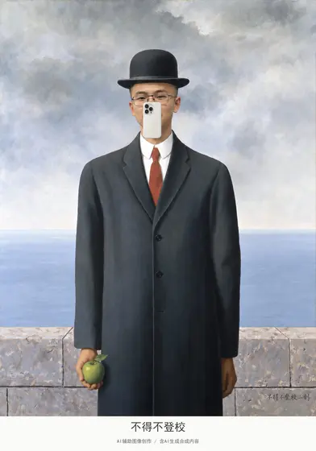](../assets/images/fig001.jpg)

[查看完整图片](../assets/images/fig001.jpg)

## 第 002 幅 · 张雪峰  /  《呐喊》二创

[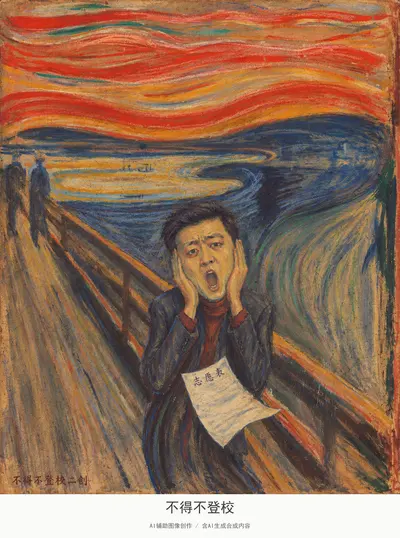](../assets/album/fig002.webp)

[查看完整图片](../assets/album/fig002.webp)

## 第 003 幅 · 雷军  /  《思想者》二创

[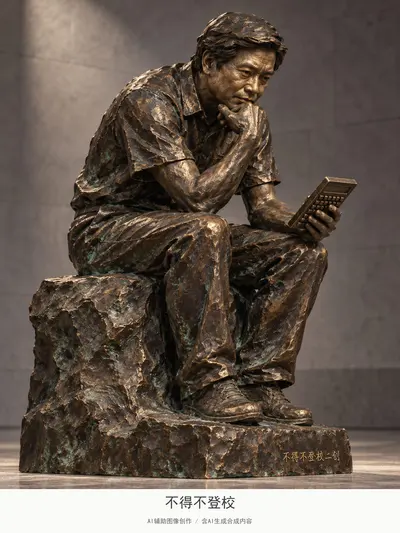](../assets/images/fig003.jpg)

[查看完整图片](../assets/images/fig003.jpg)

## 第 004 幅 · 张雪峰  /  《自由女神像》二创

[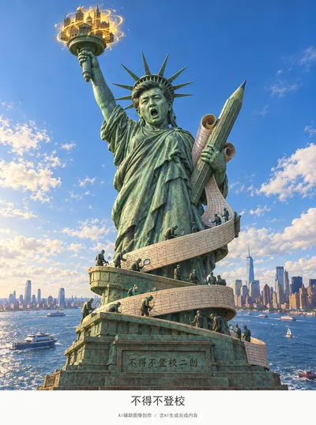](../assets/album/fig004.webp)

[查看完整图片](../assets/album/fig004.webp)

## 第 005 幅 · 张雪峰  /  《星球大战 开场字幕》二创

[查看完整图片](../assets/images/fig005.jpg)

## 第 006 幅 · 李文亚  /  《2001太空漫游 人类黎明开场》二创

[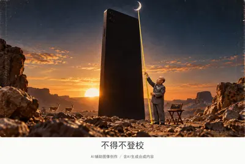](../assets/album/fig006.webp)

[查看完整图片](../assets/album/fig006.webp)

## 第 007 幅 · 《最后的晚餐》二创

[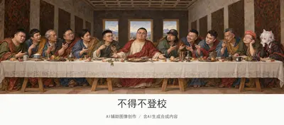](../assets/images/fig007.jpg)

[查看完整图片](../assets/images/fig007.jpg)

## 第 008 幅 · Notch  /  《大使们》二创

[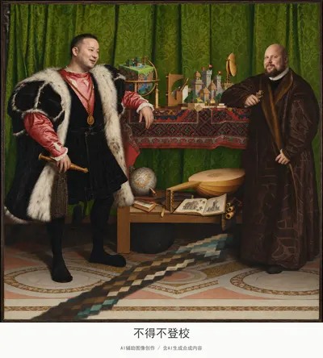](../assets/album/fig008.webp)

[查看完整图片](../assets/album/fig008.webp)

## 第 009 幅 · 丁真  /  《戴珍珠耳环的少女》二创

[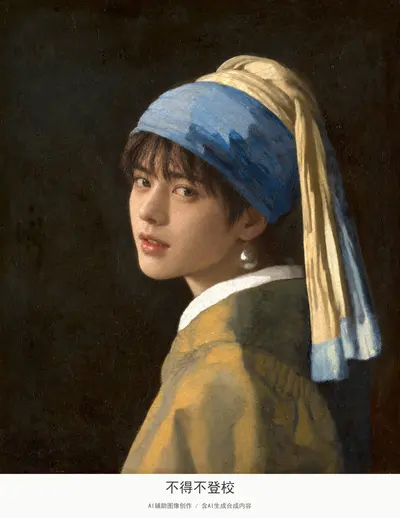](../assets/album/fig009.webp)

[查看完整图片](../assets/album/fig009.webp)

## 第 010 幅 · Notch  /  《大碗岛的星期天下午》二创

[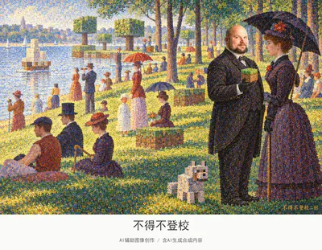](../assets/album/fig010.webp)

[查看完整图片](../assets/album/fig010.webp)

## 第 011 幅 · 峰哥  /  《伏尔加河上的纤夫》二创

[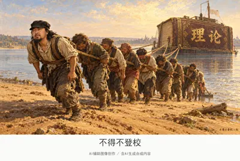](../assets/images/fig011.jpg)

[查看完整图片](../assets/images/fig011.jpg)

## 第 012 幅 · 雷军  /  《回到未来 片头钟表实验室》二创

[查看完整图片](../assets/images/fig012.jpg)

## 第 013 幅 · 谷爱凌  /  《加来义民》二创

[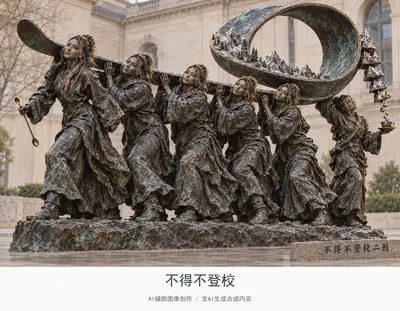](../assets/album/fig013.webp)

[查看完整图片](../assets/album/fig013.webp)

## 第 014 幅 · 丁真  /  《狮身人面像》二创

[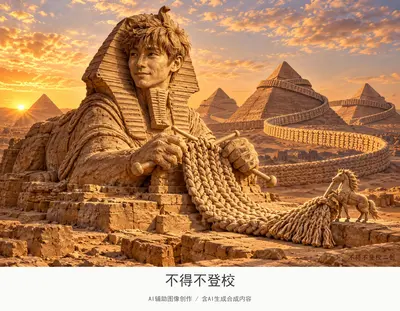](../assets/images/fig014.jpg)

[查看完整图片](../assets/images/fig014.jpg)

## 第 015 幅 · 谷爱凌  /  《音乐之声 开场草地》二创

[查看完整图片](../assets/album/fig015.webp)

## 第 016 幅 · 千早爱音  /  《蒂凡尼的早餐 开场》二创

[查看完整图片](../assets/images/fig016.jpg)

## 第 017 幅 · 名画戏仿

[查看完整图片](../assets/images/fig017.jpg)

## 第 018 幅 · 丁真  /  名画戏仿

[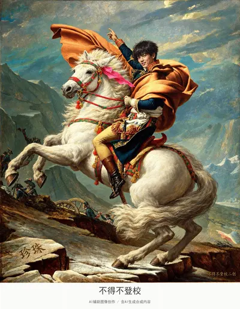](../assets/album/fig018.webp)

[查看完整图片](../assets/album/fig018.webp)

## 第 019 幅 · 名画戏仿

[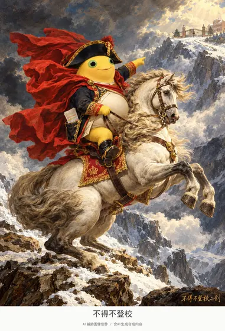](../assets/album/fig019.webp)

[查看完整图片](../assets/album/fig019.webp)

## 第 020 幅 · 《蒙娜丽莎》二创

[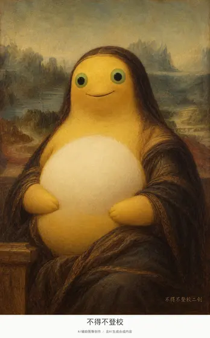](../assets/album/fig020.webp)

[查看完整图片](../assets/album/fig020.webp)

## 第 021 幅 · Peter Griffin  /  《维特鲁威人》二创

[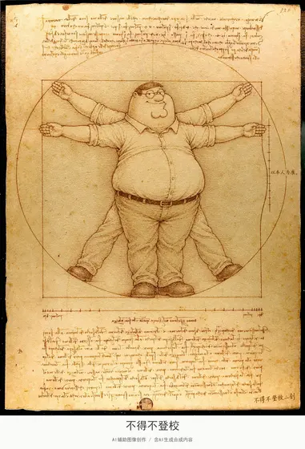](../assets/album/fig021.webp)

[查看完整图片](../assets/album/fig021.webp)

## 第 022 幅 · 东北雨姐  /  《抱银貂的女子》二创

[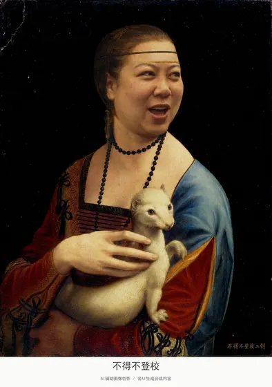](../assets/images/fig022.jpg)

[查看完整图片](../assets/images/fig022.jpg)

## 第 023 幅 · 户晨风、陈平  /  《美国哥特式》二创

[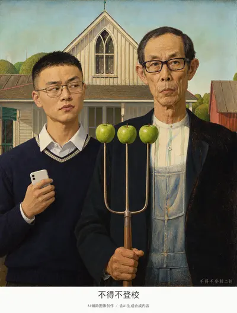](../assets/images/fig023.jpg)

[查看完整图片](../assets/images/fig023.jpg)

## 第 024 幅 · 峰哥  /  名画戏仿

[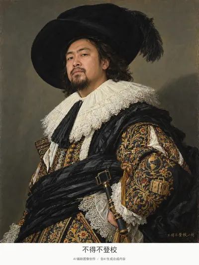](../assets/album/fig024.webp)

[查看完整图片](../assets/album/fig024.webp)

## 第 025 幅 · 谷爱凌  /  《神奈川冲浪里》二创

[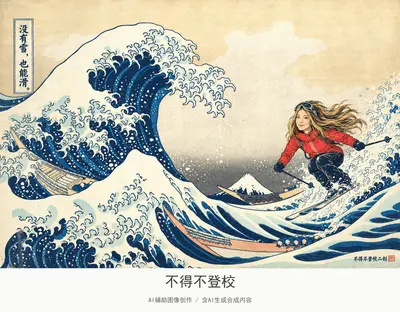](../assets/album/fig025.webp)

[查看完整图片](../assets/album/fig025.webp)

