# 原画集 · 26–50

[全部目录](README.md) · [权利说明](../RIGHTS.md)

## 第 026 幅 · 张雪峰、吴京  /  名画戏仿

[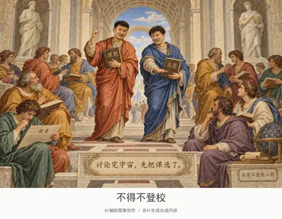](../assets/album/fig026.webp)

[查看完整图片](../assets/album/fig026.webp)

## 第 027 幅 · 名画戏仿

[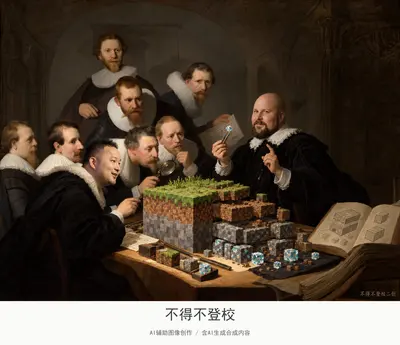](../assets/album/fig027.webp)

[查看完整图片](../assets/album/fig027.webp)

## 第 028 幅 · 名画戏仿

[查看完整图片](../assets/album/fig028.webp)

## 第 029 幅 · 陈平  /  名画戏仿

[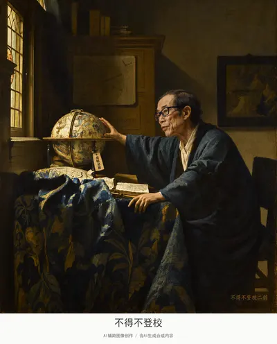](../assets/album/fig029.webp)

[查看完整图片](../assets/album/fig029.webp)

## 第 030 幅 · 王源（已打码）  /  《戴珍珠耳环的少女》二创

[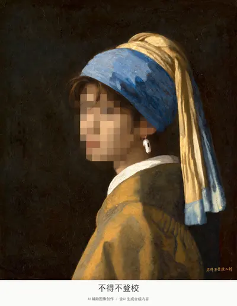](../assets/images/fig030.jpg)

[查看完整图片](../assets/images/fig030.jpg)

## 第 031 幅 · 《戴珍珠耳环的少女》二创

[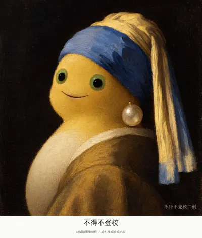](../assets/album/fig031.webp)

[查看完整图片](../assets/album/fig031.webp)

## 第 032 幅 · 《倒牛奶的女仆》二创

[查看完整图片](../assets/images/fig032.jpg)

## 第 033 幅 · 张雪峰  /  《地理学家》二创

[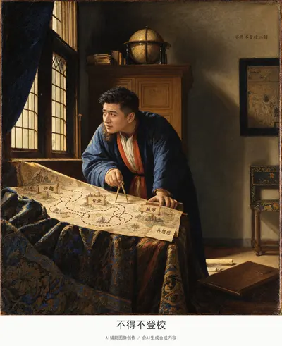](../assets/album/fig033.webp)

[查看完整图片](../assets/album/fig033.webp)

## 第 034 幅 · 傅首尔（已打码）  /  《蒙娜丽莎》二创

[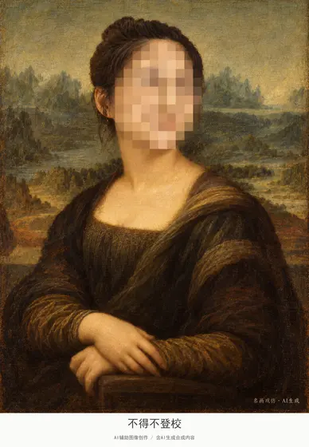](../assets/images/fig034.jpg)

[查看完整图片](../assets/images/fig034.jpg)

## 第 035 幅 · 傅首尔（已打码）、牢A白猫代称、东北雨姐、Peter Griffin  /  《簪花仕女图》二创

[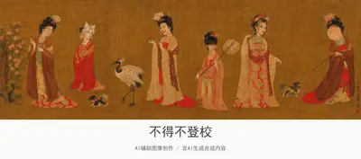](../assets/album/fig035.webp)

[查看完整图片](../assets/album/fig035.webp)

## 第 036 幅 · 东北雨姐  /  《戴红帽的女孩》二创

[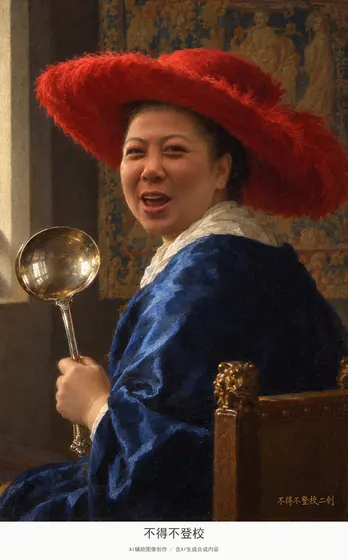](../assets/album/fig036.webp)

[查看完整图片](../assets/album/fig036.webp)

## 第 037 幅 · 雷军  /  名画戏仿

[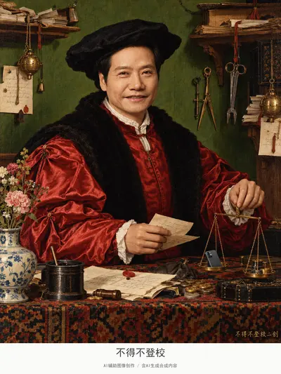](../assets/album/fig037.webp)

[查看完整图片](../assets/album/fig037.webp)

## 第 038 幅 · 陈平  /  名画戏仿

[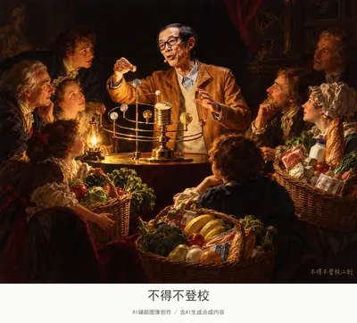](../assets/album/fig038.webp)

[查看完整图片](../assets/album/fig038.webp)

## 第 039 幅 · 张雪峰  /  名画戏仿

[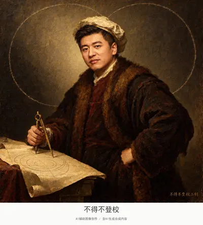](../assets/album/fig039.webp)

[查看完整图片](../assets/album/fig039.webp)

## 第 040 幅 · 丁真  /  名画戏仿

[查看完整图片](../assets/album/fig040.webp)

## 第 041 幅 · Peter Griffin  /  名画戏仿

[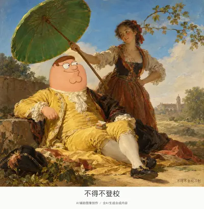](../assets/album/fig041.webp)

[查看完整图片](../assets/album/fig041.webp)

## 第 042 幅 · 丁真  /  名画戏仿

[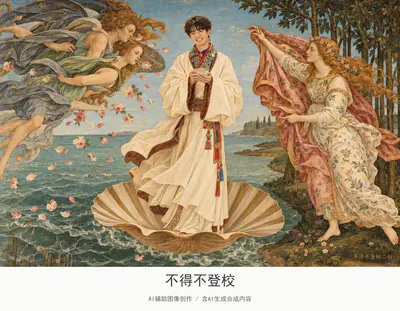](../assets/album/fig042.webp)

[查看完整图片](../assets/album/fig042.webp)

## 第 043 幅 · 峰哥  /  名画戏仿

[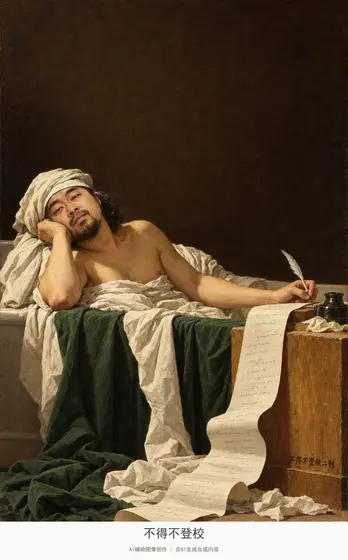](../assets/album/fig043.webp)

[查看完整图片](../assets/album/fig043.webp)

## 第 044 幅 · 雷军  /  名画戏仿

[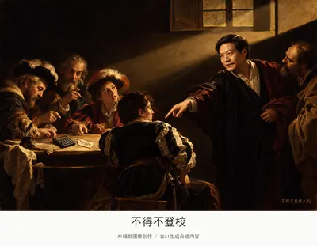](../assets/album/fig044.webp)

[查看完整图片](../assets/album/fig044.webp)

## 第 045 幅 · 户晨风  /  名画戏仿

[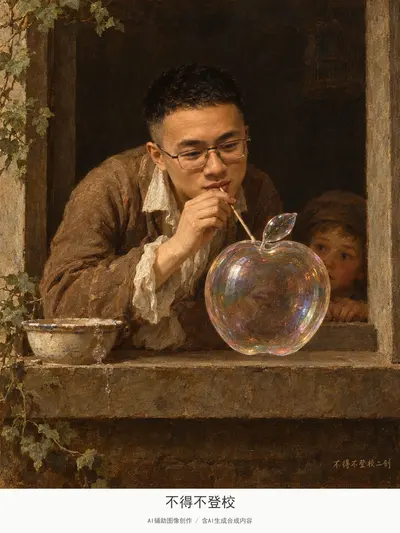](../assets/album/fig045.webp)

[查看完整图片](../assets/album/fig045.webp)

## 第 046 幅 · 名画戏仿

[查看完整图片](../assets/album/fig046.webp)

## 第 047 幅 · 李文亚  /  《天文学家》二创

[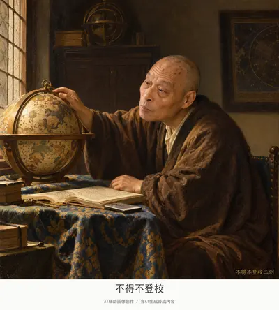](../assets/album/fig047.webp)

[查看完整图片](../assets/album/fig047.webp)

## 第 048 幅 · 李文亚  /  名画戏仿

[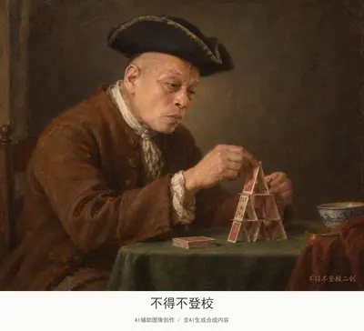](../assets/album/fig048.webp)

[查看完整图片](../assets/album/fig048.webp)

## 第 049 幅 · 李文亚  /  名画戏仿

[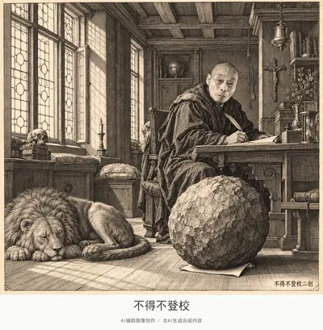](../assets/album/fig049.webp)

[查看完整图片](../assets/album/fig049.webp)

## 第 050 幅 · 企鹅  /  名画戏仿

[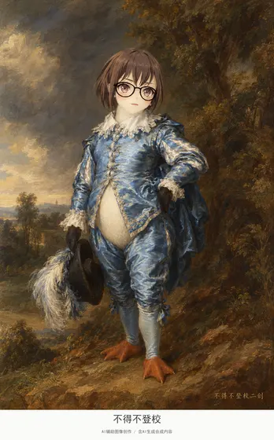](../assets/album/fig050.webp)

[查看完整图片](../assets/album/fig050.webp)

