# 原画集 · 51–75

[全部目录](README.md) · [权利说明](../RIGHTS.md)

## 第 051 幅 · 李文亚  /  名画戏仿

[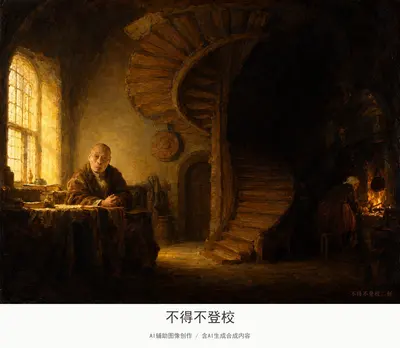](../assets/album/fig051.webp)

[查看完整图片](../assets/album/fig051.webp)

## 第 052 幅 · Peter Griffin  /  《贝尔坦先生像》二创

[查看完整图片](../assets/album/fig052.webp)

## 第 053 幅 · 丁真  /  《巴尔达萨雷·卡斯蒂廖内肖像》二创

[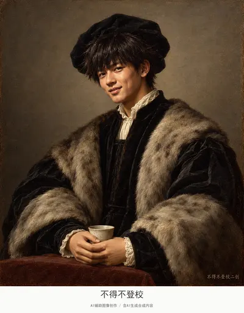](../assets/images/fig053.jpg)

[查看完整图片](../assets/images/fig053.jpg)

## 第 054 幅 · 张雪峰  /  《书房中的圣杰罗姆（安东内洛·达·梅西那）》二创

[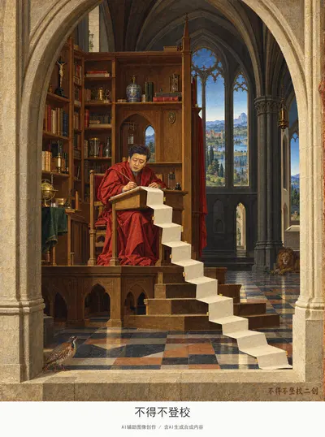](../assets/images/fig054.jpg)

[查看完整图片](../assets/images/fig054.jpg)

## 第 055 幅 · 谷爱凌  /  《戴珍珠项链的女子》二创

[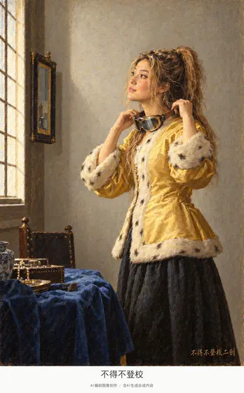](../assets/album/fig055.webp)

[查看完整图片](../assets/album/fig055.webp)

## 第 056 幅 · 雷军  /  《路易十四肖像》二创

[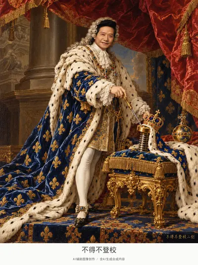](../assets/album/fig056.webp)

[查看完整图片](../assets/album/fig056.webp)

## 第 057 幅 · 千早爱音  /  《花边女工》二创

[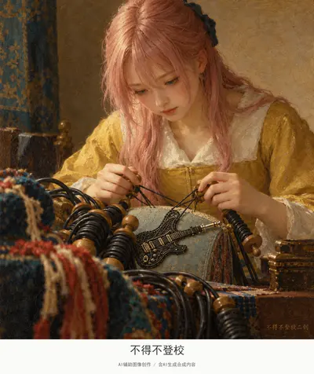](../assets/album/fig057.webp)

[查看完整图片](../assets/album/fig057.webp)

## 第 058 幅 · 丁真  /  《鲁特琴演奏者》二创

[查看完整图片](../assets/album/fig058.webp)

## 第 059 幅 · Peter Griffin  /  《魔术师》二创

[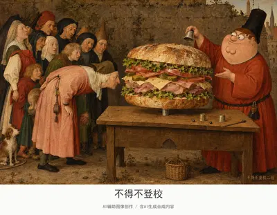](../assets/album/fig059.webp)

[查看完整图片](../assets/album/fig059.webp)

## 第 060 幅 · 张雪峰  /  《书写中的伊拉斯谟》二创

[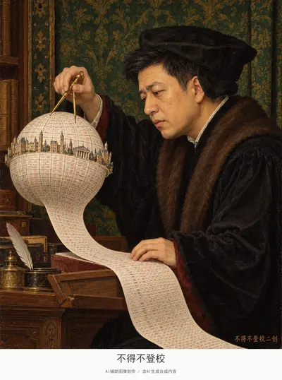](../assets/album/fig060.webp)

[查看完整图片](../assets/album/fig060.webp)

## 第 061 幅 · 谷爱凌  /  《老妇煎蛋》二创

[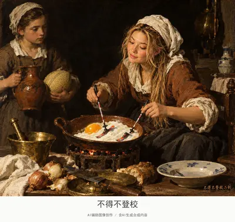](../assets/album/fig061.webp)

[查看完整图片](../assets/album/fig061.webp)

## 第 062 幅 · 雷军  /  《戴红头巾的男子》二创

[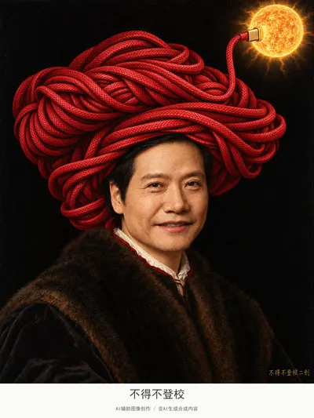](../assets/album/fig062.webp)

[查看完整图片](../assets/album/fig062.webp)

## 第 063 幅 · 千早爱音  /  《读书少女》二创

[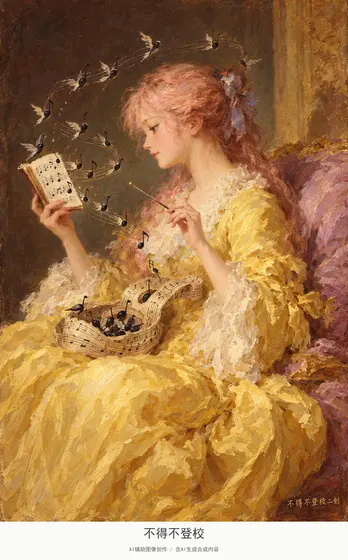](../assets/album/fig063.webp)

[查看完整图片](../assets/album/fig063.webp)

## 第 064 幅 · Peter Griffin  /  《吉尔/皮埃罗》二创

[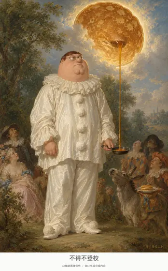](../assets/album/fig064.webp)

[查看完整图片](../assets/album/fig064.webp)

## 第 065 幅 · 雷军  /  《裁缝》二创

[查看完整图片](../assets/album/fig065.webp)

## 第 066 幅 · 丁真  /  《丢勒1498年自画像》二创

[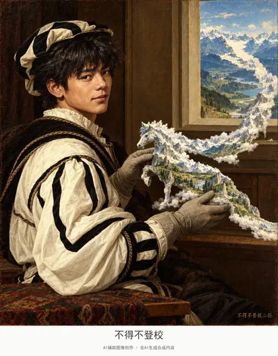](../assets/images/fig066.jpg)

[查看完整图片](../assets/images/fig066.jpg)

## 第 067 幅 · 千早爱音  /  《弹鲁特琴的小丑》二创

[查看完整图片](../assets/images/fig067.jpg)

## 第 068 幅 · 企鹅  /  《冒烟火焰的抹大拉》二创

[查看完整图片](../assets/album/fig068.webp)

## 第 069 幅 · 罗翔  /  《气泵中的鸟实验》二创

[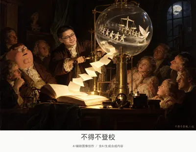](../assets/album/fig069.webp)

[查看完整图片](../assets/album/fig069.webp)

## 第 070 幅 · 张雪峰  /  《餐前祈祷》二创

[查看完整图片](../assets/album/fig070.webp)

## 第 071 幅 · 谷爱凌  /  《布罗伊公主像》二创

[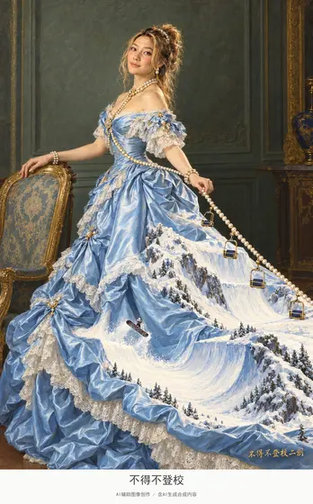](../assets/album/fig071.webp)

[查看完整图片](../assets/album/fig071.webp)

## 第 072 幅 · 罗翔  /  《巴蒂尼奥勒画室》二创

[查看完整图片](../assets/album/fig072.webp)

## 第 073 幅 · 雷军  /  《迦拿的婚礼》二创

[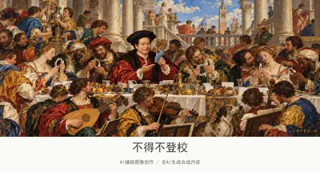](../assets/album/fig073.webp)

[查看完整图片](../assets/album/fig073.webp)

## 第 074 幅 · 丁真  /  《布雷达的投降》二创

[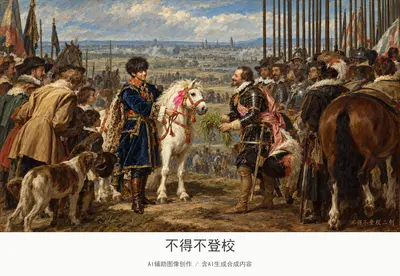](../assets/album/fig074.webp)

[查看完整图片](../assets/album/fig074.webp)

## 第 075 幅 · 雷军  /  《布商公会理事》二创

[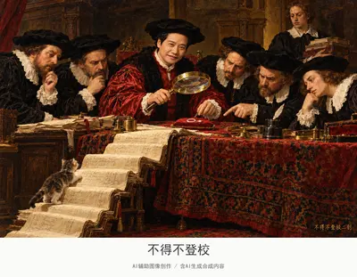](../assets/album/fig075.webp)

[查看完整图片](../assets/album/fig075.webp)

