# 原画集 · 76–100

[全部目录](README.md) · [权利说明](../RIGHTS.md)

## 第 076 幅 · 张雪峰  /  《圣乔治民兵连军官宴会》二创

[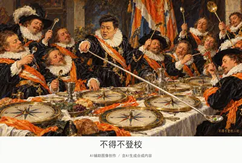](../assets/album/fig076.webp)

[查看完整图片](../assets/album/fig076.webp)

## 第 077 幅 · 千早爱音  /  《帕尔纳索斯山》二创

[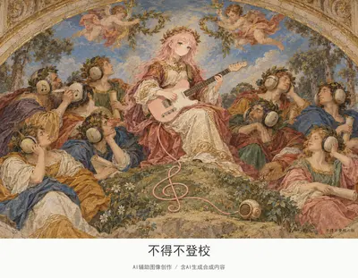](../assets/images/fig077.jpg)

[查看完整图片](../assets/images/fig077.jpg)

## 第 078 幅 · Peter Griffin  /  《博尔戈的火灾》二创

[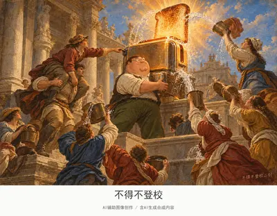](../assets/album/fig078.webp)

[查看完整图片](../assets/album/fig078.webp)

## 第 079 幅 · 千早爱音  /  《春》二创

[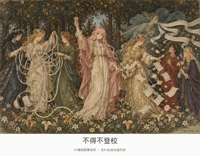](../assets/album/fig079.webp)

[查看完整图片](../assets/album/fig079.webp)

## 第 080 幅 · Peter Griffin  /  《三博士来朝》二创

[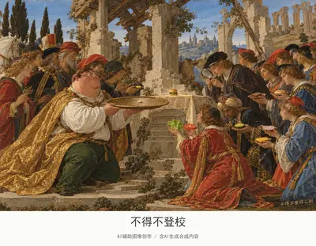](../assets/album/fig080.webp)

[查看完整图片](../assets/album/fig080.webp)

## 第 081 幅 · 丁真  /  《三王行列》二创

[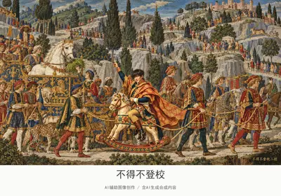](../assets/album/fig081.webp)

[查看完整图片](../assets/album/fig081.webp)

## 第 082 幅 · 雷军  /  《克娄巴特拉的宴会》二创

[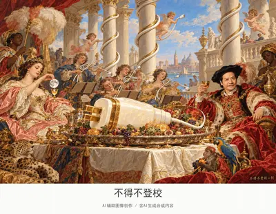](../assets/album/fig082.webp)

[查看完整图片](../assets/album/fig082.webp)

## 第 083 幅 · 千早爱音  /  《爱之园》二创

[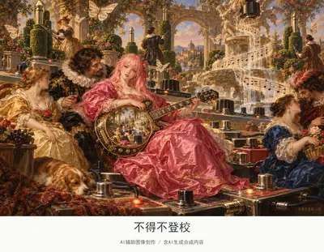](../assets/album/fig083.webp)

[查看完整图片](../assets/album/fig083.webp)

## 第 084 幅 · 张维为  /  《舟发西苔岛》二创

[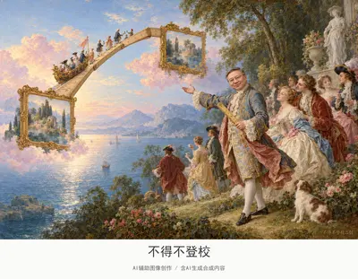](../assets/album/fig084.webp)

[查看完整图片](../assets/album/fig084.webp)

## 第 085 幅 · 谷爱凌  /  《热尔桑画店》二创

[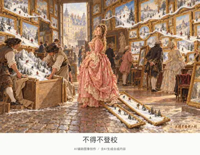](../assets/album/fig085.webp)

[查看完整图片](../assets/album/fig085.webp)

## 第 086 幅 · 张维为  /  《阿卡迪亚的牧人》二创

[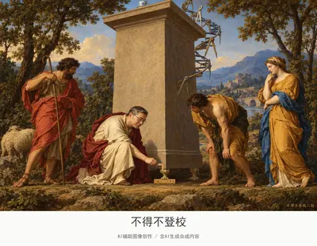](../assets/album/fig086.webp)

[查看完整图片](../assets/album/fig086.webp)

## 第 087 幅 · Peter Griffin  /  《方块A的作弊者》二创

[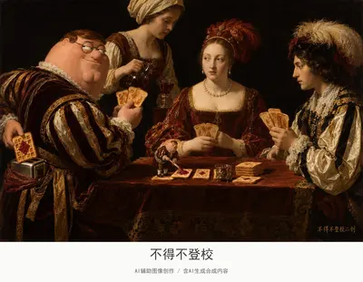](../assets/album/fig087.webp)

[查看完整图片](../assets/album/fig087.webp)

## 第 088 幅 · 雷军、户晨风  /  名画戏仿

[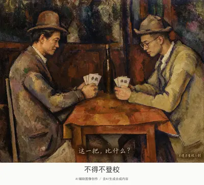](../assets/album/fig088.webp)

[查看完整图片](../assets/album/fig088.webp)

## 第 089 幅 · 孙宇晨  /  名画戏仿

[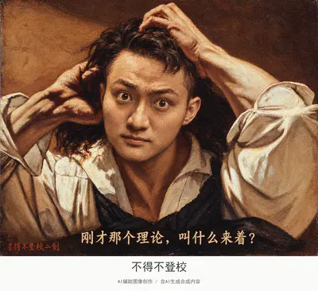](../assets/album/fig089.webp)

[查看完整图片](../assets/album/fig089.webp)

## 第 090 幅 · 名画戏仿

[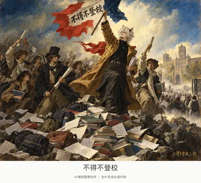](../assets/album/fig090.webp)

[查看完整图片](../assets/album/fig090.webp)

## 第 091 幅 · Notch  /  名画戏仿

[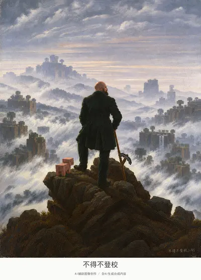](../assets/album/fig091.webp)

[查看完整图片](../assets/album/fig091.webp)

## 第 092 幅 · 王源（已打码）  /  名画戏仿

[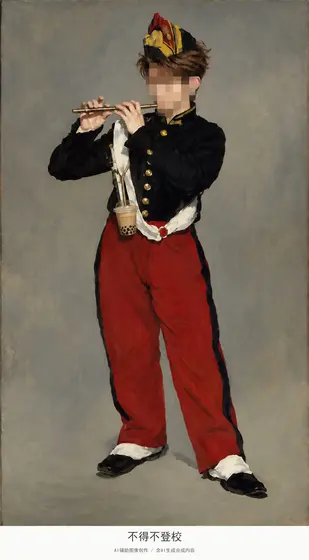](../assets/album/fig092.webp)

[查看完整图片](../assets/album/fig092.webp)

## 第 093 幅 · 丁真  /  名画戏仿

[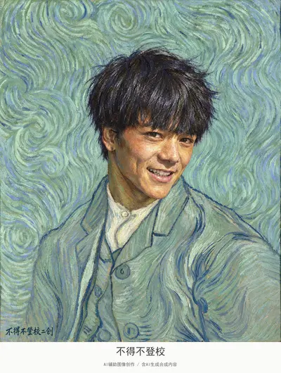](../assets/album/fig093.webp)

[查看完整图片](../assets/album/fig093.webp)

## 第 094 幅 · 峰哥  /  名画戏仿

[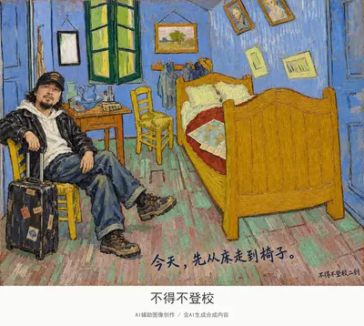](../assets/images/fig094.jpg)

[查看完整图片](../assets/images/fig094.jpg)

## 第 095 幅 · 名画戏仿

[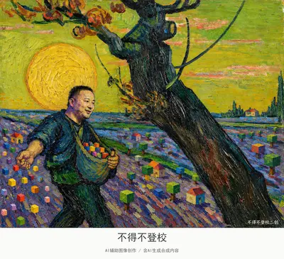](../assets/album/fig095.webp)

[查看完整图片](../assets/album/fig095.webp)

## 第 096 幅 · 怪鸽、李诞  /  名画戏仿

[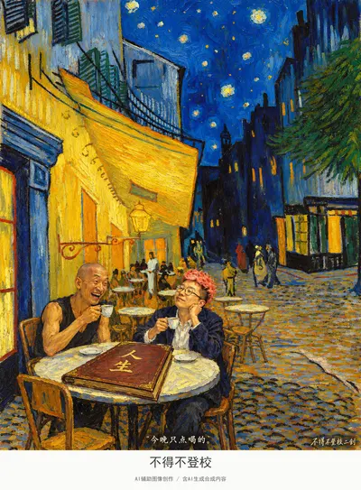](../assets/album/fig096.webp)

[查看完整图片](../assets/album/fig096.webp)

## 第 097 幅 · 傅首尔（已打码）  /  名画戏仿

[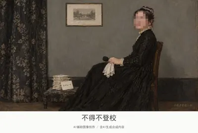](../assets/album/fig097.webp)

[查看完整图片](../assets/album/fig097.webp)

## 第 098 幅 · 傅首尔（已打码）  /  《拾穗者》二创

[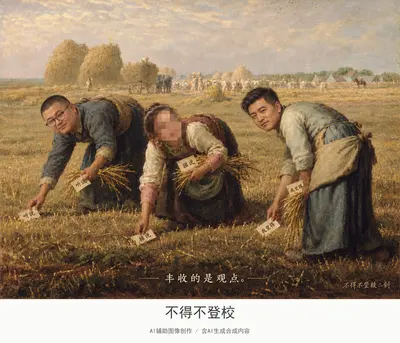](../assets/album/fig098.webp)

[查看完整图片](../assets/album/fig098.webp)

## 第 099 幅 · 峰哥、傅首尔（已打码）、怪鸽、王源（已打码）  /  《吃土豆的人》二创

[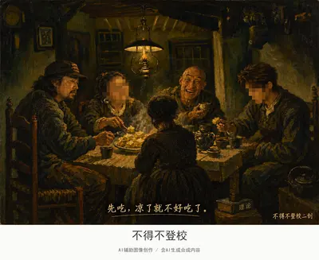](../assets/album/fig099.webp)

[查看完整图片](../assets/album/fig099.webp)

## 第 100 幅 · 怪鸽  /  名画戏仿

[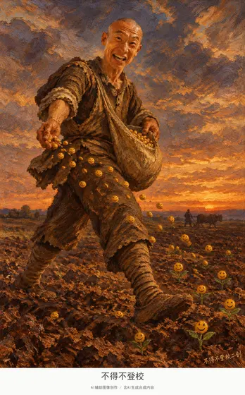](../assets/album/fig100.webp)

[查看完整图片](../assets/album/fig100.webp)

