# 原画集 · 101–125

[全部目录](README.md) · [权利说明](../RIGHTS.md)

## 第 101 幅 · 谷爱凌  /  名画戏仿

[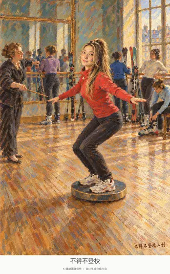](../assets/album/fig101.webp)

[查看完整图片](../assets/album/fig101.webp)

## 第 102 幅 · 李诞  /  名画戏仿

[查看完整图片](../assets/album/fig102.webp)

## 第 103 幅 · 企鹅  /  《冰海》二创

[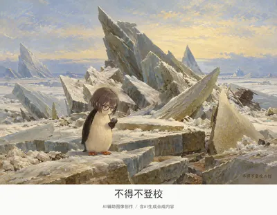](../assets/album/fig103.webp)

[查看完整图片](../assets/album/fig103.webp)

## 第 104 幅 · 千早爱音  /  名画戏仿

[查看完整图片](../assets/album/fig104.webp)

## 第 105 幅 · 千早爱音  /  名画戏仿

[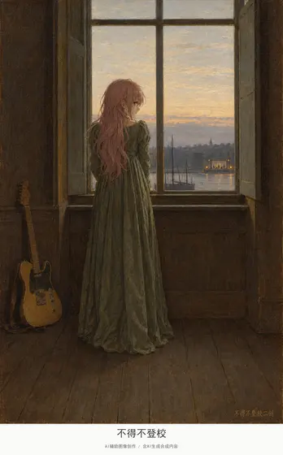](../assets/images/fig105.jpg)

[查看完整图片](../assets/images/fig105.jpg)

## 第 106 幅 · 企鹅  /  名画戏仿

[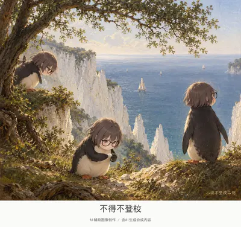](../assets/album/fig106.webp)

[查看完整图片](../assets/album/fig106.webp)

## 第 107 幅 · 千早爱音  /  名画戏仿

[查看完整图片](../assets/album/fig107.webp)

## 第 108 幅 · 王楚钦  /  名画戏仿

[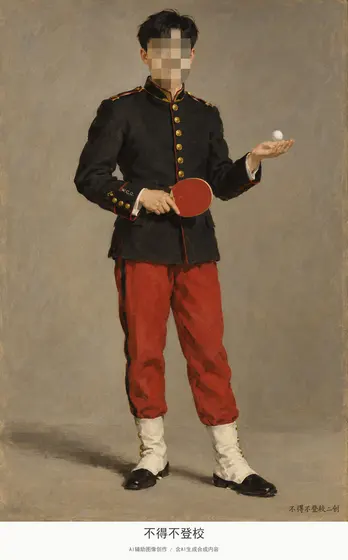](../assets/images/fig108.jpg)

[查看完整图片](../assets/images/fig108.jpg)

## 第 109 幅 · 千早爱音  /  《康乃馨、百合、百合、玫瑰》二创

[查看完整图片](../assets/album/fig109.webp)

## 第 110 幅 · Peter Griffin  /  《苦艾酒》二创

[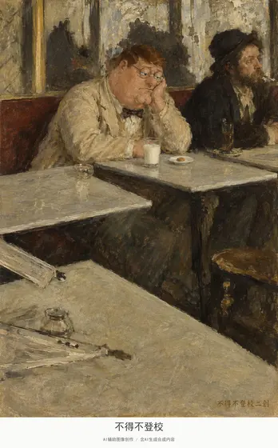](../assets/images/fig110.jpg)

[查看完整图片](../assets/images/fig110.jpg)

## 第 111 幅 · 范小勤  /  《拿水罐的女孩》二创

[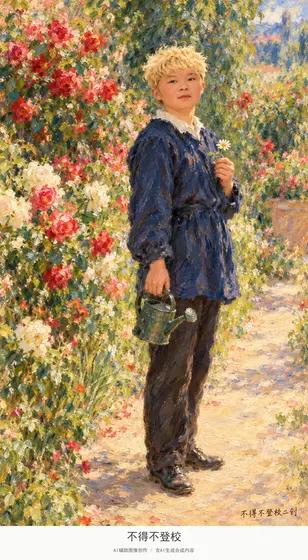](../assets/album/fig111.webp)

[查看完整图片](../assets/album/fig111.webp)

## 第 112 幅 · 李文亚  /  《纳尔尼桥》二创

[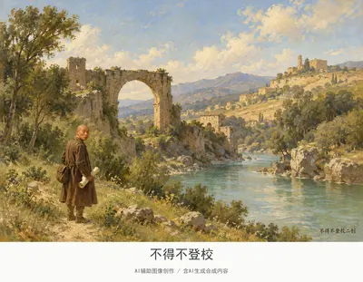](../assets/album/fig112.webp)

[查看完整图片](../assets/album/fig112.webp)

## 第 113 幅 · Peter Griffin  /  《乘顺风》二创

[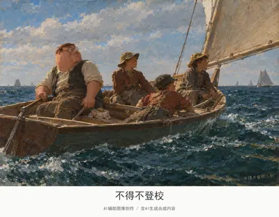](../assets/album/fig113.webp)

[查看完整图片](../assets/album/fig113.webp)

## 第 114 幅 · 药水哥  /  《两个人凝望月亮》二创

[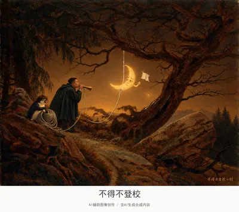](../assets/album/fig114.webp)

[查看完整图片](../assets/album/fig114.webp)

## 第 115 幅 · 企鹅  /  《战舰无畏号》二创

[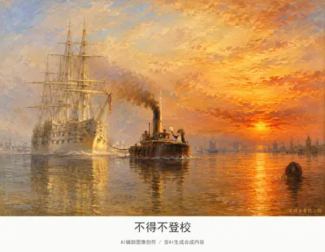](../assets/album/fig115.webp)

[查看完整图片](../assets/album/fig115.webp)

## 第 116 幅 · 千早爱音  /  《印象日出》二创

[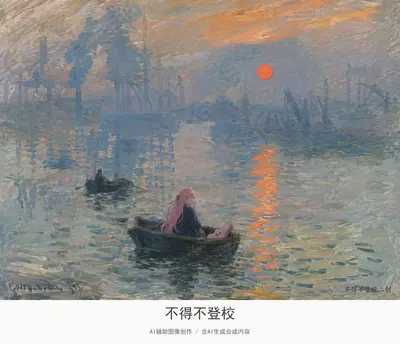](../assets/album/fig116.webp)

[查看完整图片](../assets/album/fig116.webp)

## 第 117 幅 · 《麦田群鸦》二创

[查看完整图片](../assets/album/fig117.webp)

## 第 118 幅 · 李文亚  /  《圣拉扎尔车站》二创

[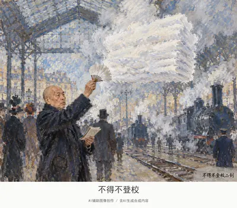](../assets/album/fig118.webp)

[查看完整图片](../assets/album/fig118.webp)

## 第 119 幅 · 千早爱音  /  《铁路》二创

[查看完整图片](../assets/album/fig119.webp)

## 第 120 幅 · 李文亚  /  《巴黎雨天》二创

[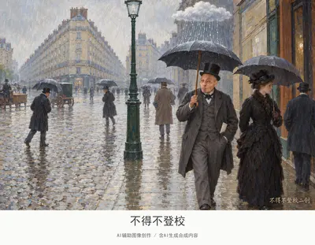](../assets/album/fig120.webp)

[查看完整图片](../assets/album/fig120.webp)

## 第 121 幅 · Peter Griffin  /  《阿尼埃尔浴场》二创

[查看完整图片](../assets/album/fig121.webp)

## 第 122 幅 · 丁真  /  《阿让特伊帆船》二创

[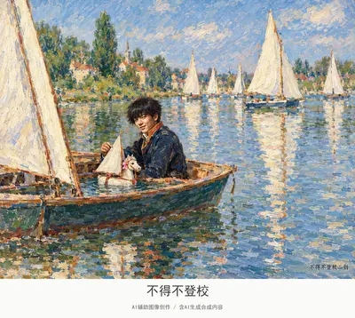](../assets/album/fig122.webp)

[查看完整图片](../assets/album/fig122.webp)

## 第 123 幅 · Peter Griffin  /  《海湾流》二创

[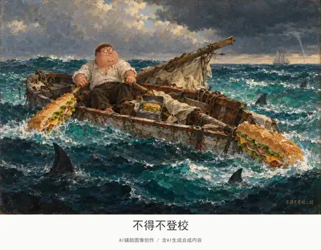](../assets/album/fig123.webp)

[查看完整图片](../assets/album/fig123.webp)

## 第 124 幅 · 李文亚  /  《雨、蒸汽和速度》二创

[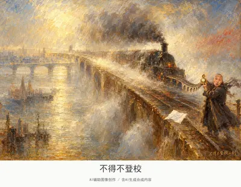](../assets/album/fig124.webp)

[查看完整图片](../assets/album/fig124.webp)

## 第 125 幅 · 谷爱凌  /  《金色秋天》二创

[查看完整图片](../assets/album/fig125.webp)

