# 原画集 · 126–150

[全部目录](README.md) · [权利说明](../RIGHTS.md)

## 第 126 幅 · 企鹅  /  《松林的早晨》二创

[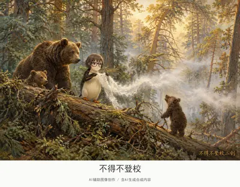](../assets/album/fig126.webp)

[查看完整图片](../assets/album/fig126.webp)

## 第 127 幅 · 李文亚  /  《白嘴鸦飞来了》二创

[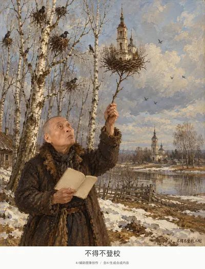](../assets/album/fig127.webp)

[查看完整图片](../assets/album/fig127.webp)

## 第 128 幅 · Peter Griffin  /  《圣维克多山》二创

[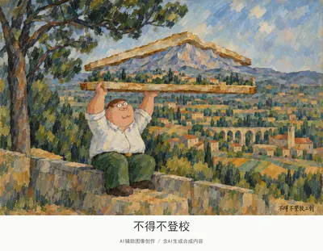](../assets/album/fig128.webp)

[查看完整图片](../assets/album/fig128.webp)

## 第 129 幅 · 千早爱音  /  《阿尔勒吊桥》二创

[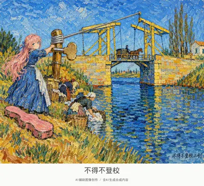](../assets/album/fig129.webp)

[查看完整图片](../assets/album/fig129.webp)

## 第 130 幅 · 企鹅  /  《喜鹊》二创

[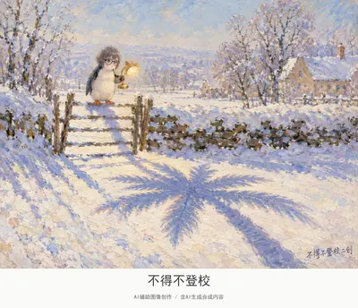](../assets/album/fig130.webp)

[查看完整图片](../assets/album/fig130.webp)

## 第 131 幅 · 李文亚  /  《莫尔特枫丹的回忆》二创

[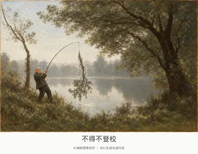](../assets/album/fig131.webp)

[查看完整图片](../assets/album/fig131.webp)

## 第 132 幅 · 企鹅、Peter Griffin  /  《晚钟》二创

[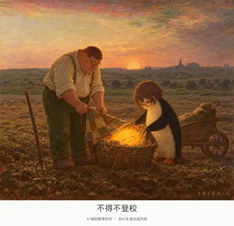](../assets/album/fig132.webp)

[查看完整图片](../assets/album/fig132.webp)

## 第 133 幅 · 千早爱音  /  《牧羊女与羊群》二创

[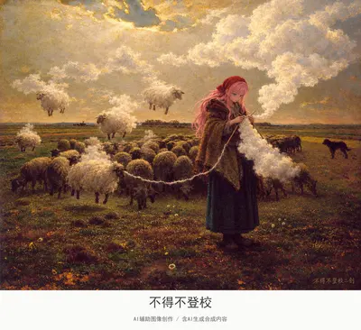](../assets/album/fig133.webp)

[查看完整图片](../assets/album/fig133.webp)

## 第 134 幅 · 千早爱音  /  《索尔兹伯里大教堂》二创

[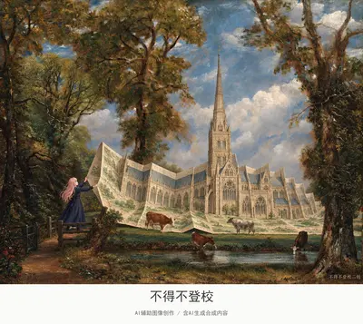](../assets/images/fig134.jpg)

[查看完整图片](../assets/images/fig134.jpg)

## 第 135 幅 · 药水哥  /  《埃特勒塔暴风雨后的悬崖》二创

[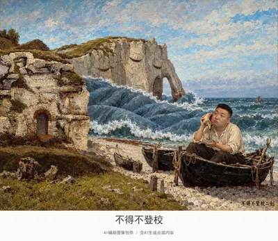](../assets/album/fig135.webp)

[查看完整图片](../assets/album/fig135.webp)

## 第 136 幅 · 李文亚  /  《星夜》二创

[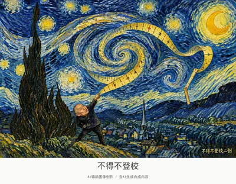](../assets/album/fig136.webp)

[查看完整图片](../assets/album/fig136.webp)

## 第 137 幅 · 谷爱凌  /  《罗讷河上的星夜》二创

[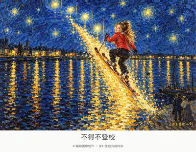](../assets/album/fig137.webp)

[查看完整图片](../assets/album/fig137.webp)

## 第 138 幅 · 雷军  /  《邮差鲁兰（绿色花背景）》二创

[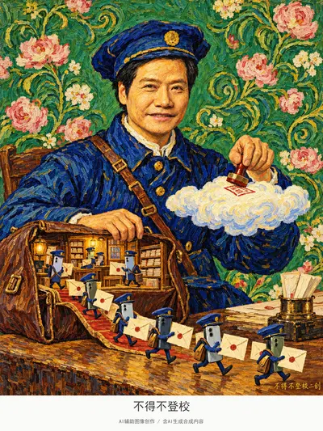](../assets/album/fig138.webp)

[查看完整图片](../assets/album/fig138.webp)

## 第 139 幅 · 千早爱音  /  《阿尔医院庭院》二创

[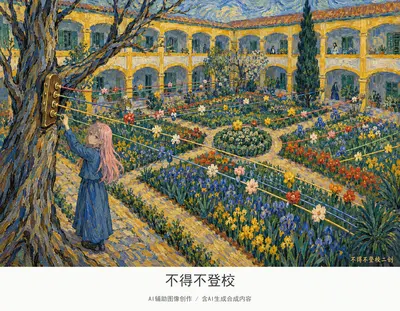](../assets/album/fig139.webp)

[查看完整图片](../assets/album/fig139.webp)

## 第 140 幅 · 丁真  /  《穿红背心男孩》二创

[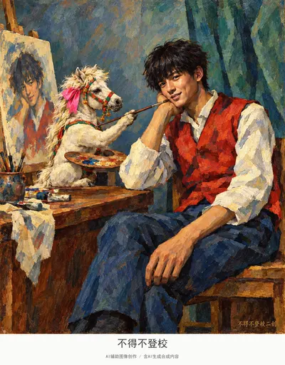](../assets/album/fig140.webp)

[查看完整图片](../assets/album/fig140.webp)

## 第 141 幅 · Peter Griffin  /  名画戏仿

[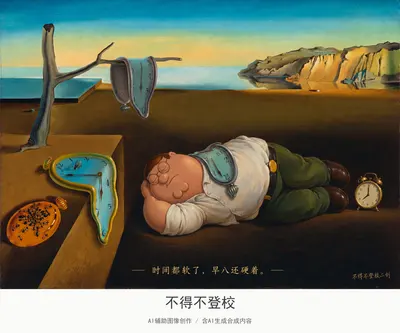](../assets/album/fig141.webp)

[查看完整图片](../assets/album/fig141.webp)

## 第 142 幅 · 丁真  /  名画戏仿

[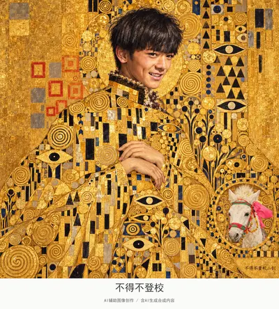](../assets/album/fig142.webp)

[查看完整图片](../assets/album/fig142.webp)

## 第 143 幅 · Peter Griffin  /  《睡着的吉普赛人》二创

[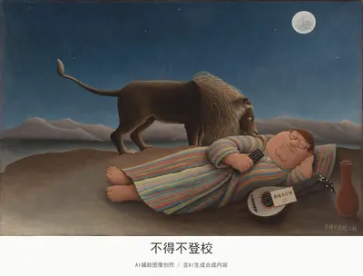](../assets/images/fig143.jpg)

[查看完整图片](../assets/images/fig143.jpg)

## 第 144 幅 · 傅首尔（已打码）  /  名画戏仿

[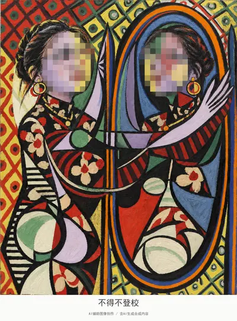](../assets/album/fig144.webp)

[查看完整图片](../assets/album/fig144.webp)

## 第 145 幅 · 王源（已打码）、丁真、Peter Griffin  /  名画戏仿

[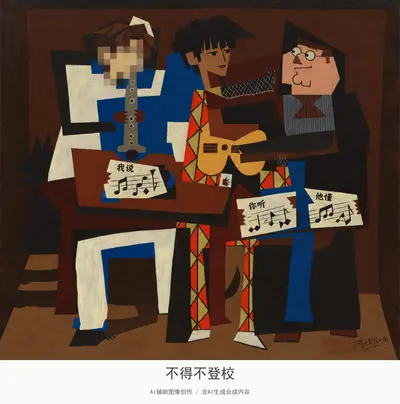](../assets/album/fig145.webp)

[查看完整图片](../assets/album/fig145.webp)

## 第 146 幅 · Peter Griffin  /  名画戏仿

[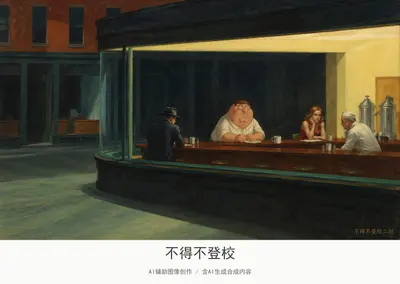](../assets/album/fig146.webp)

[查看完整图片](../assets/album/fig146.webp)

## 第 147 幅 · 企鹅  /  名画戏仿

[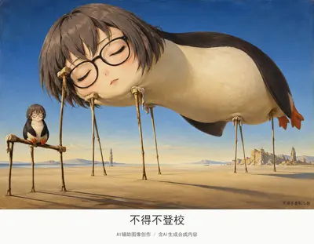](../assets/album/fig147.webp)

[查看完整图片](../assets/album/fig147.webp)

## 第 148 幅 · 李文亚  /  名画戏仿

[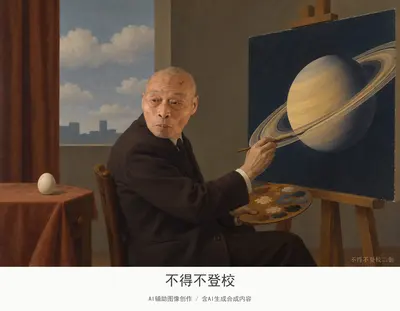](../assets/album/fig148.webp)

[查看完整图片](../assets/album/fig148.webp)

## 第 149 幅 · 企鹅  /  名画戏仿

[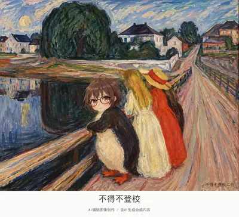](../assets/album/fig149.webp)

[查看完整图片](../assets/album/fig149.webp)

## 第 150 幅 · 千早爱音  /  名画戏仿

[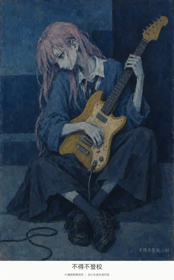](../assets/album/fig150.webp)

[查看完整图片](../assets/album/fig150.webp)

