# 原画集 · 151–175

[全部目录](README.md) · [权利说明](../RIGHTS.md)

## 第 151 幅 · 企鹅  /  名画戏仿

[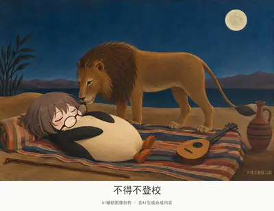](../assets/album/fig151.webp)

[查看完整图片](../assets/album/fig151.webp)

## 第 152 幅 · 企鹅  /  《嘉年华之夜》二创

[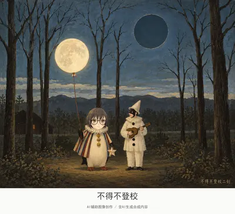](../assets/album/fig152.webp)

[查看完整图片](../assets/album/fig152.webp)

## 第 153 幅 · 千早爱音  /  《饥饿的狮子》二创

[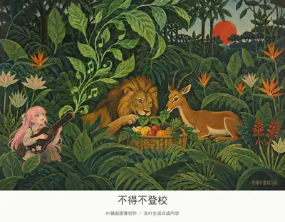](../assets/album/fig153.webp)

[查看完整图片](../assets/album/fig153.webp)

## 第 154 幅 · Peter Griffin  /  《红色画室》二创

[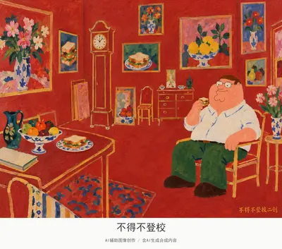](../assets/album/fig154.webp)

[查看完整图片](../assets/album/fig154.webp)

## 第 155 幅 · Peter Griffin  /  《金鱼》二创

[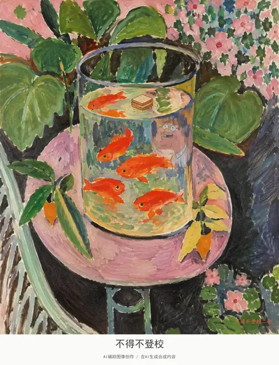](../assets/album/fig155.webp)

[查看完整图片](../assets/album/fig155.webp)

## 第 156 幅 · 李文亚  /  《太阳》二创

[查看完整图片](../assets/album/fig156.webp)

## 第 157 幅 · 千早爱音  /  《朵拉玛尔肖像》二创

[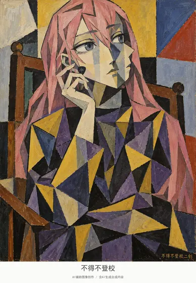](../assets/album/fig157.webp)

[查看完整图片](../assets/album/fig157.webp)

## 第 158 幅 · 丁真  /  《拿烟斗男孩》二创

[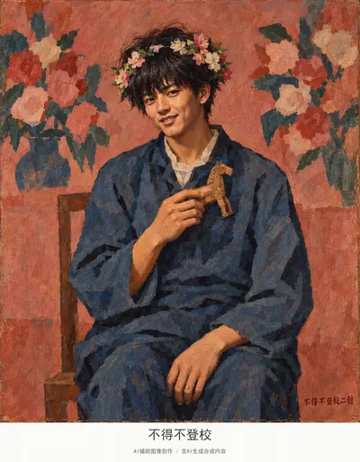](../assets/album/fig158.webp)

[查看完整图片](../assets/album/fig158.webp)

## 第 159 幅 · 雷军  /  《戈尔孔达》二创

[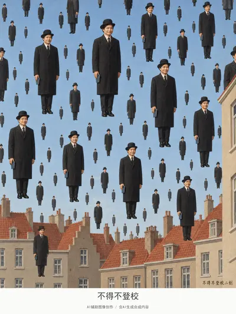](../assets/album/fig159.webp)

[查看完整图片](../assets/album/fig159.webp)

## 第 160 幅 · 李文亚  /  《人类状况》二创

[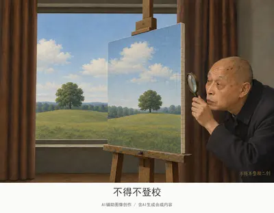](../assets/album/fig160.webp)

[查看完整图片](../assets/album/fig160.webp)

## 第 161 幅 · 企鹅  /  《摔跤手之墓》二创

[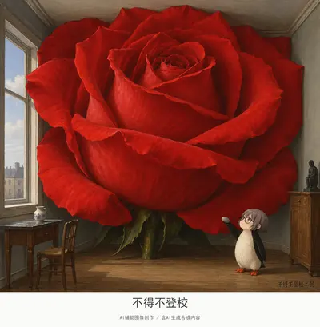](../assets/images/fig161.jpg)

[查看完整图片](../assets/images/fig161.jpg)

## 第 162 幅 · 丁真  /  《我与村庄》二创

[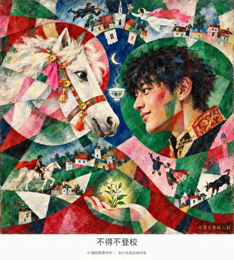](../assets/album/fig162.webp)

[查看完整图片](../assets/album/fig162.webp)

## 第 163 幅 · 雷军  /  《生日》二创

[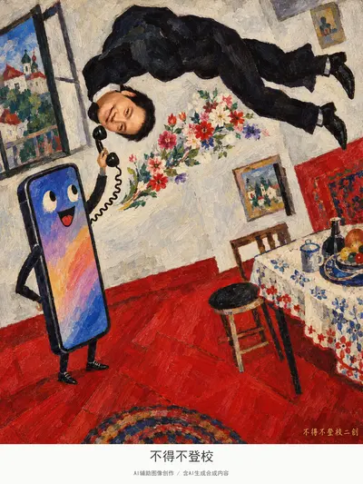](../assets/album/fig163.webp)

[查看完整图片](../assets/album/fig163.webp)

## 第 164 幅 · 千早爱音  /  《散步》二创

[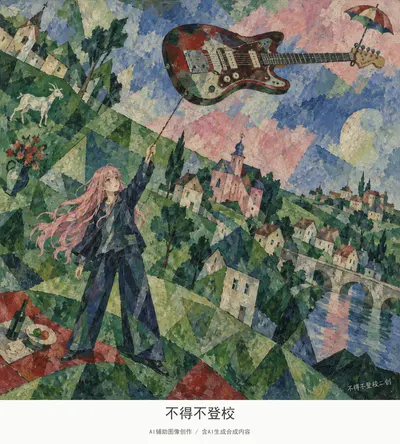](../assets/album/fig164.webp)

[查看完整图片](../assets/album/fig164.webp)

## 第 165 幅 · 企鹅  /  《街道的神秘与忧郁》二创

[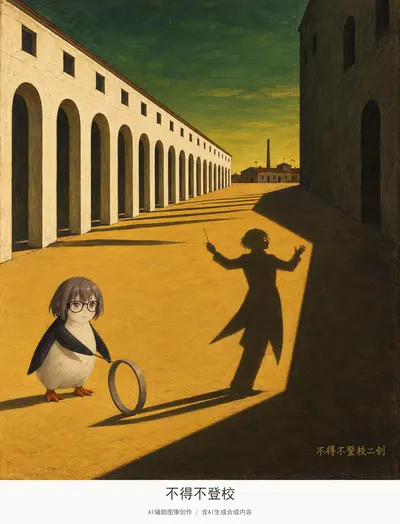](../assets/album/fig165.webp)

[查看完整图片](../assets/album/fig165.webp)

## 第 166 幅 · 李文亚  /  《恋歌》二创

[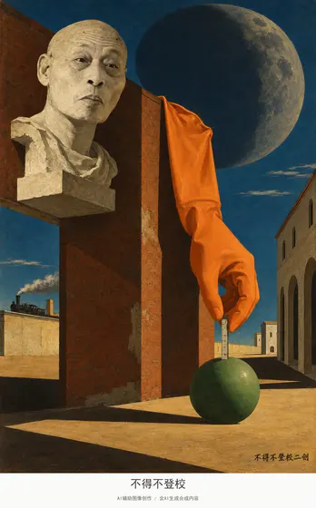](../assets/album/fig166.webp)

[查看完整图片](../assets/album/fig166.webp)

## 第 167 幅 · 丁真  /  《城堡与太阳》二创

[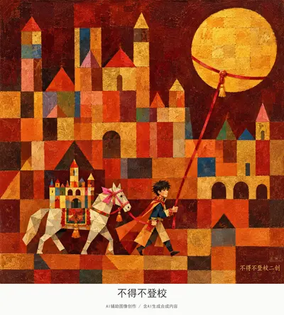](../assets/album/fig167.webp)

[查看完整图片](../assets/album/fig167.webp)

## 第 168 幅 · Peter Griffin  /  《百老汇爵士乐》二创

[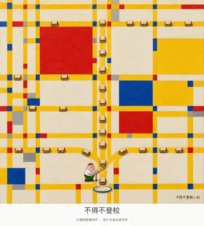](../assets/album/fig168.webp)

[查看完整图片](../assets/album/fig168.webp)

## 第 169 幅 · 《足球运动员》二创

[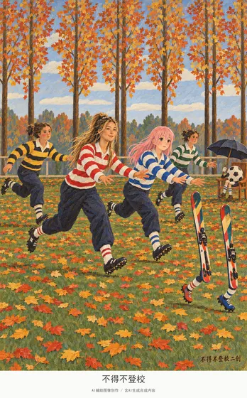](../assets/images/fig169.jpg)

[查看完整图片](../assets/images/fig169.jpg)

## 第 170 幅 · 企鹅  /  《惊奇/热带风暴中的老虎》二创

[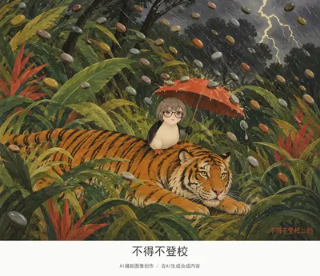](../assets/album/fig170.webp)

[查看完整图片](../assets/album/fig170.webp)

## 第 171 幅 · 李文亚  /  《比利牛斯城堡》二创

[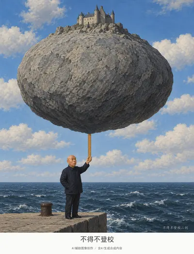](../assets/album/fig171.webp)

[查看完整图片](../assets/album/fig171.webp)

## 第 172 幅 · 雷军  /  《大象》二创

[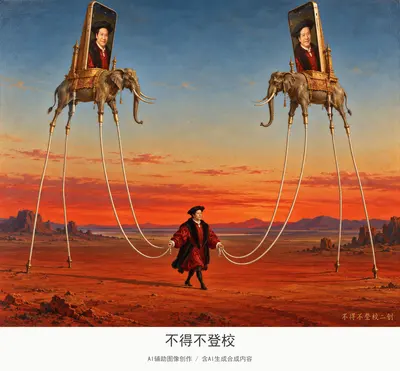](../assets/album/fig172.webp)

[查看完整图片](../assets/album/fig172.webp)

## 第 173 幅 · 千早爱音  /  《科利乌尔开窗》二创

[查看完整图片](../assets/album/fig173.webp)

## 第 174 幅 · 谷爱凌  /  《几个圆圈》二创

[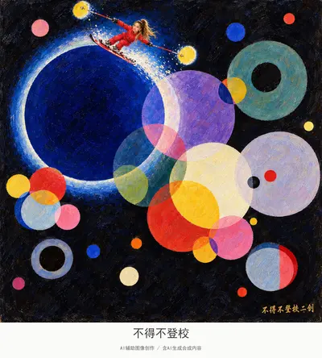](../assets/album/fig174.webp)

[查看完整图片](../assets/album/fig174.webp)

## 第 175 幅 · 谷爱凌  /  《掷铁饼者》二创

[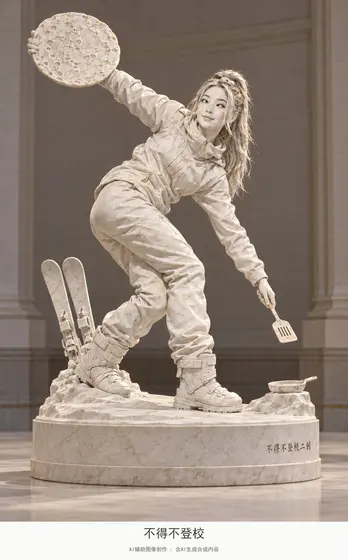](../assets/album/fig175.webp)

[查看完整图片](../assets/album/fig175.webp)

