# 原画集 · 176–200

[全部目录](README.md) · [权利说明](../RIGHTS.md)

## 第 176 幅 · 张雪峰  /  雕塑戏仿

[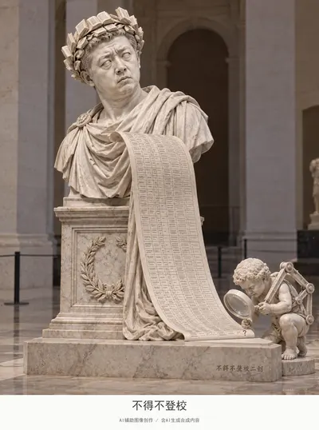](../assets/album/fig176.webp)

[查看完整图片](../assets/album/fig176.webp)

## 第 177 幅 · 丁真  /  《马可·奥勒留骑马像》二创

[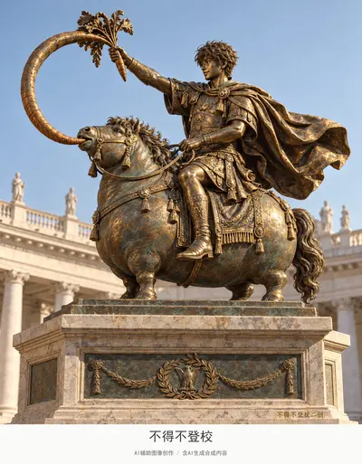](../assets/album/fig177.webp)

[查看完整图片](../assets/album/fig177.webp)

## 第 178 幅 · 雷军  /  《大卫（贝尼尼）》二创

[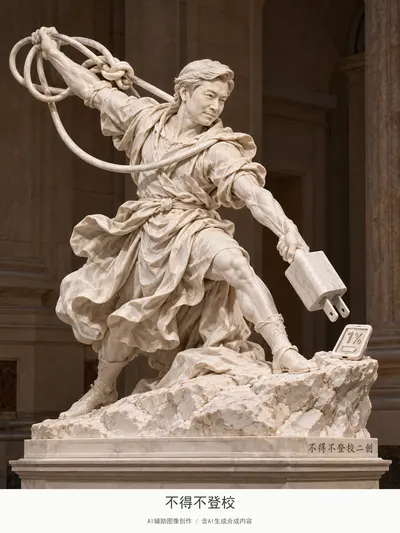](../assets/album/fig178.webp)

[查看完整图片](../assets/album/fig178.webp)

## 第 179 幅 · 丁真  /  《行走的人（罗丹）》二创

[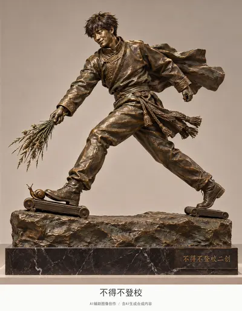](../assets/album/fig179.webp)

[查看完整图片](../assets/album/fig179.webp)

## 第 180 幅 · 谷爱凌  /  《萨莫色雷斯的胜利女神》二创

[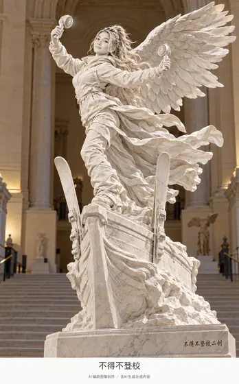](../assets/images/fig180.jpg)

[查看完整图片](../assets/images/fig180.jpg)

## 第 181 幅 · 张雪峰  /  《盘腿而坐的书吏》二创

[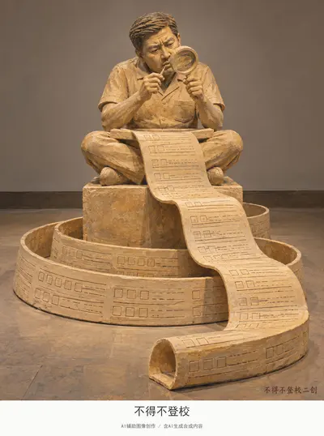](../assets/images/fig181.jpg)

[查看完整图片](../assets/images/fig181.jpg)

## 第 182 幅 · 东北雨姐  /  影视戏仿

[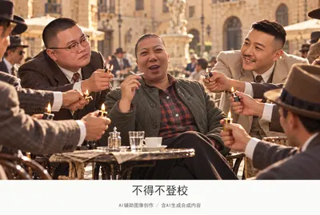](../assets/album/fig182.webp)

[查看完整图片](../assets/album/fig182.webp)

## 第 183 幅 · 峰哥  /  影视戏仿

[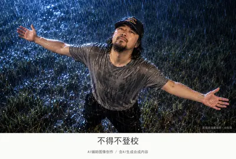](../assets/album/fig183.webp)

[查看完整图片](../assets/album/fig183.webp)

## 第 184 幅 · Notch  /  跨界戏仿

[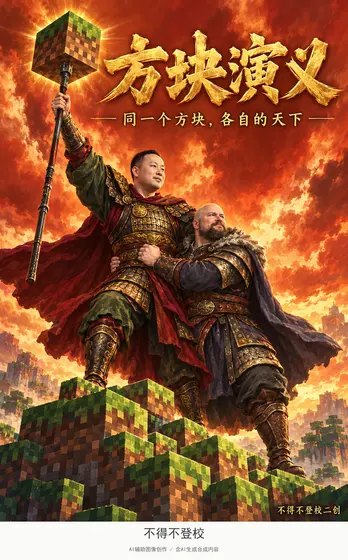](../assets/album/fig184.webp)

[查看完整图片](../assets/album/fig184.webp)

## 第 185 幅 · 峰哥  /  漫画与动画戏仿

[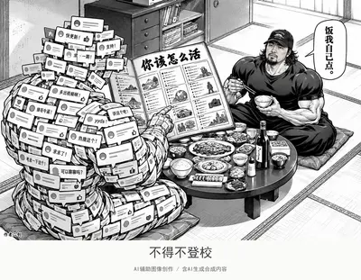](../assets/images/fig185.jpg)

[查看完整图片](../assets/images/fig185.jpg)

## 第 186 幅 · 漫画与动画戏仿

[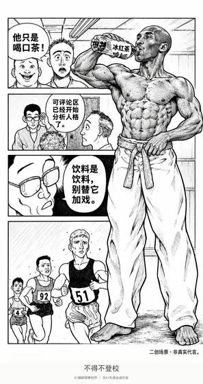](../assets/images/fig186.jpg)

[查看完整图片](../assets/images/fig186.jpg)

## 第 187 幅 · 牢A白猫代称  /  漫画与动画戏仿

[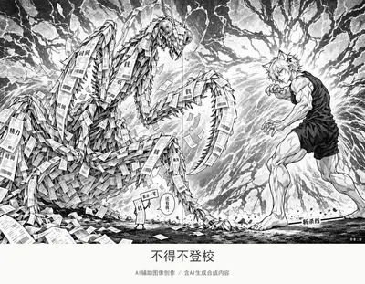](../assets/album/fig187.webp)

[查看完整图片](../assets/album/fig187.webp)

## 第 188 幅 · 雷军、户晨风  /  漫画与动画戏仿

[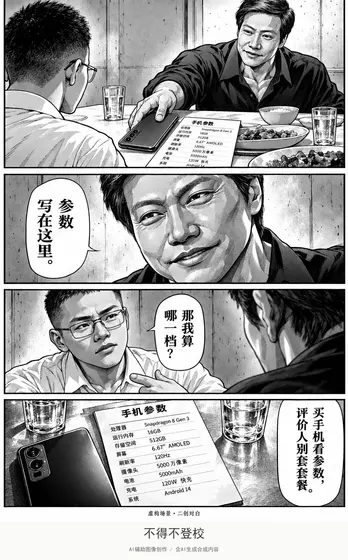](../assets/album/fig188.webp)

[查看完整图片](../assets/album/fig188.webp)

## 第 189 幅 · 孙宇晨  /  漫画与动画戏仿

[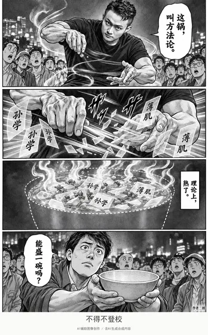](../assets/album/fig189.webp)

[查看完整图片](../assets/album/fig189.webp)

## 第 190 幅 · Peter Griffin  /  漫画与动画戏仿

[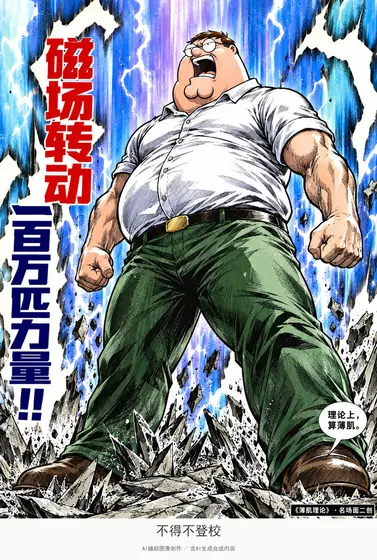](../assets/images/fig190.jpg)

[查看完整图片](../assets/images/fig190.jpg)

## 第 191 幅 · 户晨风  /  漫画与动画戏仿

[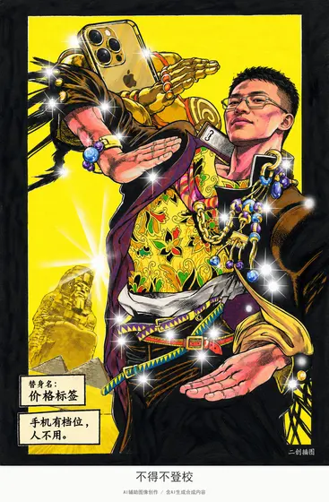](../assets/album/fig191.webp)

[查看完整图片](../assets/album/fig191.webp)

## 第 192 幅 · 牢A白猫代称  /  漫画与动画戏仿

[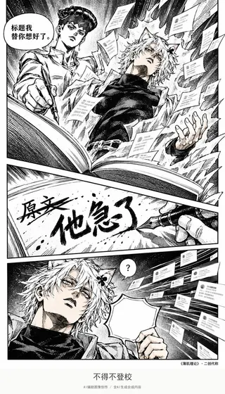](../assets/album/fig192.webp)

[查看完整图片](../assets/album/fig192.webp)

## 第 193 幅 · 牢A白猫代称  /  漫画与动画戏仿

[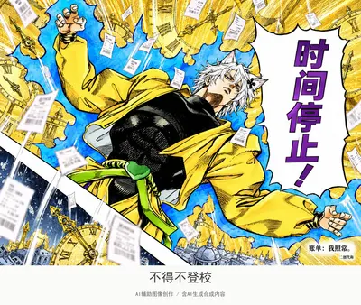](../assets/album/fig193.webp)

[查看完整图片](../assets/album/fig193.webp)

## 第 194 幅 · 孙宇晨  /  漫画与动画戏仿

[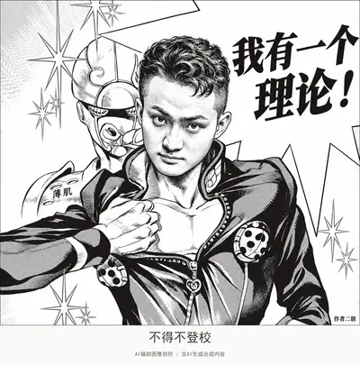](../assets/images/fig194.jpg)

[查看完整图片](../assets/images/fig194.jpg)

## 第 195 幅 · 张雪峰、吴京  /  漫画与动画戏仿

[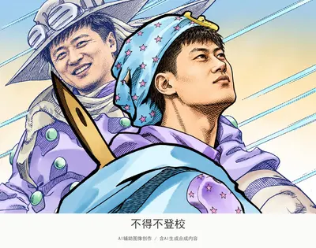](../assets/album/fig195.webp)

[查看完整图片](../assets/album/fig195.webp)

## 第 196 幅 · 峰哥  /  漫画与动画戏仿

[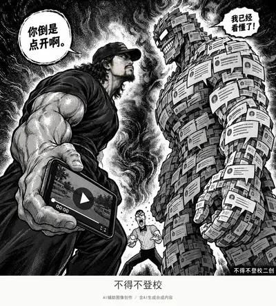](../assets/album/fig196.webp)

[查看完整图片](../assets/album/fig196.webp)

## 第 197 幅 · Peter Griffin  /  漫画与动画戏仿

[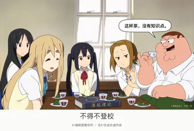](../assets/album/fig197.webp)

[查看完整图片](../assets/album/fig197.webp)

## 第 198 幅 · 户晨风  /  漫画与动画戏仿

[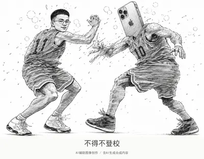](../assets/images/fig198.jpg)

[查看完整图片](../assets/images/fig198.jpg)

## 第 199 幅 · 怪鸽  /  漫画与动画戏仿

[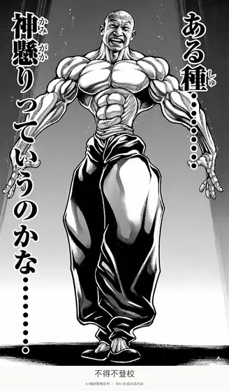](../assets/album/fig199.webp)

[查看完整图片](../assets/album/fig199.webp)

## 第 200 幅 · 傅首尔（已打码）  /  漫画与动画戏仿

[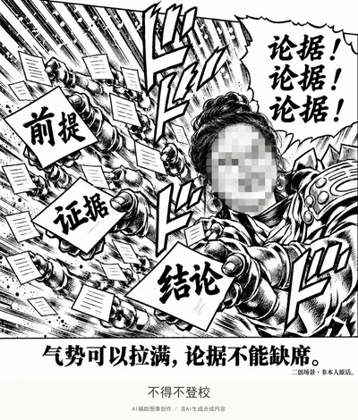](../assets/album/fig200.webp)

[查看完整图片](../assets/album/fig200.webp)

