# 《薄肌理论》完整阅读

作者署名：雾格。保留现有完整书稿，插图对应网站素材。人物虚构及引用边界以正文说明为准。

[返回项目](../README.md) · [原始 Markdown 源稿](薄肌理论_完整正文源稿.md)

# 前言 手机先替我到场

画里的苹果下班了。一部手机挡住了人的脸。

你仍然很可能认得出他。眼镜、姿势、衣服，再加上你看过的那些视频，足够让你在心里报出名字。你甚至可能还没看清画，就已经替他准备好了台词。图中的人没有开口，你这边的评论区已经营业。

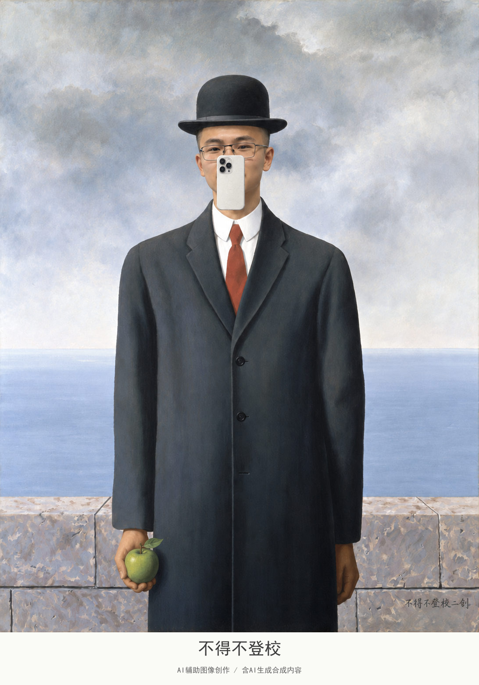

这张由现有图集收录的《人类之子》二创，适合放在书的门口。手机一面挡脸，一面帮我们认人；我们看不见眼睛，却急着辨认阵营。接着，大家开始用认识一张脸的速度，处理认识一个人的麻烦。

《薄肌理论》从这里往下走。它写一种网上很熟悉的冲动：遇到难办的生活，先找一个好看、好记、好传播的答案。练薄肌，换手机，报一个稳妥的专业，学会说话，读几本名著，买件有版型的衣服。每件事单独看，都可能有用。凑成一套人生操作系统之后，它们就开始承包自己做不到的业务。

薄肌在这里指向一种网络身体话语：精瘦、有肌肉、看起来经过管理的男性身材，被放进自我提升和吸引力的讨论中。它不是本书新发明的医学术语，也没有哪位作者授权我们宣布它能解决全部问题。本书借这个词讨论的，是答案怎么从一个局部，扩张成了对整个人的评判。身体还没练好，你已经开始怀疑自己是否配得上说一句“我今天不想去”。

小梁是本书反复出现的一个虚构人物。他上班，点外卖，偶尔运动，在看起来有道理的视频下面点收藏。他不代表某个年龄段的全体，也不承担供读者鉴定的任务。他只是方便我们把一句漂亮话放回晚饭、地铁、租房和第二天的闹钟里。

阿青、老周及其他对话人物也都是作者虚构的组合角色。他们的故事不是任何真实人物的传记。涉及公开人物时，我们主要讨论图像中的二创形象，以及能明确核查的公共材料；本书没有替真人补写犯罪、隐私、疾病、婚恋和心里话。文中的夸张句、假设句和“理论”，除另有来源标注，都是作者的写法，别拿去截成名人语录。

这本书也不打算开一所虚构学院，给每个困扰发一个拗口名称。你已经够忙了，没必要再考“人生优化学”三级证书。我们可以偶尔装一下学术腔，但得在句子里找到一个真的人：谁付钱，谁等回复，谁洗碗，谁第二天照常出门。

插图会打断文字。名画里的人握着手机，雕像看着报纸，漫画人物把日常争执摆成大战。我们借这种张力看看自己：一个晚上没回消息的朋友，怎么就需要用决斗的气势来解释；一张小票，怎么就能把晚餐升级成关于尊严的公开辩论。笑的时候，我们最好还能想起那个在现实里收桌子的人。

书里没有“看完从此不焦虑”的保修承诺。你可能在某一章认出自己的动作：先搜别人的答案，再回来问自己想要什么；用宏大的词，替一件很小但很难的事开脱。认出来也不必急着改。先把事情分清楚，总比一边刷手机，一边替自己颁发差生奖状省点力气。

最后一章叫“不得不登校理论”。这是本书原创的收束，不是我们发现的一门现成学说。它说的是：不管今晚赢了多少场嘴仗，明天还有一个具体地点要去，有一件具体事情要做。可以迟疑，可以讨厌那件事，也可以改变去法。只是别让一套关于自己的精彩说辞，把实际要走的那段路吃掉。

现在把手机往下挪一点。看看画。也看看你今天坐着的地方。


# 第一章 薄肌 从一副身体借来秩序

小梁买了一块鸡胸肉。结账的时候，他顺手加了一包薯片，回家把两样东西分别放到冰箱和电脑旁边，仿佛给今天划出了两个选区。

他在网上看见关于精瘦身材的讨论。视频里的人讲训练、体态和吸引力；评论里的人把这些内容继续往前推：练好了是不是就敢说话，穿衣是不是就好看，恋爱是不是就容易一点。小梁没有逐条相信，但他喜欢那种事情终于能排成步骤的感觉。原来困扰可以从胸、肩和背开始解决，至少这些地方能找到器械。

这里要把概念收窄。“薄肌”不是一份统一的体脂标准，更不是一个能替读者开训练处方的诊断。本书关注网络上的说法怎样把一种身材包装为可见的自我管理。邵艾伦 Alan 的公开视频标题《为什么我劝所有男人练薄肌？》提供了一个可核查的讨论入口；从这个标题，我们不能推断他发明了这个词，也不能替他补上一句“它能解决一切”。[注1]

鸡胸肉熟了，薯片先吃完了。他没有因此成为一种值得批判的人格。他只是在两个真实愿望之间来回：想让日子有点秩序，又想在累了一天之后舒服一点。网上的答案常常把第一种愿望拍得很完整，却把第二种愿望剪成一个需要克服的毛病。

## 终于有一个地方能加重量

阿青问他：“你到底想练出什么？”

“穿衬衫好看。”

“那你为什么收藏了二十个关于成功的帖子？”

小梁说，顺便。

这个“顺便”很厉害。练肩顺便练气场，练背顺便练意志，按时睡觉顺便修复人生。人在一个能数次数、看进步的地方获得安心，就容易希望别的麻烦也跟着服从同一套规则。器械的重量是可见的，朋友是否喜欢你、工作是否适合你，却不能每周稳定加两点五公斤。

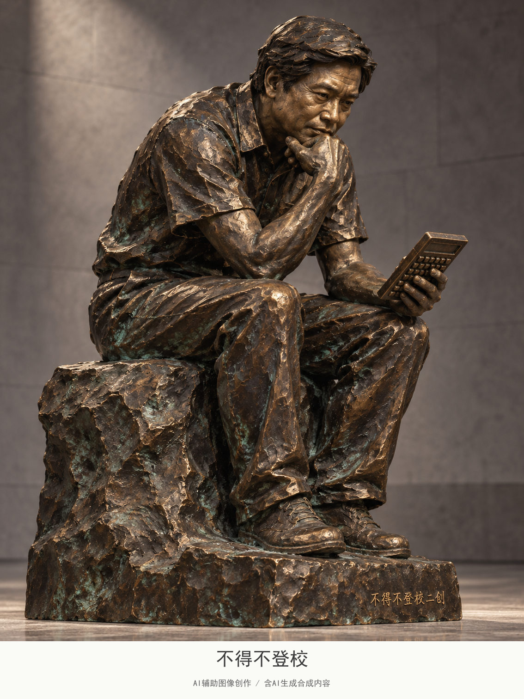

图中的《思想者》二创把沉思和手里具体的物件摆在一起。你可以猜他在看什么，却不能根据这张图宣布真人正在思考什么。这里值得看的，是那种姿势：想得很认真的人，仍然需要一个可抓住的对象。生活的疑问太散，身体至少有边界。

于是我们把边界当成了保证。健身卡上写得出期限，镜子里看得见变化，某个愿望就暂时不再飘着。这种好处是真的，没必要为了批评营销而把运动说成一场骗局。问题出在另一个动作：当我练得更好了，我是否就可以要求世界按进步发奖？如果没有收到奖，是不是只能继续从自己身上扣分？

小梁练了几周，换了件合身的衣服，仍然不喜欢部门聚餐。他在饭桌上说话还是慢，遇到熟人还是会想一下称呼。于是他开始搜索“内向的人如何提升气场”。训练计划刚帮他把一部分日子稳住，新的清单已经从门口搬进来。

## 把喜欢自己做成考勤

身材话语最容易越界的地方，是把喜好写成义务。有人觉得精瘦好看，有人喜欢别的体型，这原本能容纳差异。经过视频封面、购物页面和互相评价之后，差异就可能收缩成一句：你连这个都做不到，还谈什么别的。

这句话没有给你更多方法，只增加了负责范围。训练做得好不好，现在连同你是否值得被喜欢，一起交给同一块镜子考核。镜子能显示肩线，它无法核实一个人是否诚实、是否有耐心、愿不愿意在你赶车时帮你拿包。

阿青没有安慰小梁“你已经完美”。她说：“你想练就练，但别把别人的一句不合适，写进你的训练日志。”

这种区分不够燃。它没有给人一个反击世界的姿势，也不适合放在一段快节奏混剪的最后。但它给身体减了一点任务。今天运动，是因为你想运动、想改变某个具体状态；某个人是否回应你，是另一件事。两件事有时相互影响，也没必要合成一张总成绩单。



这张小丑主题的二创里，衣服、姿势和脸放在一起，读者很容易先辨认角色，再决定如何理解画面。它提醒我们，身体并不裸着进入目光。衣服、场景、你的既有印象，都会参与判断。把人练成一个统一规格，也不会让别人停止带着自己的经历看你。

## 薄一点以后还剩什么

小梁后来保留了训练，取消了几条自动续费。他把目标改成了能持续的安排，没在每一次缺席之后写长篇忏悔。他也仍然吃薯片。这在一份人生革命宣言里，算得上毫无戏剧性的收场。

然而，正是这个不太适合宣传的收场，解释了薄肌理论的第一个问题：一个局部有用的办法，怎样在传播中被要求证明整个人。办法承担得越多，你越难承认它只是有用，也越难调整它。你需要维护它，免得过去的付出显得白费。

下一次听见“先把自己变好”，可以追问一句：具体哪件事要好到什么程度，由谁判断？如果对方只允许你变好，却说不出如何结束考核，这个建议就很像一份没有下班时间的兼职。

身体可以成为你照顾自己的一个地方。它不必成为你向所有人申请通行的证明。小梁把鸡胸肉盛出来，发现盐放少了，起身拿盐。今晚最先得到解决的，是晚饭确实有点淡。


# 第二章 识别人 比认识人快

群里有人发了一张图。老周说是那个人，阿青说不像，小梁放大了眼镜和下巴，开始看评论里有没有标准答案。

你可能熟悉这组手势。手指一放大，我们就有了鉴定的气势。认错了也问题不大，反正下一张图马上会来；认对了，大家则可以跳过介绍，直接进入评价。

认识一个人慢。你得听他说话，见他做事，等一件小事发生之后，再重新估计原来的判断。识别一张脸很快。它可以在你还没搞清上下文之前，给你一个足够熟悉的方向。

## 从脸上领取立场

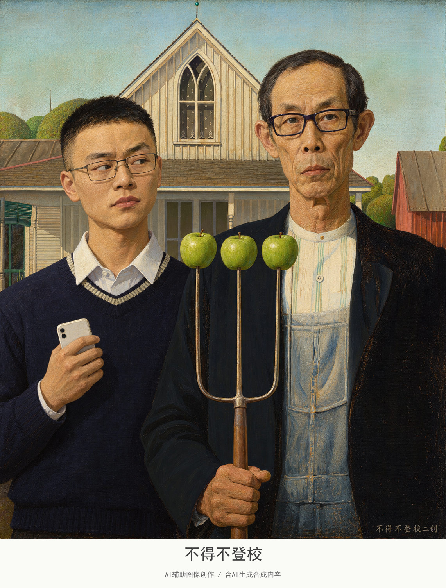

《美国哥特式》二创把两张互联网熟脸放进同一幅构图里。手机、工具、衣服和两人的站姿，构成了一种紧绷的日常感。读者认出其中的人物后，可能立即开始给他们分配台词。那些台词多数不是画里写的，更不是两位真人在这张图里说过的话；它们来自读者带来的记忆。

小梁说：“这个一看就很有理论。”

阿青问：“你看的是图，还是你以前存的表情包？”

两样都有。我们不会每次看到一张熟脸都把既有知识全部清空，这样做也没必要。麻烦在于，旧印象有时会顶替新的材料。你点开一个新视频，听见前两个字，就已经替剩下十分钟写好了总结。视频还在播放，你的判决已经排队等发送。

这给人一种聪明感。因为你能快速猜测对方接下来会说什么。但猜得准，不意味着你听见了这一次具体说了什么。一个人可能仍在重复旧说法，也可能修正了其中一部分。要发现区别，你得忍受几分钟没有表情包可用的时间。

## 熟悉感附带免检

老周买东西喜欢认老板。他会说，这个人我见过很多次，应该靠谱。阿青提醒他：“你见过的是头像，聊天记录里一共只有三句自动回复。”

我们容易把多次曝光看成多次接触。一张脸出现在不同平台、不同切片、不同二创中，你就感觉自己跟它相处了很久。可是其中许多内容可能来自同一次表达，经过不同的标题重新包装。你看了十次，不等于得到了十份独立证据。



举杯的二创形象尤其方便制造这种接触感。画里的人像是正在对观看者示意，我们很容易顺势进入一个并不存在的聚会。读者可以享受这个笑点，但不能把画面的亲近感当作现实关系。图像里向你举杯，不会把一个陌生人变成替你负责的熟人。

小梁曾把某个作者的头像设置成手机背景。他说，每次解锁都有动力。后来阿青借他手机查路线，那张脸在地图打开前亮了一下。她说：“你的精神导师也负责报路吗？”

导师当然没有负责报路。小梁笑了，忽然意识到自己使用这张脸时，经常在使用一种情绪，而非一条已经检查过的建议。情绪能给人力气，但具体建议仍然要按事情来核对。热情不能帮一家网店补齐退货规则。

## 让一个人从图标里出来

减少脸谱化，听上去像要求读者对所有人怀抱爱意。这也会增加负担。你没有义务喜欢每一个人，更没必要为了显得宽容，对自己不舒服的言行装没看见。

比较可行的动作小一些：把“这个人就是这样”改成“这一次材料里，他做了这件事”。前者方便把未来也包进去；后者给下一份材料留了位置。你仍然可以据此做决定，但知道决定依据的是哪一段话、哪一个动作。

阿青把群里那张图存下来了。她没有继续鉴定真假，而是问发图的人：“你想让我们看哪里？”

发图的人说，领带很好笑。

整个群忽然从人物阵营退回了一条领带。大家都轻松了一点。原来这张图还有一种不必上升的看法，只是刚才熟悉的脸把它遮住了。

认识人需要时间，识别人只需要几眼。本书里的画像也会让你迅速认出熟人，然后笑。我们至少可以在笑完以后补一个动作：把图注当图注，把改写当改写，把真人从自己临时安排的台词里放出来。

如果这一步省掉了，连你自己的照片也很难安全。别人看见你的电脑、衣服和杯子，就能替你宣布阶层、习惯和性格。你也许只是在公司捡了一只还能用的杯子，他们已经把你的人生写到了第三章。

## 给新材料一次真的见面

小梁后来遇到一个更小的例子。某个平时说话很冲的群友，给他发了一份认真整理的路线。小梁第一眼仍然以为对方准备嘲讽自己，先把回复写得很硬。等看完路线，他发现里面连换乘入口都标了。

他删了硬话，改成谢谢。那个人没有因此变成另一种完整人格，平时说话仍然很冲。只是这一次，小梁得到了一份具体帮助，不必为了维护旧印象把帮助也理解成恶意。

我们容易期待修正判断必须是一场翻案：从前觉得不好，现在承认其实很好。真实关系通常更杂。你可能不喜欢一个人的部分表达，也能准确承认他在另一件事上做得认真。允许这种并存，会减少把所有材料强行归进一边的劳动。

在网上也可以做类似的动作。一个作者在某个主题上有经验，换到另一个主题时没有提供足够材料。你可以接受前一份建议，继续核对后一份，无须先宣布自己粉转黑。身份的剧本喜欢完整转折，使用材料的人却可以逐项判断。

老周觉得这种看法不够痛快，问小梁到底站哪边。小梁指了指手机上的地图，说自己目前站在换乘入口。路线能不能用，先让他赶上车；这场讨论暂时还不需要他决定一个人的终身位置。

赶上车以后，他仍然可以讨论那个群友的语气。具体帮助没有替别的表达免责，别的表达也没有让这份路线自动失效。两样东西各自留在发生过的地方，世界会显得稍微没那么整齐，材料却因此多了一点使用空间。


# 第三章 理论柜台和套餐人生

小梁把一份课程目录看了三遍。第一遍觉得自己缺表达，第二遍觉得自己缺自信，第三遍发现，如果只买表达课，生活也许仍然不够完整。页面下面还有职业规划、形象管理和关系课程。

他本来只想在下次汇报时把一句话说清楚。看完目录，才知道原来自己需要重新安装。

现实里有认真做事的老师，也有提供局部帮助的服务；这里只讨论一种交易习惯：卖方怎样把你对一个问题的困惑，转成对整个人生的采购。

课程页未必说谎。它可以如实说明一门课涉及什么，也可以展示确实发生过的进步。但几个如实的句子放在同一张长页面里，仍然可能给人一种超出各句的感觉：买齐了，问题就能得到统一解释。那些没法写进目录的东西，比如同事是否配合、家里是否有照护负担、工作时间是否允许练习，通常被安排在一个很短的地方，叫“因人而异”。

## 把志愿表拍成片头



《星球大战》开场字幕的二创把志愿表和咨询场景做成了宇宙级开场。离奇感来自尺寸：一张需要仔细填的表，突然有了决定银河命运的气势。现实中的选择确实重要，却仍然要在具体学校、家庭预算和个人经历里判断，不能靠片头配乐补齐条件。

张雪峰和峰阅教研团队的《从就业看专业》，有可以核对的书目和简介。它提供了一个明确的就业导向入口。[注2] 本书不会据此断言作者否认全部兴趣，也不会从某一句网传切片，替读者挑一个未来必然高薪的专业。就业视角能提出一些好问题：毕业后可能去哪里，招聘需要什么，换路要付多少成本。它不能代替读者所有的回答。

老周给虚构的侄子看志愿建议。他希望孩子少走弯路，这个愿望很实在。孩子问：“少走哪条弯路？”

老周说：“别人吃过亏的路。”

“是他们没找到工作，还是不喜欢工作？”

老周一时答不上来。他手里的建议把两种亏混在了同一张风险图里。找不到工作会影响收入，不喜欢工作也会影响生活；一个家庭可能首先承受不起前一种风险，另一个人可能在几年后发现后一种风险逐渐变重。需要权衡的是这些具体差别。劝告越愿意说明它担心什么，越能帮到人。

网上的套餐却常把差别当作麻烦。它需要你迅速知道自己是哪类客户，于是设置几个好认的入口：普通人、迷茫的人、想逆袭的人。小梁在每个入口都觉得自己沾一点。页面的命中率很高，因为“普通”和“迷茫”没有给出可拒绝的范围。

## 使用说明放在哪里

想象一次买电器的经历：说明书认真列出了适用环境。机器不能在所有场合运行，大家并不因此觉得它羞耻。一条人生建议如果也列清楚适用条件，我们却容易嫌它不够有力。

“如果你目前收入不稳定，且家里没有足够的缓冲，这种选择需要谨慎。”

“普通人就该这样选。”

后一句传起来更快。它把条件省掉，语气也更像有人愿意负责。但负责的语气和负责的能力是两件事。对方能不能看到你的材料，是否愿意在情况变化后修正意见，比他在镜头前有没有迟疑更重要。

这里不要求每一句日常建议都配一份合同。朋友之间说“这家好吃”，通常不用承担国际餐饮认证的义务。问题在于建议的尺度。一旦从一顿饭延伸到几年生活，我们应该能多知道一些事情。不能因为回答拍成了短视频，就让损失也跟着缩成短视频。



二创的狮身人面像看起来很适合宣布一个永恒结论。脸属于今天的笑话，姿态却像一块不准退货的纪念碑。课程采购也会借这种气势：介绍越完整，顾客越容易以为自己的麻烦已经得到整体安排。可坐像的威严不能替课程交付，介绍讲得响，也仍然要说明这一项服务实际做什么。

## 只买这一项可以吗

小梁最后向课程方问了一个问题：能否只练一次工作汇报，不参加其他内容？对方说可以。他松了一口气，忽然觉得自己像在一家努力推荐套餐的餐馆里，终于点到了一份炒饭。

这个结局不证明所有课程都值得买。它说明一种顾客可以练习的权利：描述自己的局部问题，要求局部交付，然后按实际效果判断。没有必要因为一个答案帮过你，就把剩下的人生一起托管给它。

有些读者会说，这样多累，买个套餐省事。省事当然有价值。我们也不会自己研究每一件工具。关键是省掉哪一种事。省掉重复操作，能把时间还给你；省掉对适用条件的判断，可能让你更难发现什么时候该停。

老周又给侄子发了一条消息。他删掉“闭眼选”，改成“这份材料从就业看问题，你把里面提到的学校和条件再查查”。短信不如原先有气势，侄子也没有立刻发一个佩服的表情。但两人终于可以接着聊，家里能支持多少年，孩子愿意接受什么样的工作。

套餐把问题装在一起，谈话把问题拆开。有时你需要前者便于开始，有时你需要后者才能继续。收银台上没有一项商品叫“从此不用再判断”，即使宣传图给它留了一个很大的位置。


# 第四章 价格问题和身价问题

小梁换手机以前，先把旧手机擦了一遍。屏幕仍然能亮，电池却撑不到晚饭。阿青问他为什么换，他说想换。老周说，换这个品牌可以省很多麻烦。

省哪种麻烦？充电，拍照，和电脑配合，还是有人看见手机后少说两句？老周想了想，说都算。

一件商品同时服务几种愿望很正常。鞋要合脚，也可以让你开心。我们不必把每一次买漂亮东西都解释成受骗。可是，当商品被拿来证明购买者的高低，讨论就变了。原本该比较的功能和价格，被购买者是否值得尊重挡在前面。

## 四个数字够大家记很久

2011年8月16日发布的第一代小米手机，定价1999元。雷军在2020年的公开演讲里回忆过这次定价，也讲过原先计划与实际成本之间的调整。[注4] 这是一件具体商品的历史，不是一份所有产品以后都只能卖这个价格的永久承诺。

网上记住四个数字很容易，记住让它成立的条件就难得多。参数、供应、销售和成本安排，需要更长的说明；一个价格能被截进十秒钟，还能跟着配乐重复。时间一长，读者也许记得当年那种兴奋，却已经忘了自己兴奋的是哪一台机器。

这不妨碍数字成为好玩的公共记忆。只是，当小梁拿它评判今天的一件新东西时，需要把记忆和比较分开。新产品是否值这个价，应看今天拿到了什么、失去了什么。他喜不喜欢一个熟悉的发布会形象，可以另算。

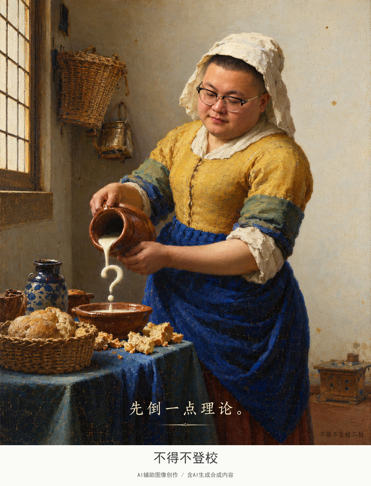

《倒牛奶的女仆》二创里，动作仍然很具体：有人在把东西倒进容器。观众认出罗永浩的形象，可能会联想到商品与表达。本书不把画面当作真人商业行为的记录；我们借它看看购物场景中一项常被忽略的工作：最终倒进你杯子里的，究竟是什么。

漂亮的讲述能让你愿意看，但饮用的是杯子里的东西。买回来以后，谁回答故障，退换是否方便，配件是否好找，仍然由具体流程决定。柜台上能讲很多故事，售后页面往往没有配乐。

## 商品开始给人分座位

官方通报曾明确提到户晨风账号相关的“安卓人”“苹果人”表述，并说明平台对账号的处置。[注5] 这提供了一个可核查的传播背景，不能证明手机品牌真的能分类人格。把消费标签当成人群标签，是本章要分析的动作。

在饭桌上，老周把两部手机放在一起，准备比较谁更体面。小梁说，先别比，自己的电池只剩百分之三，需要找个插座。

这个插座破坏了讨论的宏伟。它把两个阵营重新变成两个会没电的设备，也把购买者重新变成要赶地铁的人。身份讨论偏爱稳定的分类，现实的功能常常让分类漏水。

一个人可能因为单位系统、维修习惯、家人使用、现金安排或单纯的喜好选手机。我们无法从一张桌面的照片知道所有条件。即使价格确实反映了某次支出的能力，也不能自动转成一个人的总财富、文化、道德和命运。你看见的是一次交易留下的物件，缺的材料远多于看见的材料。

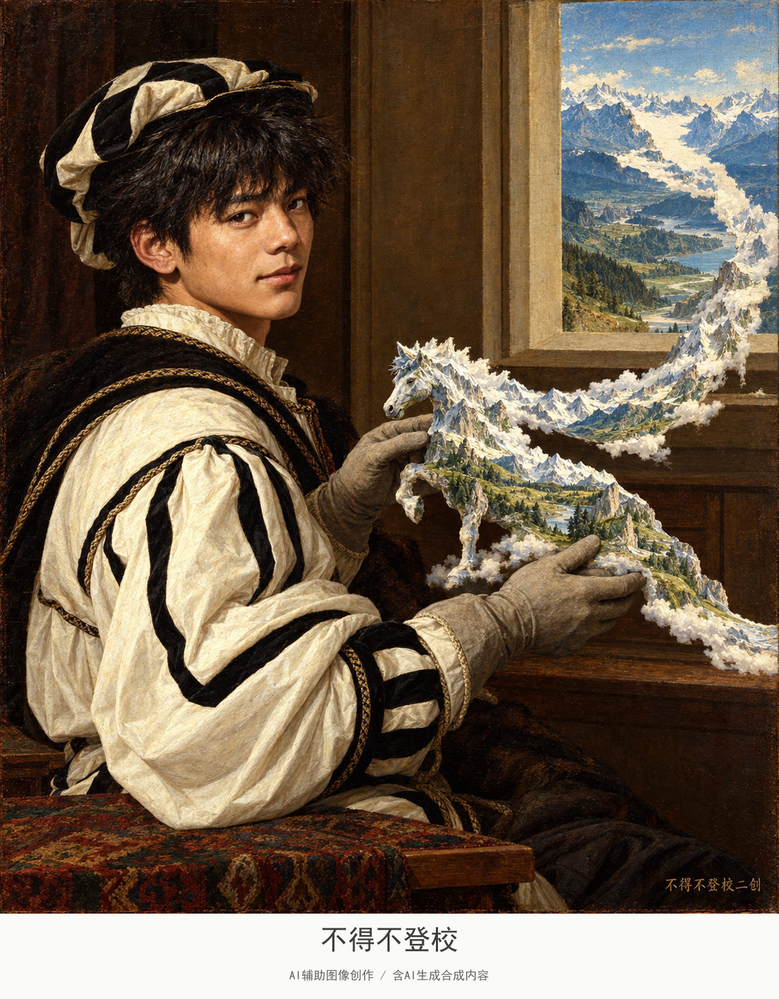

自画像二创很适合放在这里。画中的衣服和姿势有一种展示自己的意味，但我们不能仅凭穿着推断被描绘者的现实生活。看画时如此，看朋友圈时也如此。有人把一张自己觉得好的照片发出来，不等于给观看者签了资产公开协议。

## 你花钱以后还得过日子

阿青并不劝小梁买最便宜的手机。她说：“你想要的功能可以值钱，别人想借它审你，别让那笔钱也由你出。”

把购买讲成理性决策，容易被误解为把快乐全部删掉。其实快乐也可以列进预算。你喜欢一个颜色，喜欢握在手里的感觉，愿意为此花一笔承担得起的钱，就够说明一次选择。你不必先让它代表一个阶层，再申请许可。

困难发生在下一步：为了维持物件给自己的体面，不愿承认它不合适。明明用着麻烦，仍然得向别人证明买得高明；明明想退货，先担心退货会不会让自己像输了一场论战。商品已经从工具变成证词，你开始负责保护它。

小梁试用新手机，发现自己在意的功能没有想象中方便。他把它退了。老周问是不是买不起。小梁说，能买得起，也能不用。

这句回复并没有打败某个阵营。他只是在使用售后规则，不该为一次退货额外举行尊严答辩。有钱买和愿意留，是两个决定。把两个决定分开，消费者才可能根据使用中的新信息改变选择。

有时消费话语会把节省说成寒酸，有时又把花钱说成愚蠢。夹在中间的人无论怎么选，都能被评论成一种性格缺陷。对此最省事的回答，未必是写出比对方更狠的阶层理论，而是问他：你究竟知道我这次要解决什么？

旧手机最后留了下来，小梁先换了电池。它不适合拍一段“我完成升级”的视频，但第二天下班时还有电。他用它发消息，告诉阿青自己到了楼下。商品帮助他完成一件事，到这一步，本次购买讨论就可以结束了。


# 第五章 谁能承受一张志愿表

桌上的电脑开着，茶凉了，老周已经把同一所学校的名字读出了三种语气。第一种是期待，第二种是怀疑，第三种用来告诉亲戚自己并没有乱选。

这张桌子能放下一个经常被轻轻带过的问题：谁来承受选择错了以后的一段时间。

侄子想学的方向，需要继续查课程和毕业路径。老周在意的方向，看上去有一些明确的招聘入口。他们说“以后”，说的却不是同一个时间。侄子想象的是十年后自己做什么，老周想象的是四年后房租由谁转账。

这两种想象都不能被一句“眼界”判成输赢。家庭支持有限的人先算收入，不意味着他天生缺乏兴趣；有缓冲的人愿意探索，也不意味着他比别人更懂理想。争论如果不说明各自能承受什么，只会把预算问题改写成品格问题。

## 有人能换路 有人先得走完

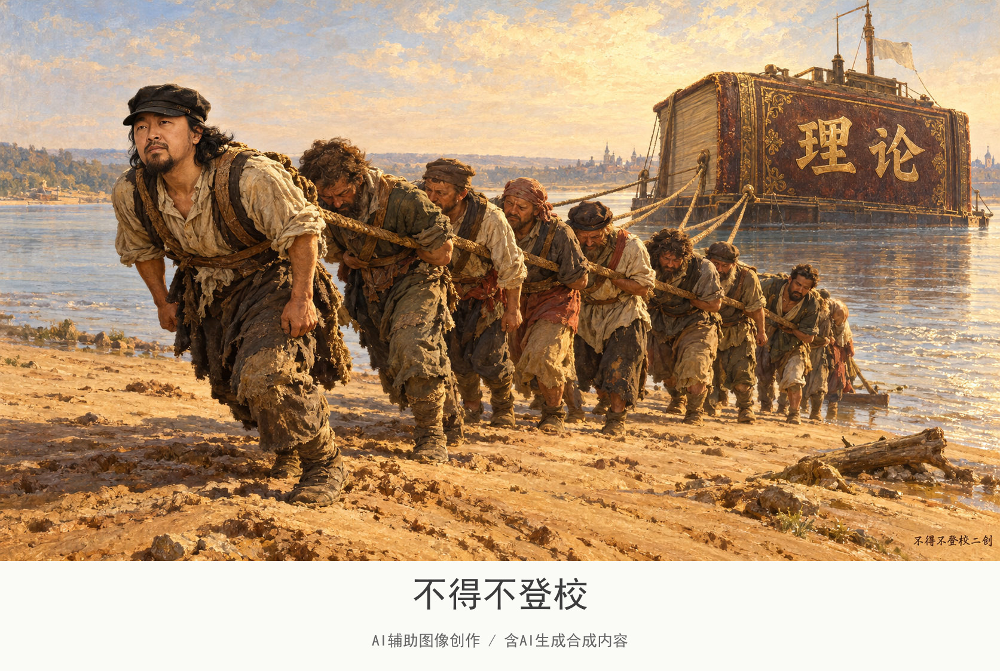

《伏尔加河上的纤夫》二创把一群人的用力放在画面里。它不是今天某个职业的纪录，也不能靠一张图证明谁辛苦程度更高。我们借它看一个关系：有人拉，有人跟着拉，几个人的方向并不由一句“你自己想清楚”就能改变。

学生的选择往往也牵着别人。谁支付学费，谁腾出房间，谁在毕业后还能留出几个月的支持，都会影响所谓的自由。把这些讲清楚，比给孩子一个听起来非常宽阔的口号更尊重他。

小梁在旁边听，忍不住说：“年轻人总得试一下。”

老周问：“试到什么时候，钱由谁给？”

小梁觉得这问题有点扫兴。他习惯把试错想成勇气，把预算想成勇气的障碍。可是，真正愿意支持一个人试错，也应该愿意谈怎么一起承受结果。只鼓励出发，不肯听第二个月的困难，提供的是出发仪式。

侄子也没有因此接受老周的全部意见。他问能不能先找到课程表、毕业生去向和转专业条件，再决定。老周第一次发现，侄子所谓的兴趣可以变成调查，自己所谓的稳妥也需要接受调查。

这比互相证明谁更成熟有用。兴趣要看每天具体会做什么，稳妥要看实际有哪些条件。两种词都很容易穿一件宽大的衣服，遮住里面不够充分的信息。

## 热门来得早 毕业来得晚

某个专业的热度上升，你看到的往往是当下的供需和叙事。学生入学到毕业却需要时间，学校之间也有差异。即使我们拥有当前资料，也无法由此承诺未来。

2023年关于新闻传播学报考的公开讨论，记录了不同解释与回应。[注3] 这些记录提供材料，不能替所有学校和学生得出同一个选择。

本书不向读者提供具体报考建议。它更关心建议的日期：一段去年拍摄的视频，今年被重新剪了封面，读者看到时以为它刚发布。一份材料若不保留条件和时间，越容易转发，越可能把旧环境穿成新答案。



《帕尔纳索斯山》二创把一个当下的角色放进古典的知识场景。插图没有告诉读者哪个专业好就业。它让知识世界看起来热闹，也让我们发现自己很喜欢把走进知识的愿望拍成抵达某座山的姿势。实际课程没有那么整齐：某一节课可能激动人心，接下来两周却是在练一个反复出错的动作。

只根据理想形象选，可能低估日常；只根据招聘名称选，也可能误解日常。同一个职业，在不同单位里做的工作不一样。一个名称不是一天，别人晒出的一天也不是全部年份。

调查很无聊。它需要你去读课程说明，比较条件，听到彼此矛盾的经验。你可能最后仍然选原来喜欢的方向，但经过调查后，知道自己接受了哪些风险。结论相同，不意味着过程白做。

## 别让孩子负责替大人争面子

亲戚群里问起学校，老周打了很长一段话。他先解释城市，再解释专业，最后差点加一句别人不懂。他发现自己正在给尚未发生的结果防御。

侄子说：“先别说以后肯定怎么样。”

老周删了最后一句。虚构的这顿晚饭没有上演完美和解。两人还有分歧，预算也没有突然增加。不同的是，他们同意把一些事从展示里拿回来：向亲戚报消息是一回事，决定读什么是另一回事。

年轻人常被要求同时做到两件很难兼容的事：自己负责选择，同时让家人随时能向别人解释这个选择。于是志愿表多了一项隐藏任务，叫做让所有人听完都觉得漂亮。它本来没有这一栏，填表的人却要为它耗很多力气。

我们能否接受一个选择现在还说不出漂亮结局？说得出目前依据，知道以后要检查什么，就已经比一句“这条路肯定行”更接近负责。父母不必伪装完全不担心，孩子也不必伪装完全不害怕。

这章谈的预算，包括钱，也包括时间和关系。有人换一次路，身边的人能等；有人每推迟一个月，家里的安排就会紧一点。把差别说出来，可以让支持变得具体。假装大家起点相同，反而会让需要帮助的人只能把困境解释成自己不够坚定。

老周关电脑前，在纸上写了几个待查项目。侄子把纸拍下来。最后他们没有拍一张“终于决定了”的合照，因为还没决定。茶凉得很彻底，两个人起身去热菜。晚饭继续发生，这比为一张尚未填完的表宣布整个人生结束，合乎现场得多。


# 第六章 建议里被省掉的人

小梁把一段难办的工作关系讲到一半，老周已经准备好了答案：“你要主动一点。”

小梁说自己主动过。

老周说，那就再主动。

这样的对话可以持续很久，因为第二句话没有给第一句话增加任何新的条件。它只把执行不到位的责任，再交回讲述者。小梁越是解释，对方越觉得他在找理由；老周越是强调简单，小梁越难说清哪里不简单。

许多建议并非错误。主动沟通可能有用，早点休息可能有用，练习表达也可能有用。我们感到烦，不一定因为拒绝改变，有时只是对方把我们已经做过的事，重新包装成尚未觉醒的证据。

## 餐桌上每个人都很会安排

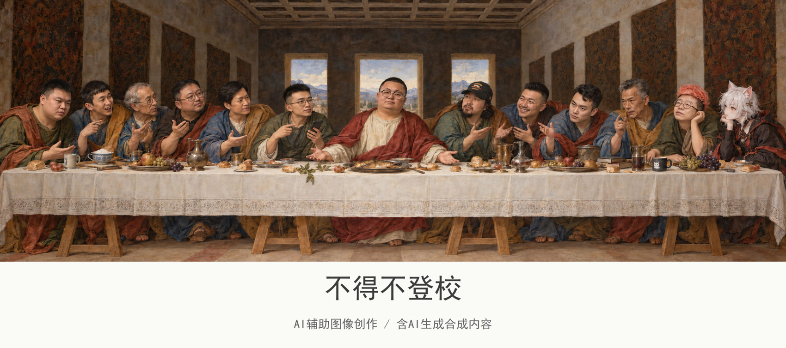

《最后的晚餐》的二创里，人物围着桌子，画面天然适合读者安排一场讨论。本书不把虚构对白放到真人嘴里。这里只借这张桌子提醒自己：当一群人拥有不同的信息，却都想给别人一个答案，餐桌很容易变成没有记录员的咨询中心。

晚饭时，大家还会带着自己的成功方式。一个人通过换工作解决过问题，就喜欢建议换工作；另一个人熬过一段难受的时期，就把熬过去视作可复制的步骤。个人经历能提供线索，但并不自动覆盖别人尚未说完的条件。

小梁说过，他想下班以后少接一点临时任务。老周听成他不喜欢工作。阿青听成他没有学会拒绝。第三个人听成他需要提升效率。三种说法分别让三个人显得经验丰富，小梁的那一天却被拆得没人认识。

他试着重新讲：具体是哪项任务，谁在什么时候发来，已经完成了什么，哪些内容要到第二天才有材料。这些细节没有“效率”好听，但它们能决定对话往哪里走。比如缺的材料来自对方，安排就不能只靠小梁早点起床修复。

## 听见约束以后再给办法

阿青后来学着在劝人之前问两件事：已经试过什么，希望我帮忙到哪一步。她也会忘。有一次小梁刚说想吐槽，她便开始列操作步骤。小梁提醒她：“这次只需要你说这确实很烦。”

这不是要求朋友永远当情绪服务员。朋友也可以说自己没有力气听，或者对这件事没有经验。说明能力和时间，往往比硬凑一套建议更诚实。

建议的价值有时在于添一份材料，有时在于陪人把材料理顺。两种工作都可能有用，却不能互相冒充。你不知道对方的处境，可以提出假设；提出假设以后，也要让对方有机会说“不适用”，而不是把拒绝认作固执。

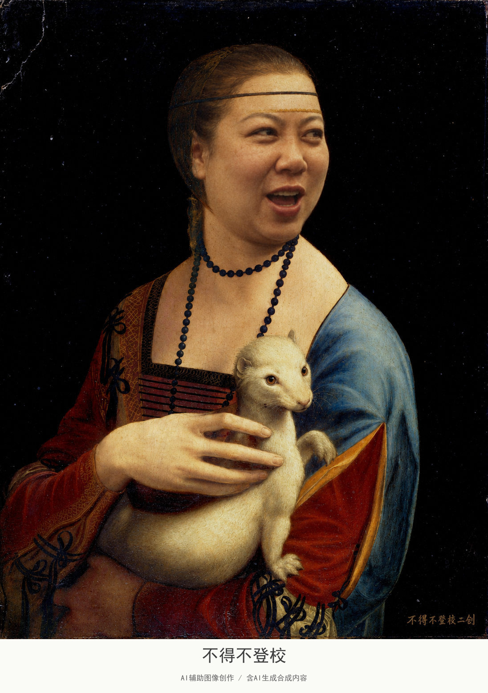

《抱银貂的女子》二创让熟悉的人物进入一种端正、安静的姿势。画面里的笑点不需要人物真的发表什么意见。它也提醒我们：一个擅长某种表达的人，被放到另一个场景里，仍然要重新认识场景。话讲得顺，不保证已经摸清听话的人。

网上的声音常常反过来。话越流畅，我们越容易把它当成对具体人的理解。一个停顿多、需要翻资料的答复，看起来不如“一句话点醒你”有分量。可是认真处理问题的人，有时正因为看见条件互相牵扯，才没办法立刻给一个轻巧答案。

## 建议可以被修改

老周终于听完了小梁的工作材料。他说：“那我前面说主动，可能不对症。”

这句话短得没有表演空间，却比前面十分钟更像帮忙。小梁不用继续证明自己努力过，两人得以接着讨论谁该补材料、哪些事情要留记录。老周仍然有经验，只是没有要求经验每次都获胜。

我们常把改口看成权威受损。于是，给过建议的人越给越坚定，听过建议的人越听越疲惫。若把双方关系放在建议前面，修正就会容易一点：我希望你少受点困扰，不等于我希望我第一句话必须正确。

在收费服务里，这种区分还涉及交付。卖方是否愿意明确适用范围，是否允许按实际情况调整，能不能承认材料不足，是读者可以检查的部分。名气只能说明你容易找到他，不能代替这些过程。

在朋友关系里，它涉及一种较小但很重要的礼貌：不要抢着给对方正在经历的事命名。你可以说自己听懂了哪些，也可以请他继续说明没懂的地方。看起来慢，却能避免一个人越说越像被自己的人生排除在外。

小梁那次没有得到一句能发朋友圈的结论。晚饭之后，老周帮他把明天要问的两件事写清楚，阿青帮他看了一眼语气。三个人也没有把这段合作叫成某种高阶沟通法。他们洗了碗，发现有一只筷子掉在桌子底下。

那只筷子让晚饭比理论完整。有人给观点，有人收拾现场，有人弯腰把小东西捡起来。下一次我们讨论谁更会关心人，也许可以把这些动作一起算进去，别只统计谁在餐桌上说了最多的话。

## 不给建议也是一个选项

还有一次，小梁讲的是已经结束的事情。结果改不了，他只是想把过程说完。老周几次要开口，最后忍住了。小梁讲了十分钟，自己发现其中一个地方先前理解错了，停下来重新说了一遍。

老周没有提供新方法，却给那段话留了没有被抢走的时间。它不同于沉默着表示赞同，也不同于装作完全理解。老周可以在没听懂时问，可以说自己看法不同，只是没有急着把对话变成一份行动清单。

我们习惯用“有帮助”证明自己值得被叫来，便容易在每次陪伴里寻找交付。可是，朋友叫你吃饭，不一定是在招一个临时解决方案供应商。你可以作为这个人来到这里，听完一段话，也把自己的近况说一说。

当然，这种相处也有范围。若你持续承担过量倾诉，感到累，可以说明时间和状态。关心对方与保护自己的安排，能够同时说清楚。不能因为没给建议，就默认自己可以无限接收；也不能因为有人需要听众，就把他判成拒绝成长。

那晚的后半段，老周讲起自己的一个烦恼。小梁没有照搬刚学到的问法，他先问要不要再添一点饭。对话并没有升到更高的沟通层级，倒是从一场单向咨询，回到了两个人共同拥有的晚饭。


# 第七章 努力发售以前

直播间里展示了一件已经做好的东西。灯光够亮，声音够清楚，桌子也擦过。小梁看完说，厉害的人做事就是有一种状态。

阿青把视频停住：“你看到的这一分钟，前面可能有很多没拍进来的工作。”

“那也是人家努力。”

“是。我的意思是，那些工作也叫努力。”

两人没有分歧到值得打架。小梁只是习惯把努力想成一种能被摄像头认出的表情。皱眉，快走，深夜喝咖啡，再把一份成果举起来。阿青在做一件小而麻烦的事：把努力的范围放回那些不适合做混剪的动作里。

## 镜头外的螺丝



《回到未来》实验室场景的二创，把熟悉的人物、钟和机器摆进一个充满行动感的空间。本书没有据此描述雷军的真实工作习惯。我们看的是图像怎样让“做事”显得完整：设备在那里，时间在那里，仿佛每一件小东西都正服务于某个大时刻。

现实里有些小东西确实服务于大时刻，也有些只是在避免一个小错误。导出文件以前检查页码，发货以前核对地址，开会以前确认线能接上，这些动作很少让人觉得壮烈。做得好，现场看不见；没做好，大家才会发现它们原来也是工作。

小梁负责过一次活动。他最初把计划列得很漂亮：谁发言，谁主持，最后如何合影。阿青问他，门口的指示贴在哪里。他说等会再想。活动当天，有人找错教室，又有人按错群里的地址。发言没问题，大家抵达发言的路却出了问题。

他后来对努力的理解多了一点狼狈。只顾最终展示，前面的安排就容易被视为杂务。可是，没有人整理杂务，成果也会被杂务卡住。一个努力的人未必在冲刺，有时是在问一句谁还没收到通知。

## 成果应该归给多少人

把所有成果都归给最显眼的人，是一种方便的讲法。它让故事有主人公，也让观众知道该记谁。但要把故事拿来安排现实工作，我们还得知道有哪些角色没有进入讲述。

假如一个团队出了一份图册，封面上只能放一个名字，不意味着整理、校对、资料核查和打印测试都由同一人完成。我们可以欣赏一个人最后把事情扛住，也需要准确记下其他人的贡献。否则“提高效率”就可能意味着让不显眼的人继续做事，让显眼的人继续负责解释为什么成功。

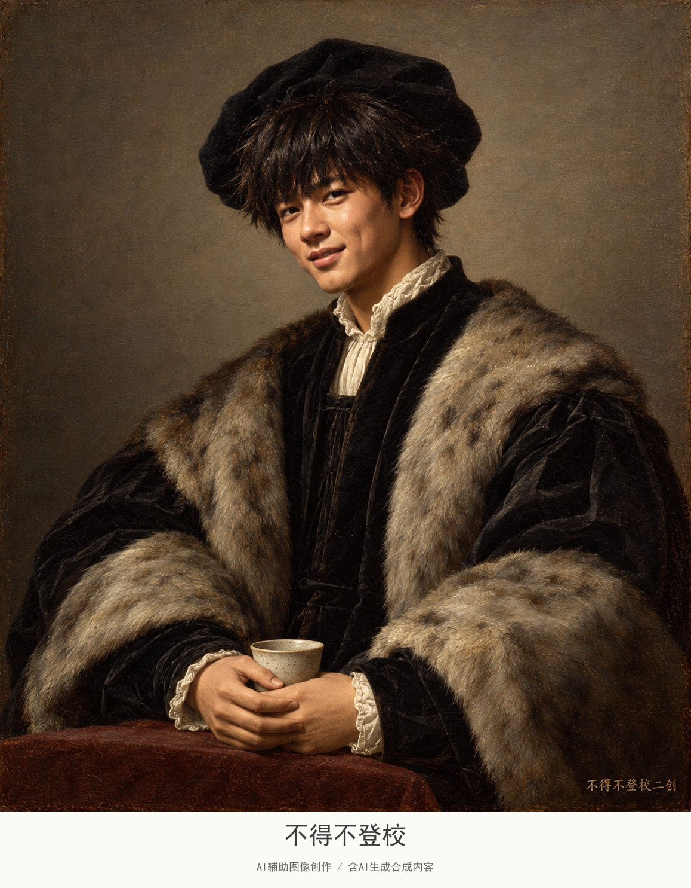

《巴尔达萨雷·卡斯蒂廖内肖像》二创保留一种克制的端正。它没有展示忙碌，却仍然容易让读者感觉画里的人已经准备好承担某种角色。这种体面很美，也很适合做成果页。但一幅完成的肖像没有义务告诉你，旁边有几个人调过光、整理过衣服、等待过。日常工作如果也只按最终姿势记账，就会漏掉不少劳动。

阿青在活动结束之后没有要求大家开一场“看见幕后”的宏大会议。她只把分工表留着，谁修了什么问题，写在相应的位置。后来需要再做一次时，团队知道该问谁，也知道哪些时间不能凭空压缩。

记贡献不只是为了表扬。它还能让计划更接近成本。有人说这个任务很快，可能因为他从前拿到的是已经准备好的材料；现在材料要自己整理，他才发现“很快”从来带着一个没有写出来的条件。

## 努力也需要停机时间

一段展示持续努力的视频，可能压缩了很长的时间。睡觉、吃饭、恢复和等待不那么适合进度条，便被略掉了。观看者如果把剪辑当作完整生活，就会开始怀疑自己的暂停是不是缺点。

小梁有一天把进度更新发到群里，写了“今天只做了一点”。阿青回他，那一点包括处理三次报错吗？包括的话，别先替别人给它打折。

失败和返工很难展示。你重新做同一件事，看上去像没有前进。但在一些工作里，发现原来方法不适合，本来就是任务的一部分。承认这一点，不会让所有拖延都变得有理，它只是让我们区分：今天确实没做，和今天做了却没有形成漂亮成果。

同样，累了需要停，并不等于你已经选择一生不努力。一段时期的安排，不能从一张今晚的截图推出。用宏大的道德判断处理小范围的疲劳，容易逼人把真实情况藏起来。每个人都说还能做，最后计划依旧按不存在的体力运行。

努力被发售的时候，常带着一个许诺：拥有这种状态，你就能接近这种结果。消费者会看见姿态，雇主会看见可调度的时间，讲述者会看见一个方便重复的主题。但真正工作的人，还要面对材料晚到、安排变化和身体需要休息。

活动的第二次版本不如第一次海报漂亮。小梁多留了一小时给到场确认，阿青多留了一个人处理临时问题。合影仍然很好看，只是大家没那么慌。他们没有发一段“效率翻倍”的宣言，修正后的流程里也没有谁被要求无限加班。

当努力从表情回到动作，我们才有机会谈它值多少时间、如何分工、何时结束。最能鼓舞人的场面可以留下，螺丝也得有人数清楚。否则你获得了冲刺的音乐，打开门才发现门把手还没装上。


# 第八章 体面是怎么装修出来的

阿青来小梁家取东西，小梁先说：“有点乱。”

然后他用了十分钟，把看起来乱的东西搬到卧室。客厅变得清爽，卧室失去了开门的可能。阿青站在客厅，看见一只拖鞋从门缝里伸出来。

这间屋子，是体面最朴素的工作现场。没有人撒了多大的谎，小梁只是给观看范围做了管理。他想让客人舒服，也想让客人相信自己并不总是这样过日子。这两种愿望一起挤进了卧室。

## 画框外还有一张床

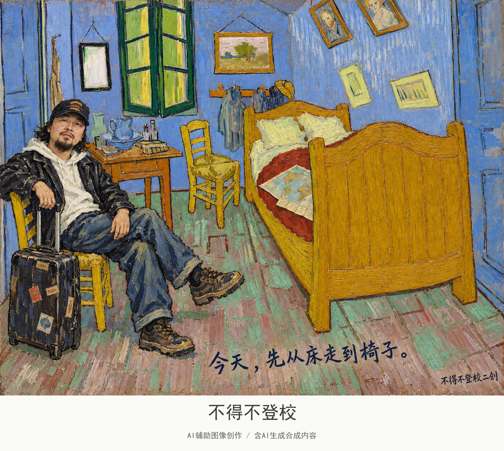

卧室主题二创把一张熟悉的脸放到室内的日常中。房间的颜色、床和椅子，让我们即使不认识人物，也能进入一种私人时间。它比许多公共形象松一点：人总得回到一个地方，把东西放下来。

可我们观看私人空间时，又经常急着替里面的人打分。书架是否有品位，床是否整齐，桌面是否显示了职业能力。房间本来用于生活，在照片里却像一份没有写字的简历。

小梁也做这件事。他羡慕别人拍出来的书桌，买了同款收纳。装好以后，桌面确实整齐了一点；过了几天，旁边又长出了快递袋。他曾怀疑是不是自己缺少那种生活能力，后来才意识到，对方发来的是某个拍摄时刻。他无从知道昨天的桌子，也不知道相机旁边堆了什么。

承认画框有限，不意味着所有展示都虚假。对方可以确实喜欢整齐，也可以确实为了拍照做了整理。两者都正常。观众若把整理后的样子当作连续生活的标准，便会对自己的每一次使用感到失望。

## 壮观的空间让我们暂时安静



《索尔兹伯里大教堂》二创把人物和建筑的外观重新组合。站在画前，读者会先面对尺度与氛围。我们很容易把宏大的空间理解成宏大的生活，但实际使用空间的人，仍然要处理照明、路线、天气和维修。

体面有一部分也是这样。它让来的人不必马上看见细碎的维护劳动。桌布干净，服务清楚，入口方便，这些做得好，当然有价值。问题出在维护者被要求消失：空间看起来毫不费力，提供费力工作的人也不能表现得累。

小梁曾在一次聚会上帮忙摆桌子。拍照时，他被叫到旁边，因为手里还有垃圾袋。没有人故意羞辱他，大家只是想让画面更干净。他站开之后才觉得不对劲：如果垃圾袋没有人拿，干净的画面也不会存在。

后来他们又拍了一张，袋子仍然留在角落。这不一定是一张更好看的照片，也不需要成为大家的新审美原则。只是对现场而言，保留一点劳动的痕迹，会让体面不至于只归给站在正中的人。

## 谁为整齐付账

一些生活建议把房间变美的过程，讲成购买清单。灯，杯子，桌垫，植物。东西确实能改变环境，却无法独自负责日后维护。植物需要照顾，杯子需要洗，桌面需要腾出来。购买那一刻短，使用它们的时间长。

小梁买了一个不太容易清洗的杯子，起初拍照很高兴，后来总把它放到最后洗。最后他换回了普通杯子。老周问是不是不喜欢精致生活，他说，自己喜欢喝水，不太喜欢为一只杯子每天开工。

精致生活并非一种统一义务。有人享受维护漂亮物件，愿意为此花时间；有人把同样的时间用于别的事情。两者没有必要在公共评分表上分出谁更会生活。只要物件安全好用，使用者便可以按自己的偏好安排。

更难处理的是共同空间。如果屋子里住着两个人，一人负责提供审美意见，另一人负责洗所有难洗的东西，那么“我们想过得好一点”里藏着分工。讨论美感之前，也应该讨论谁来维护。否则漂亮是共同的，麻烦却只有一个人拥有。

## 允许别人看见使用痕迹

阿青没有因为门口的拖鞋取笑小梁。她问卧室还能进去吗，因为要找的东西似乎在里面。小梁把门一点点推开，刚搬进去的包装盒又回到了客厅。

整理没有白做。客厅的桌子仍然能放茶，阿青也仍然愿意坐一会儿。只是小梁不需要继续维护“我家总是这样”的错觉。两个人一边找东西，一边把显然已经不用的纸盒叠起来，屋子得到了另一种整齐。

体面可以帮助陌生人相处，让场合更舒适。我们没必要把它全部拆穿，仿佛任何准备都是不真诚。真正消耗人的，是把准备过的样子说成天然状态，再要求身边的人全年维持。

用过的桌子会留下杯印，读过的书会出现在床边，做过的事也会留下一些尚未收拾的材料。生活不是持续开放的样板间。你可以选择何时整理，也可以在邀请人进来时告诉他，今天确实还没收拾好。

小梁找到了东西，阿青临走前帮他把箱子搬到门口。他拍了一张客厅，想发出去，又把手机放下。他仍然喜欢整齐的房间，只是这次不急着让别人来证明它。


# 第九章 张三今天没有替你出庭

小梁说了一件买东西不顺的事。东西有问题，商家回复慢，他还没把时间顺序讲清，群里已经有人宣布商家违法，另一个人宣布他证据不足。老周问他有没有录屏。阿青问他吃饭了没有。

它的热闹在于，东西还没退，庭审已经在三个聊天窗口里开了。每个人都能扮演一个岗位，小梁本人反而只负责搬运截图。

## 案例里的名字很方便

罗翔在公开采访中说明，“张三”是法学教师常用的代称，前辈课堂也用，并非由他首创。他也谈到幽默与知识普及的关系，以及希望普及法治精神的教学目标。[注6] 本书把这份采访当作认识其教学方法的入口，不把网上归到他名下的图片全部当成原话。

一个代称能让人迅速进入案例：我们先知道有个人，接着听他做了什么。观众不用每次记住新的姓名，就能把注意力留给关系和条件。张三在这里是一件课堂工具，不是罗翔的个人经历，也不是一张包办法律结论的脸。

工具太好记，容易出现另一种效果。你记住了张三又干了什么，却没记住判断为什么要区分行为、条件和证据。下一次遇到相似故事，便觉得自己可以直接套结论。

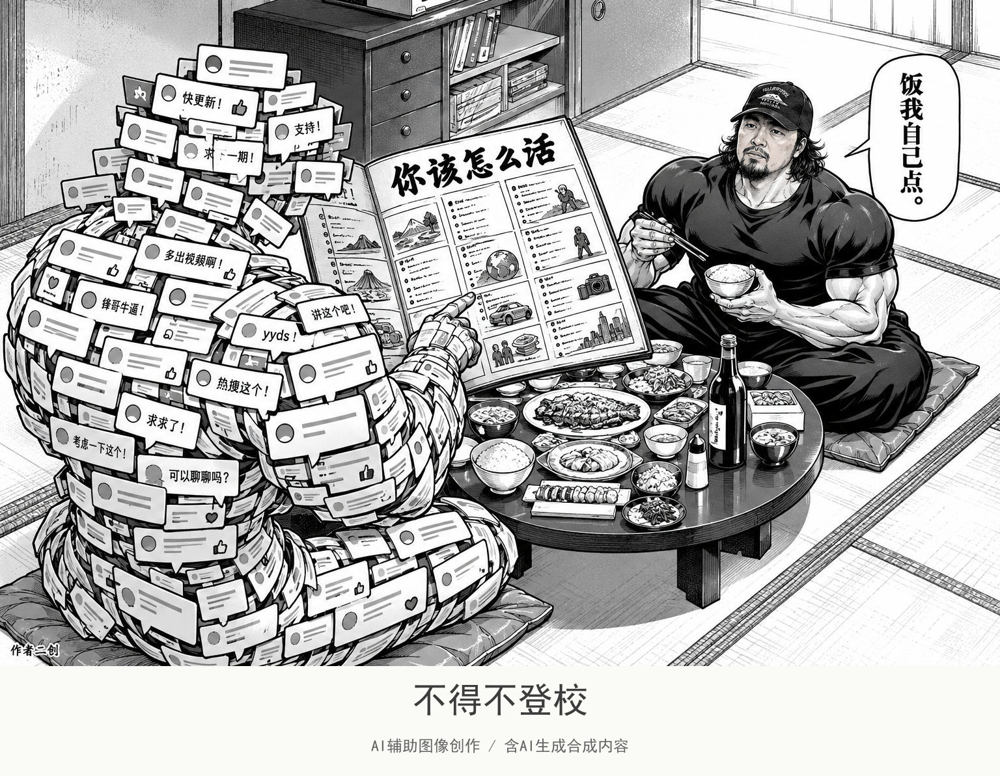

格斗漫画式二创把日常事物和强烈的身体张力放在一起。这种荒诞十分适合群聊：一个小争执，一旦有了决斗的架势，参与者便开始期待有人倒下。本书借画面的夸张提醒读者，表达强度不等于事实已经清楚；你把句子写得像必杀技，也不会替截图补齐时间。

## 把事实排好是很慢的技能

小梁开始整理材料。第一张截图显示下单，第二张显示沟通，第三张是他转给老周看的总结。群里最早发言的人说，第三张最清楚。阿青说，第三张只是小梁自己写的话，其他材料还要对应着看。

她没有由此宣布商家就没问题。她只拒绝让一张容易读的总结，替代它所总结的事情。总结可以帮助找到线索，也可能省略不利于讲述者的部分。我们听朋友说话，可以相信他愿意诚实，仍然需要把材料和判断分开。

这一步常常没法给观众即时满足。你不能在每张截图下面立刻判一个输赢，有时还得问这条消息之前是什么，双方有没有改过约定。在评论区的节奏里，这很容易显得不够痛快。

老周说：“这么看岂不是永远不能说？”

阿青说：“可以说目前看见的部分。没看见的部分，就先别替它做主。”

谨慎并不要求人永远沉默。它只是让句子与材料的大小相称。材料只能支持某次沟通不顺，就别直接把对方的一生写成骗子履历；材料支持一个具体问题，也不必因为尚未知道所有事情而否认问题。你可以把确定的说清楚，把待查的单独放着。

## 听起来像法律 不等于已经做完判断

有人喜欢把“依法”“侵权”“追责”放在句子前面，好像句子穿上制服以后，事实也跟着站齐了。本书不在这里给现行法律作简化教程，更不提供具体个案结论。真实问题若涉及权利与责任，读者应结合完整材料向合适的专业渠道核对。

我们能讨论的是说话习惯。借一个专业词增强语气，与完成专业判断，中间还隔着许多工作。名词的门槛很低，核对材料的门槛较高。网络传播往往奖励前一种动作，因为它快，显得果断，还能让别人立即站队。

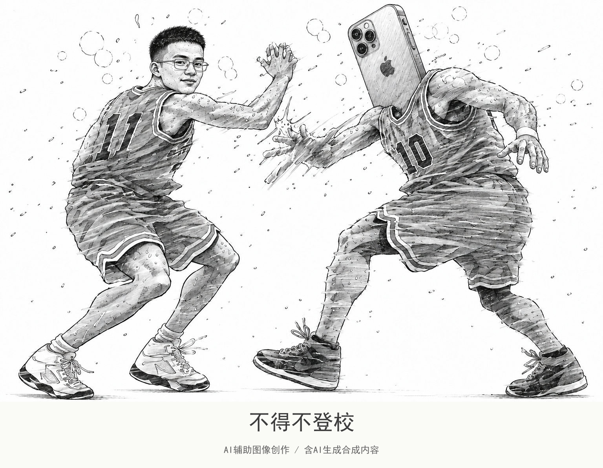

运动对抗场景的二创让双方看起来势必要分胜负。你可以欣赏它借来的动感，也可以意识到，许多现实协商并不需要其中一方被画面击倒。退一件商品，补一份材料，改一条说明，有时就够让事情继续。把全部矛盾都安排成决斗，会让可以修复的关系也开始寻找观众。

小梁后来只保留了一个窗口，用来与商家沟通。他没有拿群友讨论当证明，而是按顺序提交自己手上的材料。结局并不适合成为普法爽文：问题得到了一部分处理，还有一部分需要继续核对。聊天群对此兴趣不大，大家已经转去讨论晚饭。

这让小梁有点失落。他最委屈的时候，希望有人把事情说得很严重；真正处理事情的时候，又不得不把严重的说法拆成可核对的项目。两种需要可以同时存在，但不能让后者完全服从前者。

法学课堂使用假设案例，可以训练我们如何想清楚条件。把课堂里的笑点带走以后，还应该把这种训练也带走一点。否则张三承担了无数荒诞剧情，你只从他那里学会了抢先宣布自己赢。

群里的虚构法庭散了。阿青把晚饭链接发给小梁，让他先吃。小梁没有因此忘掉纠纷，只是今晚不再要求一份外卖也给自己判个无罪。实际问题留在实际的办理过程里，张三终于能休息一页。


# 第十章 评论区的名字归谁

有人在一个完全无关的视频下面提到熟悉的名字。没人需要介绍这个人，大家就能接上去。短短几分钟，名字已经从称呼变成接头暗号。你笑了，顺手参与，甚至不用点开那个人的主页。

这种乐子有一种奇妙的廉价：参与者每次只出一句话，拥有名字的人却可能面对所有话累积在一起的样子。分摊到每个发送者，动作很小；落到同一个对象身上，数量不再小。

触乐对孙笑川的采访报道，记录了人物、观众表演和围绕名字制造的网络形象之间的关系。[注7] 它让我们有材料讨论这一层差别，不能让我们把观众编造的恶行计入本人的履历。本书不复述那些指控细节，也不因为一个名字适合玩梗，就替本人宣布他同意全部玩法。

## 一个名字变成公共按钮

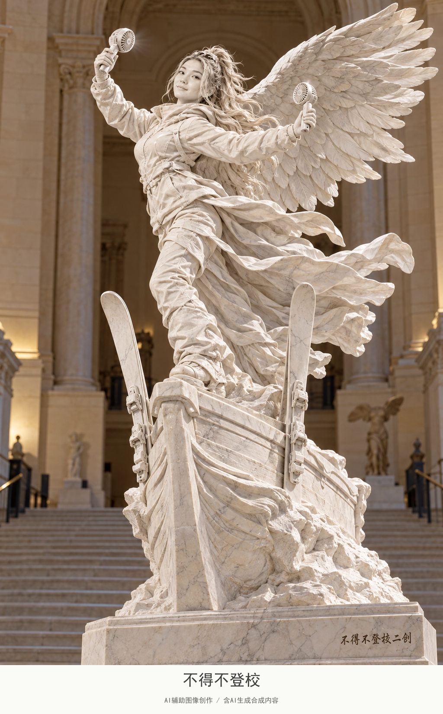

胜利女神主题的二创把一张熟脸放进古典雕塑的姿态里。画面可以很荒诞，读者可以笑它的拼接关系。我们却不能从这个姿态推断真人的自我理解。二创作者借用了形象，观看者带来了记忆，这两件事一起组成了笑点；被描绘的人未必参与了这场组合。

评论区最喜欢无需解释的符号。一旦某个名字成为按钮，发言者只需要按一下，就能召集同样认得按钮的人。大家获得的是互相确认：你也看过，你也懂。被提到的人有没有新的表达，常常已经不重要。

这不只发生在名人身上。小梁的群里，有个人总被拿来代表迟到。那个人在一次聚会上确实晚到了，后来几次提早抵达，大家仍然把迟到梗分给他。最初是共同记忆，后来成了角色分工。为了让群聊顺畅，新的事实反而不方便进入。

他有一天说，别再用这个了。群里有人觉得他太认真。可要求结束一个笑话，不等于要求大家从此不许开心。只是某个使用成本发生了变化，玩的人得重新算一下。

## 为了让梗继续 我们开始排斥材料

阿青发现自己也做过这样的事。她喜欢一个固定反应，听见某个名字就知道该发哪张图。后来对方做了一件不符合旧形象的事，她的第一反应居然是，这下不好玩了。

她没有真的要求对方退回旧形象，但这个念头很有意思。观众为了获得稳定笑点，会希望对象稳定地扮演一个版本。一个真实的人继续生活、改口、疲惫、换工作，本来很正常，却会让公共角色的维护者感到麻烦。

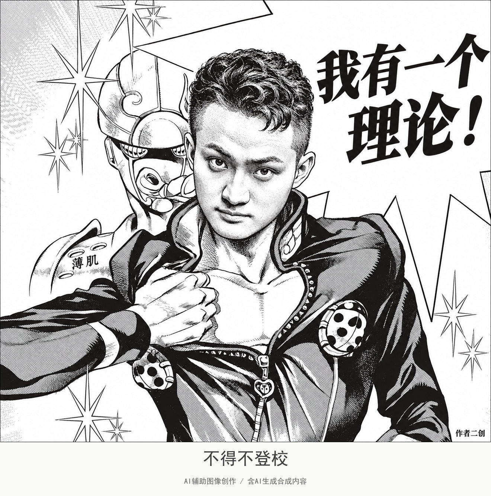

漫画式二创里的台词和表情充满戏剧张力。台词属于图像安排，不能当作被描绘真人在某个场合的逐字发言。它让读者看到一个强烈的角色版本，却也提醒我们：角色越方便，越容易压过这个版本之外的人。

本书保留笑话，也保留这种不方便。作者虚构的角色可以承担设计好的对白；公开人物只能承担我们有依据确认的材料。若要写一个明显夸张的画面，就把它留在二创和虚构的层级里，别再加一条“他当年真的这样说”的假来源。

## 退出一个梗不用先毕业

停止参与某种笑话，常被搞得像退出组织。你得解释自己有没有变，为什么从前能玩现在不能玩，是否因为认识了对方才偏袒。其实一个人可以重新估计成本，未必需要完整的思想宣言。

小梁不再用群友的迟到图，但仍然和大家聊天。有人问他是不是没有幽默感，他说：“我今天还有别的图。”

这不是一个漂亮的论证，却给关系留了路。他没有要求大家立刻承认错，也没有继续把不舒服的人当作课堂材料。他换了一种笑点。喜欢乐子的人如果相信自己还能找到别的乐子，通常不必为了保住这一条耗到天亮。

评论区有时会奖励更狠、更快的表达。你发一条小一点的话，可能没有人赞；你把话推进一点，就有人接。参与者于是逐渐改变自己原来会说的话，却以为自己只是在延续同一个梗。等有人要求停下，大家都指向前一个人，说明自己并没开头。

谁开头值得核查，但并不能替后来每次发送自动决定是否合适。你拥有的权限很具体：自己要不要发，发之前有没有检查，收到反对后是否愿意调整。把责任全部寄存在“这本来就是网上的梗”里，会让一个无须签字的人群获得持续使用他人名字的权力。

同样，我们也别把每个失误都写成完整人格。有人发了不合适的图，愿意删除和道歉，可以让事情在相应范围内处理。若立刻宣布他一生恶劣，我们又把刚刚批评的动作做了一遍。

孙笑川的名字在这里提供一个入口，不能成为所有讨论的容器。其他有名的人，无名的人，群里那个只迟到过一次的人，也会面对被缩成符号的问题。笑话能让陌生人迅速相认，维护笑话的人还可以再学一个动作：允许被叫到名字的人，说自己不想继续演。

群里换了新图。旧角色没有因此消失，只是不用每次出场。小梁发现大家仍然笑得出来，那个人也多说了几句。真正减少的，是一个人每次点开群聊以前，需要先猜自己今天又做了什么的时间。


# 第十一章 美术馆的浏览记录

小梁看到第一张图，认出了人。看第二张图，认出了画。到第三张，他发现自己认得人的速度，远快于说出原作名称的速度。他很高兴自己没白上网，又有一点遗憾：上网的成果如此充分，美术课似乎只留下了几个轮廓。

小梁的这次观看，不是为了羞辱谁知识不足。图像的乐子恰恰来自两套记忆突然碰面：一种来自美术史和大众文化，一种来自平台里反复出现的脸。原本需要抬头看的姿势，忽然拿着手机；原本遥远的人物，带着今天熟悉的表情。你认识其中一边，就能开始笑。

我给这一章起这个名字，是想保留那种轻微的尴尬。逛个美术馆，怎么全是互联网熟人。浏览记录没有真的被上传到画里，观看者却把记录带了进去。

## 认得出脸以后 看看画面



《戴珍珠耳环的少女》二创里的王源形象保留了原图集已有的打码。这张图能被用来讨论观看者如何认人，不能成为关于真人的私生活、动机和授权状态的证据。

我们仍能看见转身的姿势、头巾的颜色和光线的安排。若读者只报出人物名字，就可能错过二创借来的构图：眼睛与脸的方向怎样吸引观看，身体怎样停在转回来的那一刻。笑点把我们领进来，原画面里值得看的东西还在。

认得快有一种奖励，仔细看却需要放慢。你在群里发“这是某某”，马上就有人回应；你说光线让这个动作变得安静，可能过一会儿才有人愿意接。但后一种观看，能让图像提供的不止是一道辨脸题。

把画叫作“素材”，便于安排创作，却也容易让我们忘记它本来是一件已经组织过的作品。姿势、空间和颜色不是供熟脸随意占据的空位。好的二创可以与这些关系发生作用，省事的二创则只把识别当成全部内容。本书使用已有图像，不另造一套更好看的脸来替换它们。

## 马赛克也在参与画面



《蒙娜丽莎》二创里的傅首尔形象保留了已有打码。那片像素不能被当作“从此无人可识别”的保证。图注、背景和观看者自己的记忆，都可能继续提供识别线索。这里说的是观看过程；公开与售卖的权利范围，还要另行核查，不能由这段观察代替。

像素块还有一种视觉效果：它让观看者意识到自己正在看一个经过处理的版本。有些人会急着想补出遮住的脸，有些人会先看处理为何出现在这里。第二种好奇更适合这本书，因为它关心图像如何被制作、使用和观看。

看到一个处理痕迹，不必立刻判整个作品失效。画面原有的光线、身体和空间仍然存在，处理也成为版本的一部分。我们可以说这版图有什么限制，再决定它适合放在哪种讨论里。把限制全部藏起来，只会让看的人误以为自己获得了未经处理的记录。

水印同样参与观看。读者知道自己正在看一个整理版本，也更容易留意画面中已经留下的处理痕迹。一个符号把版本标出来，画面里的其他关系还需要继续看。

## 熟脸也需要一个身体

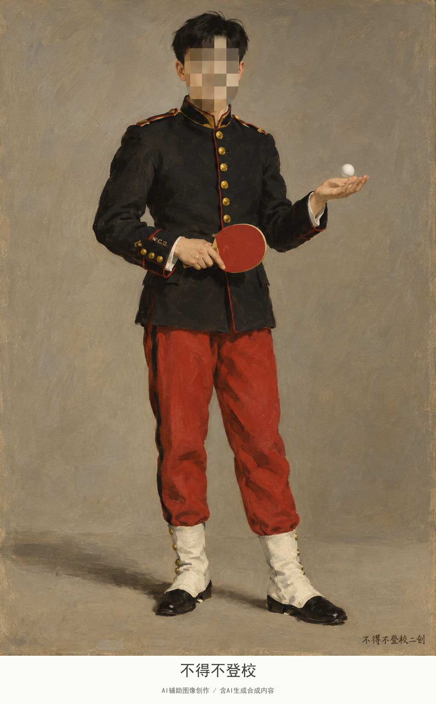

王楚钦主题二创中的已有打码保留。图里有站姿、衣服、球拍和场景，不只是一张脸。观看者可能从这些信息认人，也可能从它们理解画面的荒诞。把图像看成“只要遮脸就没有其他信息”，会低估画面里各部分的共同作用。

二创最有趣的一种张力，是把角色从原先最熟悉的身体里移出来。他不在原来的镜头和情境中，却仍然带着观众对他的印象。观看者便要在两个场景之间完成一次拼接。这种拼接属于作品与读者的活动，不是被描绘者现实行为的证明。

所以，图注得尽量做一件朴素的事：告诉你这是什么版本，对应图集里哪一张，使用了什么可见主题。它不应该顺便捏造一段真人经历，让笑点看起来更“有出处”。有时加一句来源不明的狠话，反而把一个完整的荒诞画面降成谣言配图。

小梁看完三张图，试着不先说名字。他说第一张像是在转身听人叫，第二张坐得很稳，第三张的球拍把熟悉与陌生连在了一起。阿青说这就已经是观看。他没有因为一句更细的描述就升级成艺术专家，但也不必永远停在抢答。

图集里还有漫画和影视、雕塑和绘画。它们能借来不同的气势：决斗，沉思，宏大开场，安静的房间。将它们放进一本书，最好让这些气势服务于讨论，而不是每页都用同一张熟脸提醒读者作者会上网。

这章结束之前，给画面留几秒。看看衣服褶皱、边缘的物件和人物与背景的距离。名字可以暂时不报。你还会笑，只是笑声之后多了一点东西，足以让下一次观看不必重新从一张脸开始。


# 第十二章 血条外面的风险

小梁收到一张支出表。房租、水电和几笔到期的费用在表上占了不同的行。他把数字加起来，问阿青自己是不是已经到了某条线。

阿青说：“先看哪一笔什么时候到期。”

这个回答没有游戏术语那么清楚。游戏的血条画在同一个地方，现实的账单来自不同的人，使用不同的日期，还有一些事情没有提前写在表里。你可能有一份收入，却不知道下一次支出会增加什么。

我们不为任何国家划一条统一的贫困阈值，也不拿一个网络隐喻替读者作财务判断。我们关心的是，为什么一条看起来明确的线，能让分散的不安忽然变得容易讲。

## 知道还有多少 很让人安心

“斩杀线”作为游戏阈值的比喻，在有关牢A的采访与传播报道中出现。[注8] 这足以让我们分析这个词的网络吸引力，不能据此验证当事人讲述的全部经历，更不能把猎奇故事当作社会调查。本书不复述那些细节，也不替他的身份、职业或行为作未经核实的判断。

一个阈值好记。它允许听的人迅速把风险分成线内线外，也给发言者一个很省事的画法。现实中却可能同时存在几种边界：一次迟付就会带来麻烦的支出，尚能协商的安排，家里可能提供但不稳定的支持。把它们画成一条线，能帮助表达紧张，也会省略差别。

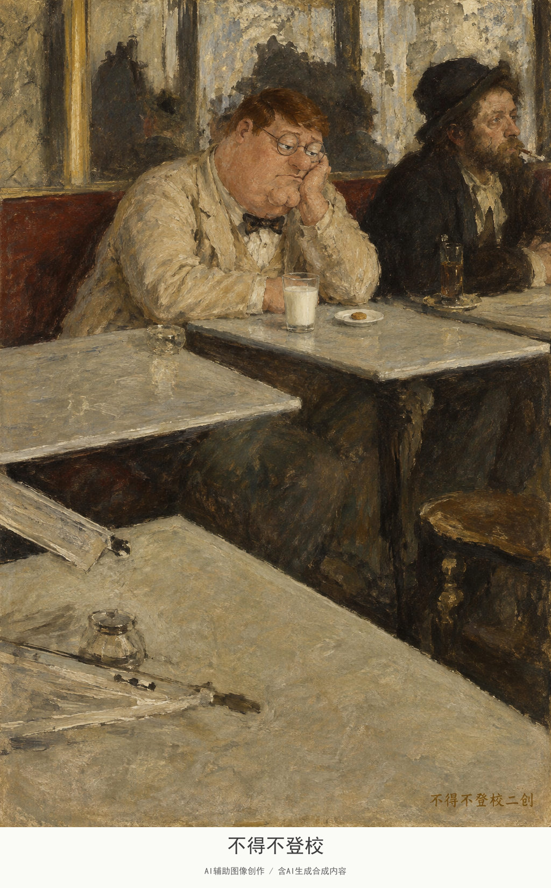

《苦艾酒》二创把熟悉的卡通人物放在咖啡馆式的场景里。角色坐在桌旁，身边的人物与桌面让等待显得具体。读者可以感到安静，也可以感到隔着一点距离；仅凭画面，不能替角色计算现实中的生存风险，更不能把杯子里的东西当作已经看见了他的生活条件。

面对一张安静画面，读者有时会把“休息一下”想成暂时退出环境。可是，坐下来喝点东西不会让到期事项停止。另一种说法又会走向相反方向，要求人随时准备承受风险。这与第一章里对身体的期待相似：把个人状态修好，仿佛环境就应该随之配合。

## 缓冲有些写在账上 有些没有

小梁与另一位朋友的收入相近。朋友暂时住在家里，小梁独自租房。两人的支出安排不同，所以同一次停工对他们的影响也不同。这个例子不需要推导任何群体规律，只说明一个比较收入的表，如果不看缓冲，就没有说完自己要说的话。

缓冲也会有代价。住在家里，可能省一部分钱，却需要协调共同生活；请朋友帮忙，可能得到时间，却不能假设朋友永远有空。支持存在，不等于支持无限。把这些都说成“有没有背景”，会把各种具体关系又压成一个能够嘲讽的标签。

前面谈房间时，我们讨论过画框外的东西；这里也要看表格外的东西。谁能临时照顾孩子，谁能在一次搬家里来帮忙，哪项费用可以谈，哪项必须准时处理。它们不会都变成一串同等可靠的数字，却可能影响下一步的安排。

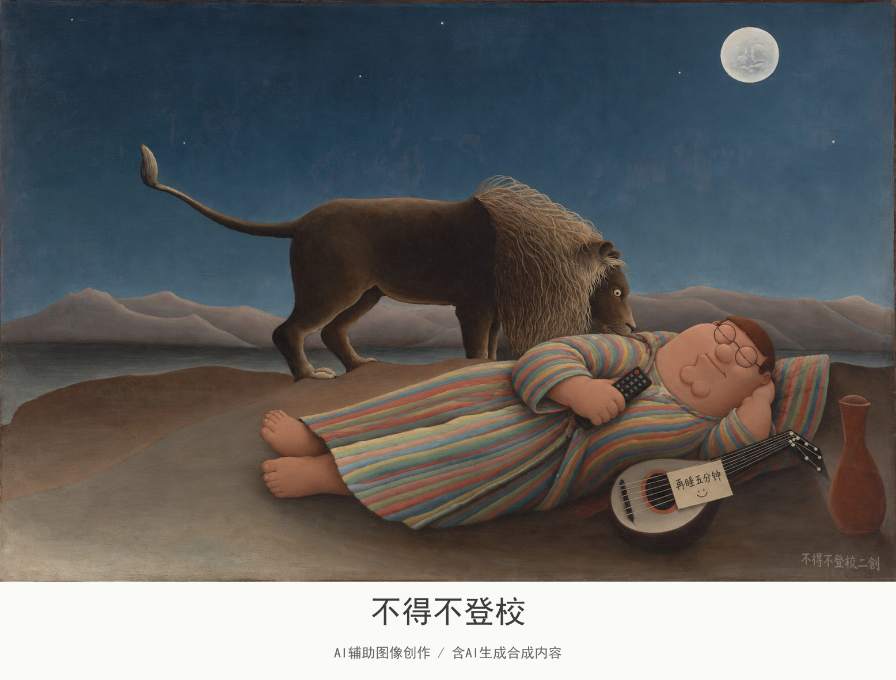

《睡着的吉普赛人》二创里，人物和旁边的动物构成一种悬着的关系。观看者知道画不是现实风险报告，也能感到一个人休息时并没有自动退出环境。这种感觉适合放在这里：需要休息的人仍然有账单，但账单的存在也不说明休息本身有罪。

## 别替风险增加道德分数

知道别人遇到困难，旁观者容易开始复盘他过去的每个选择。为什么租这个房，为什么没有更早积蓄，为什么没学一门技能。部分问题可能确实与后来的安排有关，但复盘很容易从寻找可改之处，变成证明他应当如此。

判断一个决定时，我们至少得知道当时看见了什么，能选什么，以及改变需要付出什么。事后出现的新材料，不能自动证明当时的人故意忽略了它。你现在能提出一种更好的选择，也未必说明对方当时可以承担。

阿青没有替小梁保证一切会好。她陪他把到期顺序列清楚，让需要询问的事项有一个对应的人。两人仍然不知道下一次工作会如何安排，也没有制造一个漂亮的风险指数。能处理的部分先得到了名字，不能处理的部分没有被假装消失。

这类动作很难传播。它们不能替所有人解决同一种焦虑，还需要根据材料再改。但面对具体风险，有时我们正需要一个承认局限的步骤。描述世界很可怕，可以得到很多回应；描述下一封要发给谁的邮件，可能只得到一个人愿意帮你看。

后一种支持数量少，却可能与事情相连。我们可以保留宏观讨论，也不必用它取消这种小范围的帮助。知道环境有问题，不会让今天的询问变得可笑；今天做了一件事，也不意味着环境问题已经归零。

小梁收起支出表，决定明天先核对一项费用。他没有把自己画成在线内安全或在线外终结的人。纸上有一些确定的日期，有一些还需要问。今晚也还有饭要吃。

血条给游戏一份明确的结束说明。现实的问题往往要由不同的人，在不同的时间，带着不完整的材料继续处理。我们可以借血条表达感受，别让它替一个仍在生活的人提前写完结算页面。


# 第十三章 我也知道 但收藏还在增加

小梁的收藏夹很丰富。如何专注，如何减少收藏，如何避免只收藏不行动。最后一条的封面做得很好，他也收藏了。

阿青并没有把他从床上拉起来，要求现场执行。她知道有些收藏只是兴趣，有些是备忘，还有些在当时帮人熬过一小段难受。看了没做，不必立刻宣布内容全部无用。问题是，小梁开始用收藏的数量证明自己已经处理了那些事。

他跟老周说，最近在研究怎么沟通。老周问具体想说什么。他打开收藏夹，给老周看一串标题。标题里有很多人的方法，却没有他明天那一场对话的对象。

## 会解释的人也可能忘记发消息

“我知道我为什么迟迟没开口。”

“那你想说的是什么？”

“我可能在等待一个更稳定的状态。”

“你想说的是周六来不来吗？”

小梁笑了。阿青的提醒有一点粗糙，也把问题缩回了原来的尺寸。一段关于自我状态的解释，可以帮助人理解迟疑，不能自动替他发出一句消息。如果要说的只是安排，发送并不需要一个完整人格先通过审核。

知识在这里有两种用途。一种让我们发现事情如何发生，一种让我们更会解释自己为什么尚未做。后者不全是坏事，解释可以让人停止无用的自责，知道问题不只是某个品格缺陷。但解释如果没有尽头，我们就会给每一个小动作安排一场越来越长的听证。



《书房中的圣杰罗姆》主题二创里，人物置身于知识与工作相关的空间。你可以从画中感到一种认真，但无法据此核查被描绘者读了什么、相信什么。书房的气氛很容易让观看者相信事情已经得到处理；实际处理仍然要看书页之外的动作。

小梁也很喜欢书桌照片。灯亮着，笔放好，旁边一本看起来很重要的书。拍完以后，他得决定先读哪页。这个决定比布置桌子更难，没有人会给一页普通正文加一段他已经熟悉的开场音乐。

## 懂了以后还能问

有时“我知道”表示我掌握了内容，有时表示我不想再被提醒。两种意思使用同一组字，听的人不容易分清楚。阿青说晚一点睡会影响明天安排，小梁说知道；她问是否需要帮他改时间，他还是说知道。对话没有往前走，因为答案覆盖了一个没有被回答的问题。

说“我知道”能维护体面。它告诉对方，我不是第一次碰到这个知识，你不用从基础开始教。可一旦把懂不懂放在前面，我们就很难承认自己知道道理，仍然需要帮助。

比如，你知道一封邮件应该写清楚诉求，却不知道怎样把自己的复杂情况写进去。知道原则没有让这个困难消失。有人愿意一起看具体材料，可以提供一种原则之外的支持。你不必先演成完全不会，才有资格得到它。

老周后来问小梁，哪些材料自己已经懂了，哪一部分仍然不好做。小梁终于说出，自己担心对方把一个具体请求听成整体抱怨。老周帮他把两者分开。收藏夹里的知识没有白看，只是这次需要进入一段真实的句子。

## 语言太熟练也会拦住我们

有些词一旦学会，就能很快解释许多体验。边界、投射、成长、系统。它们可以提供角度，也很容易被用来结束调查。你遇到一个难受的人，说他在投射，便不再问具体发生了什么；你遇到一项复杂工作，说这是系统问题，便觉得所有局部材料都已经归类。

本书也在使用“局部”“条件”“成本”这类词。它们同样有变成万能答案的危险。若你读到最后，只记住作者认为凡事都有条件，却不愿看某一次到底有哪些条件，那这本书也帮你制作了一个新的快捷按钮。

所以我们偶尔要让自己的词失效一会儿。别急着给事情装名字，先描述动作和顺序。谁说了什么，什么时候发生，哪里还不清楚。名词需要跟材料重新碰一次，才不至于只负责维护你的聪明形象。

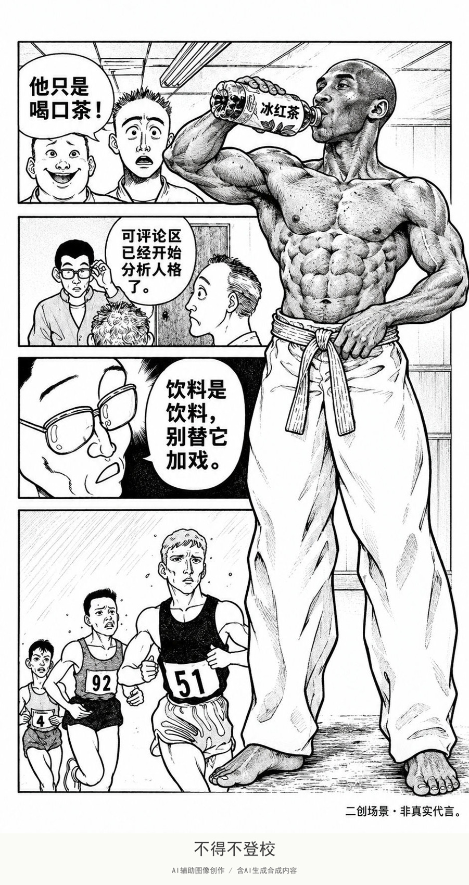

漫画二创把一个讲述者和听者放在同一组画面里，气势很足。观众看见强烈的台词结构，会期待下一句话把问题打通。本书不复制原作长台词，也不把图中文字写成真人原话。这里想保留的是期待本身：我们多么希望有人用一句话，让自己从此获得解释。

一句好话能带来理解。只是理解以后，新的材料仍然会来。它可能支持原来的说法，也可能要求你把它拆开。我们难以接受后者，因为一句曾经救过自己的解释，很容易变成不准别人触碰的纪念物。

## 给收藏夹一个较小的工作

小梁给收藏做了一次整理。他没有全部清空，也没有写“今天起重生”。他把几个真会再次用到的材料放到容易找到的位置，又允许另一些内容只作为过去喜欢过的东西留下。

然后他为明天的对话单独建了一页，写对象、时间和要问的事。那一页不够好看，标题也没有“掌控人生”四个字。老周看完就能知道他想干什么，所以够用了。

把知识变成一个较小的工具，不会降低知识的价值。地图不需要代表旅行者的全部品位，便签也不需要证明使用者有先进思维。你知道它替你省哪件事，遇到新情况就比较容易改。

网上有一种很诱人的毕业想象：找到正确框架，以后任何问题都能迅速定位。它让每次收藏像领到一块拼图，似乎再补最后一块，整张生活地图就能闭合。可人还会遇到从前没做过的事，条件也会改变。旧工具好用，仍然需要现场的人来使用。

我们读书、听课、刷到认真内容，不必以当天立即转成成果为唯一证明。有时一句话需要等到另一件事发生，你才知道它能怎么用。但我们也可以诚实地分清，今天只是看过，还是确实据此做了判断。

小梁最后发了那句关于周六的消息。对方回得很普通，没有赞美他的表达，也没发现他研究过多么复杂的框架。他放下手机，继续读收藏里的一篇文章。这次读，不用先把文章记成一种能力已经到账的通知。

知识可以让生活开阔，也可以成为我们拖延的装修。区分它们不靠审判自己读了多少，而是偶尔回头找找：读到的东西，在哪件具体事情上帮助了我；如果现在还没用到，是否可以让它先待着，不替我宣布今天已经完成了。


# 第十四章 无聊的权限

星期六下午，小梁坐在窗边。没有想好做什么，手机里却有人替他安排了很多事：练体态，学新工具，整理房间，做一顿营养晚餐。每一条看起来都比他坐着有价值。

他起身倒水，在厨房看见早上没洗的锅，又觉得自己甚至不配拥有一个高质量的休息日。阿青发来消息，问要不要出去走走。他问去哪，阿青说还没想好。

没想好也能出门，这件事有一点奢侈。它没有路线攻略，没有最终收获，不保证回家以后能写一篇有用的经验。

## 不把周末变成预备上班

休息经常被说明成恢复效率的工具。睡好，为了明天精神；散步，为了思路；社交，为了支持网络。它们确实可能有这些作用，但若只按作用领取许可，你连发呆都得提交一份收益预测。

小梁用过一个虚构的周末表格。表上有阅读、运动、整理和学习，也有休息。休息在最后一行，因为他想先做完上面的事。到了周日晚上，前几行没全部完成，最后一行就像一个对表现好的自己才开放的奖品。

这样的安排没有把他变懒，却让他更难休息。身上已经没力气，脑子仍然在点名。等到周一，工作又有理由继续占用时间，因为周末那份未完成的任务并没有一个真的提交人。

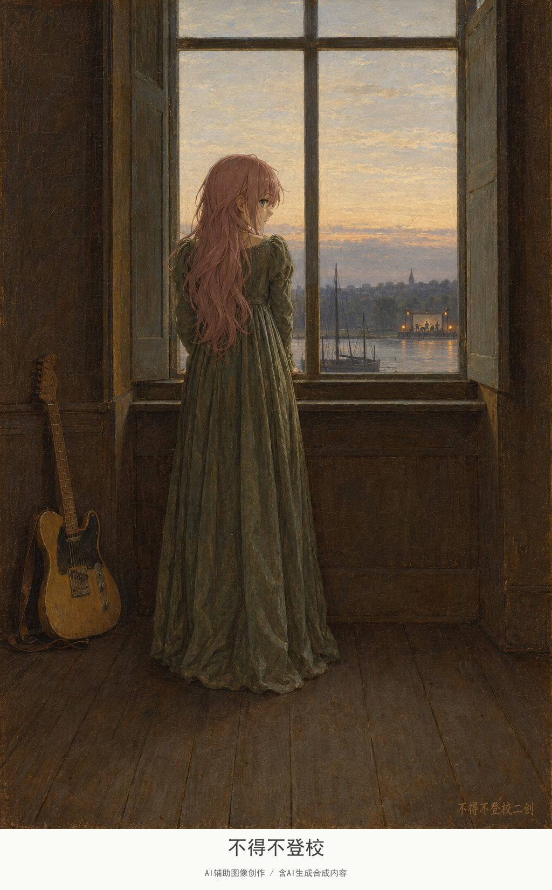

这张室内主题二创把角色放在一个安静的房间里。画面里没有必须战胜的人，也没有表明成绩的图表。它可以让读者停一会儿，看看人物怎样待在自己的空间中。二创的安静不证明真人或角色原作拥有怎样的生活，只给这页书提供一种较低的速度。

## 乐子也会被迫交作业

小梁喜欢玩游戏，后来却发现自己需要解释游戏给了他什么。反应能力，协作，策略，文化体验。他说了很多有道理的作用，最后连自己也忘了，他最初只是想玩。

爱好当然可以带来能力，也能成为职业。只是未必所有爱好都必须通过这种转化，才获得留在生活里的权限。你欣赏一段荒诞图像，笑一会儿，未必需要立刻把笑声写成情绪管理成效。

我们常把人往两种极端推：要么爱好成为生产，要么爱好成了逃避。中间那一大片时间，被说得像没有合法身份。你可以下班后做一点没有作品、没有证书、没有社交用途的事，也可以承认今晚就是需要躲开工作。

这并不能替所有责任开脱。有约定需要履行，有共同生活需要协调，沉迷可能让具体安排出问题。本章所说的权限，是在材料和责任清楚之后，仍然允许一部分时间不被要求产生额外证明。我们不靠否认后果来保住快乐，也不让快乐承包所有后果。

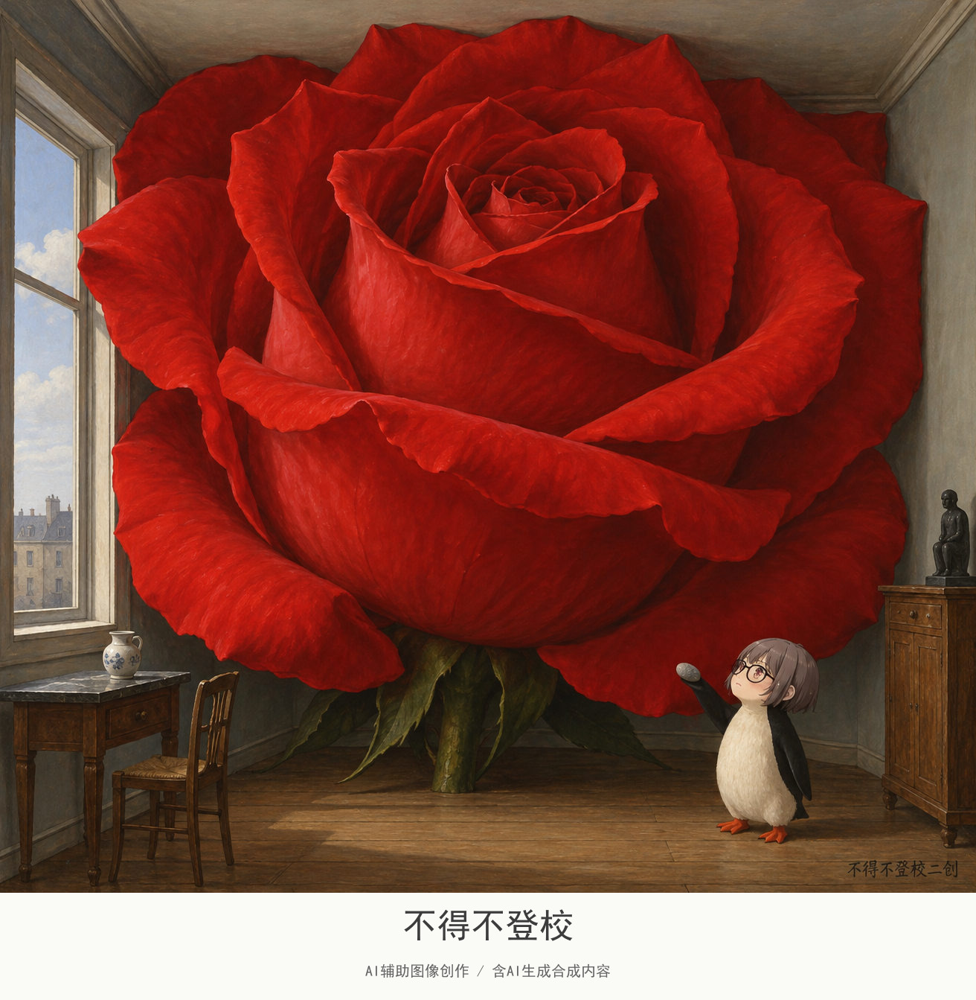

《摔跤手之墓》主题二创里，巨大的玫瑰和小小的角色占据不同尺度。它没有给出生活安排，却能让一个普通的凝视变得有趣：花可以大到不合理，观看可以暂时不用解释自己要解决什么。读者不必替它发明一个社会科学结论，才准许自己喜欢。

## 想做的时候再开始

阿青在路上停下来，看一家已经关门的小店。小梁问是不是有什么典故，阿青说没有，就是门口那只招牌像在打瞌睡。

他也看了一会儿。两人没有拍照，不是为了证明他们比拍照的人清醒，而是这次没有想拍。换一天想拍，当然也可以。我们没必要为了摆脱一种任务，又给自己规定一种更纯粹的休息姿势。

这一点容易被忽略。有人读了关于“远离手机”的文章，便开始考核自己每次出门有没有完全断网；有人知道休息重要，就要求休息必须彻底、高效、没有杂念。原来的任务被搬走，新任务穿着宽松衣服进来了。

无聊会让人不舒服。我们习惯随手拿到一个刺激，空出来的几分钟像系统出了故障。这里不要求读者坐着克服故障，也不发一份注意力修行计划。只是允许你在不舒服以后，选择一个小动作：看看周围，去拿水，或者承认自己现在就想刷点东西。

承认选择比假装受到一套完美方法管理，更容易让人发现实际用了多少时间。你没有必要每次都赢过手机，也可以在发现自己已经不喜欢继续看时停下。停下是一次具体决定，不需要被包装成从此脱离时代。

## 没有收获的下午也会过去

小梁与阿青走了一段路，买了两杯东西，又沿原路回去。小梁原先想给下午起一个意义很大的名字，后来只在聊天里说，今天出去走了走。

这并不是对宏大意义的敌意。某次旅行、某段经历，可以让人真正改变。但没改变的时间也需要放得下。否则我们会为了让经历值得，事后替它补出一份超过当时感受的总结。

发出来的生活总像有用，未发出来的生活就更容易显得浪费。我们可以记下值得记的东西，也允许没有内容可发的一天。一个人不是持续向外供货的账号，不必把每个周末交成一篇更新。

回家以后，小梁洗了锅。这件事不像外出那样轻松，却也不需要在休息日前面扮演道德审查。他花了几分钟完成，重新坐到窗边。窗外没有替他提供一个成熟的结论，水还温着。

如果你愿意，可以让这一页短暂地没有任务。不是为了下章读得更好，也不是为了给作者证明自己理解了无聊。你可以关上书，待一会儿，等什么时候有兴趣，再回来。阅读的继续不该由前一页对你的表现评分来决定。


# 第十五章 别把朋友做成项目

小梁给老周发了一张新计划。上面写着运动、阅读、睡眠，还有一项“扩大社交”。老周说很不错，阿青看完问，他们周末那顿饭是不是也要算一个指标。

小梁觉得她想多了。他并没有把朋友当作资源，只是想把生活安排得更好。他说完以后，又有点迟疑：如果周末见面不开心，或者没有聊出什么收获，自己会不会觉得这项计划浪费了？

这种迟疑值得留着。把活动写进日历，能帮助履行约定；把关系写进收益表，容易让对方开始负责证明值得。两份表看起来都整齐，给人的位置却不同。

## 对方不是一项反馈

第一章里，小梁希望身体变化让自己更有信心。那种希望可以理解，练习也可能让他感到自在。但是，一旦想象别人应该用欣赏确认这种变化，关系就多出了一项对方没有同意的工作。

阿青不喜欢某件衣服，小梁可能会失落。失落是自己的感受，可以说，也可以慢慢消化。若他据此宣布对方不懂自己的努力，就开始把意见改写成一种违约。衣服如何被看待，没有因为他付出很多就提前结算。

同样，你认真听了许多沟通建议，对方也未必在一次谈话里马上接受。语气改好、安排讲清楚，能够帮助对话发生；它们不保证对方得到与你相同的结论。另一个人还带着自己的材料、愿望和边界。

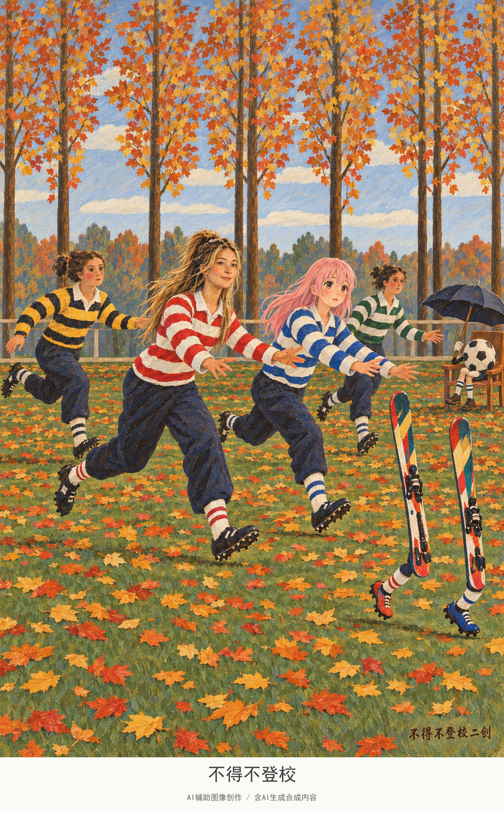

球类运动主题二创中的人物一起待在画面里，各有姿态。它没有替我们证明现实中谁与谁亲近，也不提供关系教程。作为这一章的插图，它让“在一起”保持具体：有人面向前面，有人望着旁边，共同场景仍然可以容纳不同动作。

小梁以前很喜欢给一顿饭评分。菜好不好吃，地点方便不方便，大家是否聊得开心。评分本来只是他的使用习惯，后来却让他遇到一种困难：一个朋友没说很多话，整顿饭是否就算社交失败？

阿青有时工作累，来了以后吃饭，听别人说，最后按时回家。她也在赴约，只是没有持续提供热闹。若每次相聚都需要大家高兴到可见，疲惫的人便很难出现。他必须先修好状态，才准加入朋友的晚饭。

## 有空和愿意是两件需要分别问的事

老周搬家时，请大家帮忙。有人周末没有工作，但仍然不想整天搬箱子。老周起初觉得既然有空，帮一下没什么；后来才知道，对方原本打算休息，还要处理自己的事。

“有空”常常只表示日历上没排一个别人看得见的任务。“愿意”涉及另一份选择。把两者合并，我们就会把对方不容易展示的安排自动转成可以使用的时间。

这并不要求朋友之间每次递东西都正式协商。熟悉的关系有默契，有顺手帮忙的部分，也有彼此知道可以依靠的范围。只是当任务增加、时间拉长，原来的默契可能不再覆盖全部。多问一句，不会让友情失去温度。

老周改了邀请：需要两个人搬大件，具体是哪个时间段，能不能来。他也说明有些箱子可以稍后请人处理。消息比“大家都来搭把手”长一点，却让回复变得容易。愿意的人知道自己答应了什么，不愿意的人不用先解释周末如何过才够正当。

一份明确的请求往往比一份关于感情深浅的测试更好回应。朋友拒绝这次帮忙，不自动证明从前的支持是假；朋友同意这次，也不是此后所有周末都签了待命协议。

## 帮助别变成永久审计权

小梁第一次换工作时，老周帮他看过材料。后来老周遇到他，每次都问有没有按当时的建议去做。小梁有点不敢说，自己只采用了一部分。

得到帮助的人应该尊重对方的时间，也可以反馈实际效果。但一份建议不能因此获得永久管理权。情况变化以后，受助者仍然要按新材料作判断；帮助者如果真在乎结果，也需要愿意听见某个步骤已经不适合。

小梁终于告诉老周，有一项做法用过，另一项暂时不做。老周没有马上高兴，觉得自己有些白忙。两人聊了一会儿，才把辛苦和决定分开：老周的投入值得感谢，小梁的决定也需要由他承担。谢谢你，不等于我以后不能改。

这样的谈话有一点不体面，因为谁都不能一直显得大度。老周允许自己失落，小梁也没有为了免去失落而答应做不想做的事。关系得到继续，是因为两人还愿意知道彼此的具体情况，没把一场谈话压成谁更懂感恩的比赛。

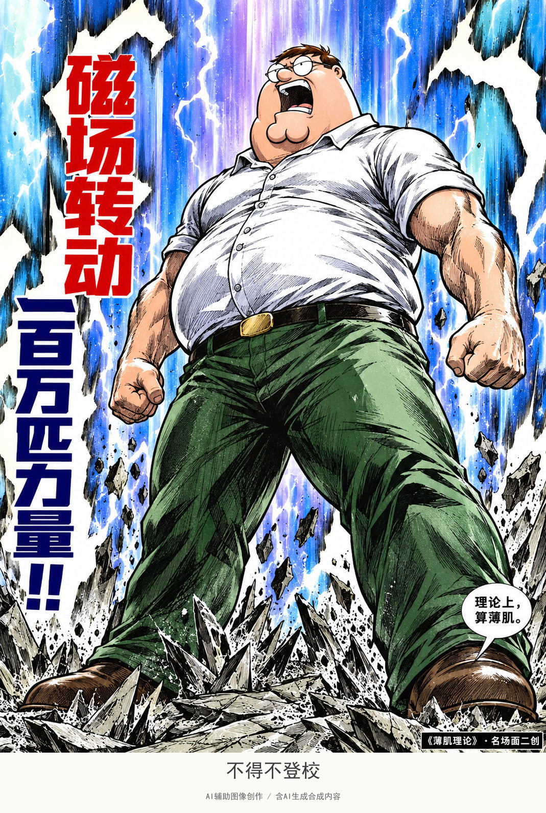

热血漫画式二创把角色的张力拉到很高。身体和画面像是随时准备宣布一个重要动作。我们借来的只是已有图的表现力，不借原作长台词来替正文壮胆。它放在这里，有一点好笑：朋友之间很多重要动作，其实小到没有一个适合的战斗姿势。

比如说，我这次来不了。比如问，你需要我听，还是一起想办法。比如在自己忘了答复以后，承认忘了，重新确认约定。没有气势，不妨碍它们对关系有用。

## 允许一段相处没有成果

那顿周末的饭照常吃。老周讲了一件工作上的小事，小梁没听懂一处，又问了一遍。阿青后来加入，吃了一会儿便走了。三个人没有交换多少新观点，也没有为了彼此制定下一阶段目标。

如果要写成活动总结，内容很薄。可每个人都知道对方最近在忙什么，也知道下次找谁时应该避开什么时间。这种了解不一定能转化成“有效社交”，却会影响一些很实际的动作：一条消息能否晚一点发，一项请求能否讲清楚，一句没回是否需要立刻解读。

有人喜欢把关系比作账户，强调投入与回报。这个比喻有时能提醒人不要长期单方面消耗，但如果把每次相处都记成存取，我们就难以容纳不对称的时段。今天一个人需要更多支持，过些时候情况可能会变；是否愿意继续，得看具体关系，而非强行每天结平。

另一个极端也不好：只要是朋友，便不能计较。它可能让负担长期落在同一个人身上，还不许他说明。亲近的关系应该能容纳对分工的讨论，不能靠取消讨论来维持亲近的样子。

小梁把计划表里的“扩大社交”改成了一句较小的话：约有空、也愿意见面的人吃饭。他没有因为这一改就成为关系专家，后来仍然会过度解释回复，仍然可能把拒绝想重了。

但下一次他准备这样做时，可以先看见一个活人。对方不是给自己薄肌、自信和表达课程盖章的审核员，也不必每次到场都帮助自己完成成长。他有自己的周末，有一只没洗的锅，有时只是想吃完饭回去。

当我们终于允许朋友带着这种普通状态出现，自己也比较容易赴约。小梁穿了一件没有特别考虑版型的衣服，在约定的时间到店。他把手机放进包里，问老周上次搬家找到那盏灯没有。话题就从那盏灯继续往下走。


# 第十六章 不得不登校理论

小梁前一晚睡得很晚。他读完一段很有力的分析，觉得很多事终于可以解释。对方把焦虑、消费和关系安排进一个完整框架，每个麻烦都有位置，他甚至想把过去几年的经历重写一遍。

第二天，闹钟照常响。他要去的地方没有因为框架完整而关闭。手机在床头，昨天准备的材料仍然没有发出去。小梁坐起来，先把闹钟按掉，又看了一眼昨晚那段分析。

看完以后，他依然要起床。

我把这类事情叫作“不得不登校”。它是本书的原创收束，一个关于到场和继续学习的比喻，不借日本“不登校”教育讨论替自己提供权威，也不用于评判实际面临就学困难的人。这里的“校”可以是教室，也可以是工作、晚饭、一次需要核对的沟通，或你仍然想做却还没开始的一页材料。

## 没有一张证书能替所有事情结课

小梁希望某一次顿悟能让自己毕业。明白了别人如何评价，就不再在意；懂得了风险来自哪里，就不再害怕；看清了努力的局限，就不会再误判自己。这样的希望很温柔，也给每次新材料增加了不小的负担。

理解可以改变一个动作。它不一定让一种感受永远停止。你知道手机不能定义身价，看到一场热闹的比较仍然可能心动；你知道朋友的拒绝有不同条件，收到一句不来仍然可能失落。出现这些反应，不说明先前的阅读全都作废。

问题在于，你接着怎样安排下一步。拿手机去做一次具体比较，还是去购买一种阵营资格；问朋友是否方便改时间，还是替对方写一份没有根据的疏远声明。我们不必先把感受清空，才能检查动作。



《蒂凡尼的早餐》开场场景的二创让角色站在橱窗与街道之间。读者可以想起网络形象里那种“我有自己的世界”的姿势。图像可以承担这种张力，现实的人还得决定离开画框以后往哪里走。它放在结尾的前半，是想让宣告与路线碰一下：你可以保留宣告，路线仍然要自己核对。

## 到场可以有不同的方式

“不得不”听上去很硬，像本书最后也要加入那些催你努力的声音。我不想给每个人规定同一个闹钟。具体生活里，人可以请假、求助、换路径、停止不适合的安排，甚至重新考虑是否还要去原来的地方。到场也包含这些决定所需要的实际沟通。

小梁那天并没有按原计划完成全部事情。他迟了些，把需要说明的情况告诉对方，重新约定一部分工作。他没有把迟到包装成自由思想，也没有因为一次迟到宣布自己从此不配做事。

这是一种规模较小的负责。承认发生了什么，说清可以做什么，询问接下来怎样安排。它没有一套统一的励志表情，仍然可能让事情继续。

与此相反，一份漂亮解释有时会帮我们退到更远的地方。只要问题足够宏大，眼前的小任务就显得不值得做；只要自我认识还没完善，下一封消息就可以延后。你可以不断讲自己为什么无法行动，讲述越完整，越像已经完成了另一种工作。

这里要小心，不能把所有不能行动的人都说成只会讲道理。身体、环境、资源和具体限制确实会影响一个人能做什么。本书已经花了很多页拒绝省掉这些条件，结尾也不会突然把它们全部扣成意志问题。

我们要区分的，是手上哪些材料支持“现在做不了”，哪些材料支持“还不知道怎么做”，哪些只是让一句解释显得更有气势。不同情况，需要不同帮助。把它们全叫懒，帮不了人；把它们全叫时代，也可能让已经能问的一句话继续留在草稿里。

## 把几个问题放回原来的位置

一路下来，小梁碰到的事没有被同一个答案收走。身材、商品、志愿表和关系，各自带着不同的人与条件；课堂代称和公共表情包，也要回到材料面前。能用的建议可以留着，需要补的地方继续问。看见幕后劳动，不意味着以后每件小事都要重新写一份分工报告。这些讨论不是一套新准考证，只帮助他认出某些熟悉动作里省掉了什么。

小梁从床上起来，打开昨天的材料。他不需要给今天写一个理论级标题，先找到那页还没确认的内容就行。阿青发来一条提醒，他没有立刻防御自己已经懂了。他说，刚看到，稍后核对。

## 理论可以留在包里

我并不希望读者看完这本书，从此厌烦理论。好的概念、讨论和方法能让人看到从前没看到的关系，也能帮人在混乱时找到一个起点。我们的问题一直是承包范围：一种解释能帮助哪件事，又在哪个位置需要交还给现场的人。

把理论放在包里，随时可以拿出来用。它不必占着座位，要求每一个新情况先向它报告。你发现它不适用，可以换一个角度；你发现它缺材料，可以去问；你只是累了，也可以先睡。

有时我们需要一个说得响的观点，争取别人正眼看待一个被忽略的问题。有时我们需要小声确认一项细节，让已经开始的事继续。两种声音都有位置。不能因为宏大的问题存在，就让所有具体帮助变得可笑；也不能因为一项局部任务完成，就宣布宏大问题不过是借口。

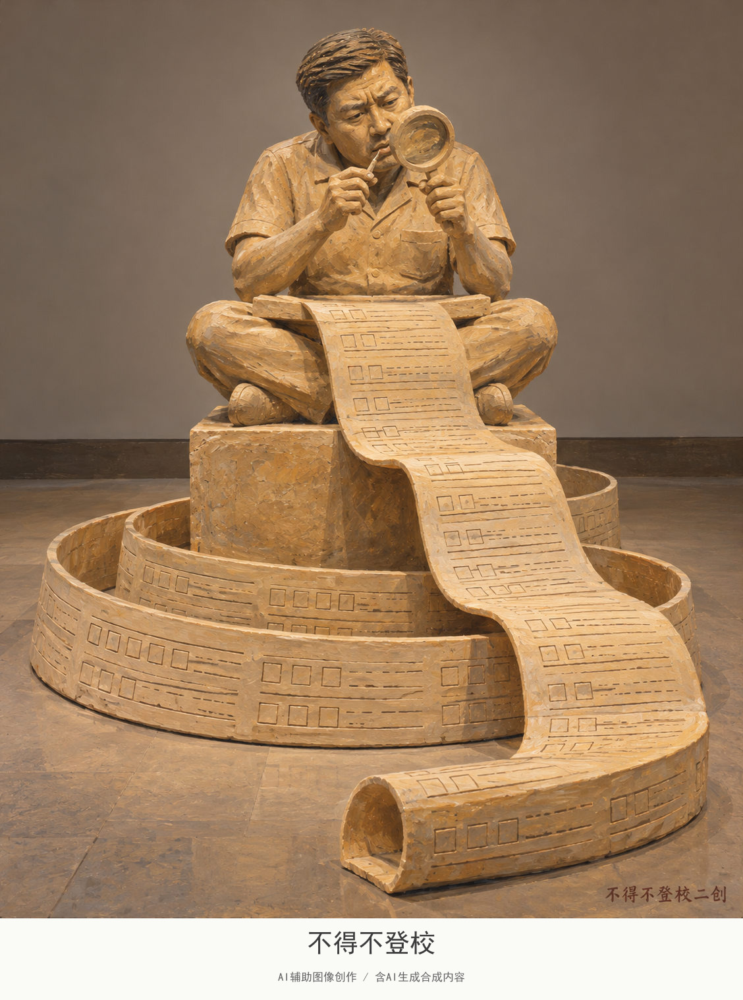

《盘腿而坐的书吏》主题二创中的人物拿着材料，保持一种阅读的姿态。它不是张雪峰本人在这处场景的记录，也不替雕塑原作补故事。我们选它作为最后一幅插图，是因为画里的人并没有获得“从此无需再读”的姿势。看过许多东西，还能拿起下一页，这很适合本书要留的位置。

## 第二天仍然会来

老周问小梁，这一轮折腾之后到底学会了什么。小梁先说了一句很大的话，又觉得它不太对，改成：“有些事得问清楚。有些事可以不买。有些事今天做一小段。”

他没有把这三句话当作所有人的生活口诀。老周明天的条件不同，阿青也有自己的安排。若三个人把它们印成统一海报，过几天恐怕又得开会讨论谁没有照着做。

阿青问，今天那份材料发了没有。小梁说发了一部分，还有一处等回复。老周说那就先吃饭。几个人没在饭前完成世界观统一，也没有人负责总结本次成长。他们把菜往中间挪，给后来的人空出一张椅子。

这张椅子没有评选当天最清醒的人。坐下的人可以刚看懂一点，也可以还在糊涂；可以练过身体，也可以穿着不讲版型的衣服；可以带着一段好建议，也可以暂时只想听别人说。

到场不保证获奖。那份材料可能被要求再改，昨天很有用的办法明天可能失灵。你仍然可以核对新要求，解释不清楚的地方，决定有没有另一条路。继续不是为了给失败补一个好听名字，而是因为事情还没做完，人也还有机会重新判断。

最初那张画里，手机挡住了脸。走到这里，我们仍然能认出很多熟人，也认出自己曾经借给熟人的那些答案。没必要把熟悉全部清空，只要偶尔把手机往下移一点，给画里没被挡住的地方留些目光。

小梁第二天到得比昨天早。他没有宣布自己终于战胜了什么，站在门口确认了一下房间号。里面的人说，先找位置坐，材料等会一起看。

他走进去，把手机放在桌上，屏幕朝下。桌子上没有“最后一次学会生活”的毕业证，有一页已经圈过几处的纸。他拿出笔，在第一处旁边写了一个小小的问号。


# 后记 给理论留一点修改的位置

写完这本书，最容易做的事，是再替它制造一条总公式：局部答案不能承包人生。公式大致表达了书里的关切，却也会让读者误以为，接下来只要拿它套任何东西，就能提前知道作者想说什么。

所以我想在后记里留一点不整齐。局部答案有时候很有力量。一次训练、一份明确的职业材料、一条别人帮你改好的消息，都可能在一个具体时刻改变不少事情。批评它们的扩张，不该取消这些作用。读者愿意认真使用某个方法，也不必为了显得看透，而把自己的受益全部藏起来。

同样，玩梗和二创并非天然比严肃表达低一等。荒诞画面能让一些关系显形：一个人在另一种身体里显得熟悉，某种语气放进名画就变得好笑，日常争执借来漫画张力，忽然暴露了它超出现场的部分。读者可以先笑，也可以笑完以后继续看，不必在两个动作里择一个作为身份。

写作更难的部分，是让自己别偷走这种方便。作者也喜欢一个好认的形象，喜欢一句能迅速完成讨论的话。一旦觉得自己的观点足够对，就容易替例子省去条件，替人物补出对白，替一次小事安排一种过于完整的寓意。本书使用虚构组合场景，是为了让作者的安排留在作者应该承担的地方；现实人物的材料则要单独核对，不能因为作品需要张力就替他们签字。

插图也有自己的来路。这次使用已有图集中的水印版本，保留已有处理，不重新生成画面。它们帮助书形成观看的节奏，也带着原作、人物和图像来源的权利问题。创作稿可以继续完善，公开版本仍然需要逐图确认相应范围。书中的水印和文字，没有替第三方作品作出一份统一的开放许可。

如果你读到一处觉得作者解释太快，可以把那处标下来。书也需要回到材料面前。它不因已经装订，就获得拒绝新问题的资格。一个观点在此刻说得通，也应该说明它怎样说通，留得出修正的位置。

我想把这点还给阅读：你可以认同一章，跳过另一章；喜欢插图，也不接受作者赋予它的全部意思；在一个时期需要某段话，后来觉得它不合用。书不必管理你的使用方式，作者只需要对已经写下来的内容负责。

小梁、阿青和老周的生活停在纸上，读者的生活还在继续。最后那个问号也不用变成终身标志。它只是在一页需要讨论的材料旁边，说明有个人到了现场，准备把没有弄清楚的地方再问一次。

到这里，书可以合上。留给第二天的事情，不用在后记里提前替它完成。


# 注释与材料边界

本书的虚构组合人物为小梁、阿青、老周及其亲友。未标注来源的对话与场景由作者创作，不能归到插图中的真人名下。所有章节中的分析与比喻，包括“不得不登校理论”，均由本书作者承担，不宣称为已获验证的统一学说。

注1 邵艾伦 Alan 的 B站视频《为什么我劝所有男人练薄肌？》，页面与搜索索引显示发布时间为2026年8月29日。核查材料未取得完整视频转录，正文仅使用标题和公开讨论入口，不补写逐字言论，不断言首次发明“薄肌”。原页面：https://www.bilibili.com/video/BV1xa4k6vEpp/ 。补充传播材料为3DM小免惠子2026年9月27日原创专栏《继大压抑理论过后，帮男人重拾信心的“薄肌理论”成了互联网新圣经》：https://www.3dmgame.com/original/3746494.html 。该文具有戏谑语气，不能把其中的夸张转作视频作者原话。

注2 张雪峰、峰阅教研团队编著《从就业看专业》，电子工业出版社2025年版。正文使用其书名和书目简介中的就业导向，不根据书名判断作者全部观点。授权电子书书目：https://www.dedao.cn/ebook/detail?id=bODoM61kAj9Rql84gzG5nVNZopXKY3DqyJKwJLrBmEDv2QPMOyx7a6e1dbPQj2Zd 。交叉书目：https://product.dangdang.com/11937876522.html 。

注3 中国传媒大学高教信息所载《理性面对学科争议 多方权衡填报志愿》，2023年7月文件。正文仅据材料说明当时专业选择讨论存在不同解释，不据此为任何读者推荐或排除具体专业。材料：https://gaojiao.cuc.edu.cn/edit/uploadfile/20237/2023-7-1-23-38-2.pdf 。

注4 雷军2020年8月11日十周年公开演讲全文，界面新闻转载：https://www.jiemian.com/article/4811865.html 。第一代小米手机发布于2011年8月16日、定价1999元的历史信息，可与小米历史页交叉核对：https://www.mi.com/about/history 。正文谈及定价调整时，明确限于雷军本人的回忆，不将自述中的成本当作独立审计资料，也不把这次价格写成所有产品的永久承诺。

注5 中国网信网《网信部门依法查处网络名人账号违法违规行为》，2025年12月3日：https://www.cac.gov.cn/2025-12/03/c_1766488328081202.htm 。正文使用通报中点名账号与“安卓人”“苹果人”表述的事实，不由行政通报推导手机品牌能分类人格。有关传播的补充报道为联合早报2025年10月26日特稿：https://www.zaobao.com.sg/news/china/story20251026-7684291 。该报道中的解释属于媒体分析。

注6 钱江晚报、小时新闻记者宋浩对罗翔的采访，2021年4月25日，《春风白银图书奖丨罗翔：荣光归于他们，我不过是草船借箭》：https://tidenews.com.cn/news.html?id=328592 。正文转述“张三”为法学教师常用代称及幽默作为教学入口的说明，不把假设案例中的行为归入罗翔经历，不对虚构纠纷作现行法律结论。

注7 触乐胡正达《新津青年孙笑川》，2018年9月13日：https://www.chuapp.com/?a=index&c=Article&id=285712 。正文只讨论采访记录的观众表演、人物与网络形象之间的区别，不复述恶性谣言，不将粉丝言行自动归为本人主张。核查过程中网页抓取完整性有限，发布前需复核使用范围。

注8 新民周刊相关采访的新浪转载，2026年2月9日：https://finance.sina.com.cn/jjxw/2026-02-09/doc-inhmcrmy6053558.shtml 。有关账号开通与话题关联的辅助报道，2026年1月22日：https://finance.sina.com.cn/tech/roll/2026-01-22/doc-inhicwve2962676.shtml 。正文只分析“斩杀线”隐喻的传播与局限，不为当事人所述经历背书，不创造统一收入阈值，不转述猎奇故事。

插图说明 本书采用已整理图集中的34幅水印图。所有真人姓名、主题与原作名称，先沿用原图集标注，不把图注视为独立的来源鉴定。插图保留“不得不登校”水印和已有打码；没有重绘、修脸或去除原署名。完整图像来源、原作作者、公开、商用及再授权范围仍需逐图确认。图像二创不是真实事件记录，图中的文字不自动视为真人原话。

本书依据2026年10月12日提供的来源核查材料写作。来源页、采访自述、媒体分析、作者原创与虚构案例各有边界。无法唯一识别的“古镇新”“north”未被编成章节或理论；没有检索到稳定定义，也不足以证明某个词从未被任何人使用。

版本与权利说明 水印“不得不登校”只标识整理版，不能凭该标识授予第三方图像的商用权限。书稿保留既有打码，不恢复被遮挡区域；图像来源、人物与公开使用范围仍须另行审定。


# 人物与理论索引

邵艾伦 Alan 第一章 薄肌网络话语入口 注1

户晨风 前言 第二章 第四章 第九章 图像与消费标签 注5

张雪峰 第三章 第五章 第十三章 第十六章 书目与图像 注2 注3

雷军 第四章 第一章 第七章 历史定价与图像 注4

罗翔 第九章 课堂代称与教学目的 注6

孙笑川 第十章 真人与网络形象 注7

牢A 第十二章 斩杀线传播关联 注8

罗永浩 第四章 图像二创 不作为真实商业行为证据

傅首尔 王源 王楚钦 第十一章 保留打码的二创图像 不补写真人故事

小梁 阿青 老周 作者虚构组合人物 贯穿全书

## 理论与作者用法

薄肌 网络身体与自我提升话语 并非医学诊断 本书不认定首创者

识别与认识 本书对快速脸熟和持续认识的区分 第二章

套餐人生 作者分析 一种局部服务被期待包办生活的现象 第三章

血条隐喻 网络风险表达 不提供统一贫困阈值 第十二章

不得不登校 本书原创收束 到现场继续核对和行动 第十六章